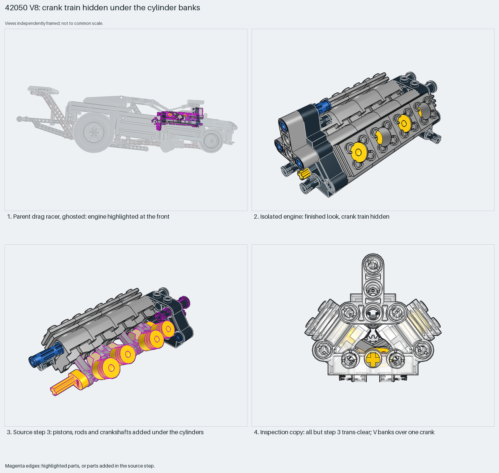

# V8 engine: crank train hidden under the cylinder banks

A Technic V8 puts its whole crank train in one step between the two cylinder banks, so the finished engine hides it.

Reusable source construction: source checks pass and the Python and LeoCAD BOMs match.

Technic mechanism · 70 parts · 8 source steps in 1 section

[Build pages](index.html) · [Inspection board](board/mosaic.png) · [Source](source.mpd) · [Editable plan](scene.plan.json) · [Checks](source-checks.json) · [Board provenance](board/board.json)



## Read the construction

70 parts in 8 steps. Steps 1–2: the 5×3 Technic brick frame and the first bank of four cylinders. Step 3: the whole crank train, with 8 pistons, 8 connecting rods, crankshaft ends and centres (26 placements). Step 4: the second bank closes over it. Steps 5–8: a second frame brick, cross block, liftarms, a 16-tooth gear and a T-beam. The 8 cylinder heads are embedded `42050 - 2850b.dat` parts.

The parent tilts it about 4° about X at the front of the car. Step 7 adds a 16-tooth gear; how the parent drives the crank was not traced.

## What the parent supplies

- `42050 - Drag Racer.ldr` places it at `0 -202.02 132.082`, matrix `1 0 0 / 0 0.998 -0.072 / 0 0.072 0.998`.

The engine at the front of `42050 - Drag Racer.ldr`.

The 4° tilt and the engine's place at the front of the car.

## Description check

- **Database (accurate):** “A Technic V-engine assembly with eight cylinder heads, pistons, connecting rods, and dual crankshafts mounted on a 5x3 brick base.”
- **What it is:** A Technic V-engine with eight cylinders, pistons, rods and crankshafts on a 5×3 brick base.

## Read the board

Panel 1: the ghosted drag racer from the right, engine highlighted. Panel 2: the finished engine; the crank is hidden. Panel 3: source step 3, the crank train going in. Panel 4: an x-ray copy where every placement outside step 3 is trans-clear. It shows two banks in a V over one crank, which no source view shows. X-ray works here because a thin shell covers a few distinctively coloured parts.

Magenta edges mark highlighted parts or the parts added in a source step. Pale grey, see-through parts are ghosted context. A neon-green rod (`#39FF14`) is a synthetic axis marker, not a part. Stud maps recolour each part by where its studs point: up lilac, +X rose, −X vermilion, +Z electric blue, −Z aqua, down lime, odd angle violet. These synthetic colours are ΔE ≥ 16 from every LDraw colour. LDraw −Y is up; LeoCAD `right` shows the model's right side, from −X.

Replay a board into `output/`:

    ./ldraw-xray board run examples/submodel-atlas/recipes/03-42050-v8-engine.json --output output/boards/03-42050-v8-engine

## Reuse it

Build the crank train before closing the second bank. Keep the embedded cylinder definition with the source; the extracted `source.mpd` already carries it.

```sh
./ldraw-agent manual export examples/submodel-atlas/03-42050-v8-engine --outdir output/my-03-42050-v8-engine
./ldraw-agent build output/my-03-42050-v8-engine/scene.plan.json --output output/my-03-42050-v8-engine/03-42050-v8-engine.mpd
```

Export needs a current visual review. Build the copied plan, then inspect its interfaces in the new model.

The placement plan preserves source axes. `source_origin` is a positioning frame, not a physical connector.

## Limits

The crank was not turned, and piston clearance was not checked.

The source and renders teach a construction. They do not prove clutch, fit, clearance, travel or stability. Boards are rendered from synthetic inspection copies, and poses are rigid re-placements.

## Source and evidence

Source: `42050-1.mpd` / `42050 - engine.ldr`, SHA-256 `35f18ae53fcac3fa08109c468245d7fad4351435437708f7f69048f8586173e6`. Parent: `42050 - Drag Racer.ldr`. Look it up with `./ldraw-agent discover show submodel-aafc08dae1dd1923fd248597`.

Original authors and licences stay in [source.mpd](source.mpd); [extraction.json](extraction.json) records renamed sections and 17 bounded preparation changes. Python and LeoCAD BOMs match. The visual review is recorded separately, after opening the actual images.
