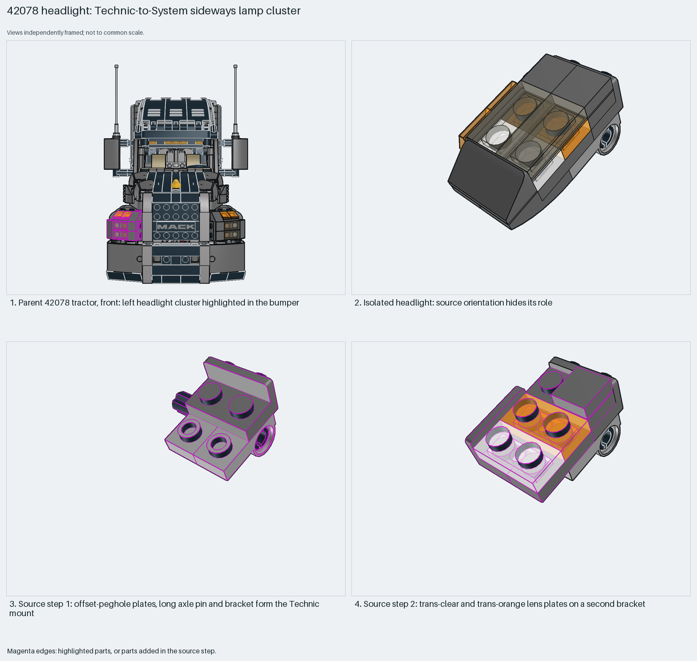

# Technic-to-System SNOT headlight cluster

A sideways System lamp cluster sits on a Technic mount; only the parent's axis-permutation matrix explains its orientation.

Inspiration study: the source keeps errors (`assembly.body_overlap` ×1). Study the technique and rebuild it; `manual export` is blocked.

Technic-to-System SNOT · 20 parts · 4 source steps in 1 section

[Build pages](index.html) · [Inspection board](board/mosaic.png) · [Source](source.mpd) · [Editable plan](scene.plan.json) · [Checks](source-checks.json) · [Board provenance](board/board.json)

## Read the construction

20 parts in 4 steps. Step 1, the Technic mount: two plates 1×2 with an offset peghole underneath, a long axle pin and a 1×2–1×2 bracket. Step 2: trans-clear and trans-orange lens plates and a grooved tile on a second bracket. Steps 3–4: inverted curved slopes, slopes and tiles form the housing; an axle connector and a 3L axle finish the mount.

The parent places it with the axis permutation `0 0 1 / 1 0 0 / 0 1 0`. The offset-peghole plates, long axle pin and axle connector join it to the bumper.

## What the parent supplies

- `42078 - tractor.ldr` places it at `-90 -70 -860`, matrix `0 0 1 / 1 0 0 / 0 1 0`.

The left headlight cluster in the bumper of the truck (`42078 - tractor.ldr`).

The orientation and the identity. In isolation it is an unreadable sideways block; the parent front view shows the left headlight in the bumper.

## Description check

- **Database (accurate):** “Brackets and translucent elements forming a left headlight assembly.”
- **What it is:** Brackets and translucent elements forming a left headlight assembly.

## Read the board

Panel 1: the parent from the front, cluster highlighted in the bumper. Panel 2: the isolated cluster, whose source orientation hides its role. Panels 3–4: source steps 1 (Technic mount) and 2 (lens plates on a bracket).

Magenta edges mark highlighted parts or the parts added in a source step. Pale grey, see-through parts are ghosted context. A neon-green rod (`#39FF14`) is a synthetic axis marker, not a part. Stud maps recolour each part by where its studs point: up lilac, +X rose, −X vermilion, +Z electric blue, −Z aqua, down lime, odd angle violet. These synthetic colours are ΔE ≥ 16 from every LDraw colour. LDraw −Y is up; LeoCAD `right` shows the model's right side, from −X.

Replay a board into `output/`:

    ./ldraw-xray board run examples/submodel-atlas/recipes/04-42078-headlight.json --output output/boards/04-42078-headlight

## Reuse it

Use it where a System lamp must sit on a Technic body: the peghole plates and pin give the Technic interface, and the brackets turn the lenses. For the right side, build a real mirror image with real parts; never reflect the matrix.

Rebuild the technique with the new model's own parts and interfaces; the source errors above stay in this copy.

The placement plan preserves source axes. `source_origin` is a positioning frame, not a physical connector.

## Limits

Inspiration only, for one measured reason: a 1×1 tile (`3070b`) and a 1×2 tile (`3069b`) on matrices tilted about 25° overlap by 0.00045 LDU (`assembly.body_overlap`). Their coordinates are rounded to three decimals; it is not a real collision. A recorded position repair, as in the spaceship atlas, would make it exportable. The pin-to-bumper fit was not checked.

The source and renders teach a construction. They do not prove clutch, fit, clearance, travel or stability. Boards are rendered from synthetic inspection copies, and poses are rigid re-placements.

## Source and evidence

Source: `42078-1.mpd` / `42078 - light1.ldr`, SHA-256 `3dc932db5957805ac0aa592c1bdfe16c0da7f17471d54c68335af07539965be1`. Parent: `42078 - tractor.ldr`. Look it up with `./ldraw-agent discover show submodel-f6bd74faa699ccff023aa5a7`.

Original authors and licences stay in [source.mpd](source.mpd); [extraction.json](extraction.json) records renamed sections and 18 bounded preparation changes. Python and LeoCAD BOMs match. The visual review is recorded separately, after opening the actual images.
