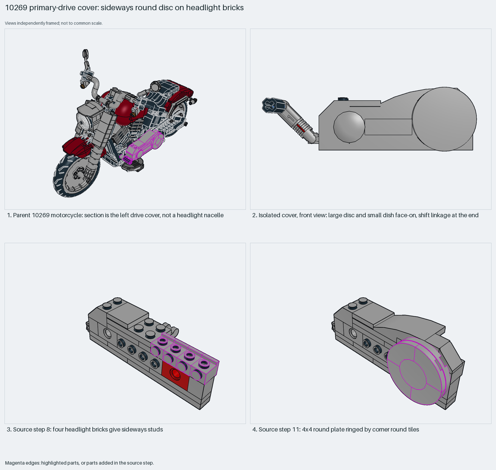

# Motorcycle primary-drive cover: a sideways round disc on headlight bricks

A sideways round disc on headlight-brick studs. The parent shows it is a drive cover, not the headlight nacelle the database names.

Reusable source construction: source checks pass and the Python and LeoCAD BOMs match.

Vehicle SNOT · 41 parts · 13 source steps in 1 section

[Build pages](index.html) · [Inspection board](board/mosaic.png) · [Source](source.mpd) · [Editable plan](scene.plan.json) · [Checks](source-checks.json) · [Board provenance](board/board.json)



## Read the construction

41 parts in 13 steps. Steps 1–7: plates, a 1×4 brick with side studs and Technic bricks form the body. Step 8: four 1×1 headlight bricks give sideways studs. Step 11: a 4×4 round plate ringed by four 2×2 corner-round tiles makes the disc. Step 12: a 2×2 dish. Step 13: a shift linkage of a locking hinge arm and a 45° angle connector.

The parent rotates it 90° about Y. The headlight bricks carry the disc on their side studs.

## What the parent supplies

- `10269 - main.ldr` places it at `70 -120 0`, matrix `0 0 -1 / 0 1 0 / 1 0 0`.

The left primary-drive (belt) cover beside the footboard of the motorcycle (`10269 - main.ldr`).

Only the placement, beside the footboard. "Headlight" in the database text refers to the headlight bricks inside it.

## Description check

- **Database (misleading):** “Dashboard and headlight nacelle subassembly with headlight bricks, dish, round plates, hinge arms, and contoured tiles.”
- **What it is:** The left primary-drive (belt) cover beside the footboard, not a dashboard or headlight nacelle.

## Read the board

Panel 1: the motorcycle with the cover highlighted. Panel 2: the isolated cover from the front, disc and dish face-on, with the shift linkage at the end. Panels 3–4: source steps 8 (headlight bricks) and 11 (round plate and corner tiles). xray reports panels 3–4 as near-duplicates (difference 5.6), but they differ visibly; its threshold needs recalibrating. The isolated home view nearly duplicates step 11, so the board leaves it out.

Magenta edges mark highlighted parts or the parts added in a source step. Pale grey, see-through parts are ghosted context. A neon-green rod (`#39FF14`) is a synthetic axis marker, not a part. Stud maps recolour each part by where its studs point: up lilac, +X rose, −X vermilion, +Z electric blue, −Z aqua, down lime, odd angle violet. These synthetic colours are ΔE ≥ 16 from every LDraw colour. LDraw −Y is up; LeoCAD `right` shows the model's right side, from −X.

Replay a board into `output/`:

    ./ldraw-xray board run examples/submodel-atlas/recipes/05-10269-headlight-nacelle.json --output output/boards/05-10269-headlight-nacelle

## Reuse it

Use the headlight-brick ring for any sideways round cover: a hub face, a dial or a porthole. Keep the corner-round tiles with the 4×4 round plate.

```sh
./ldraw-agent manual export examples/submodel-atlas/05-10269-headlight-nacelle --outdir output/my-05-10269-headlight-nacelle
./ldraw-agent build output/my-05-10269-headlight-nacelle/scene.plan.json --output output/my-05-10269-headlight-nacelle/05-10269-headlight-nacelle.mpd
```

Export needs a current visual review. Build the copied plan, then inspect its interfaces in the new model.

The placement plan preserves source axes. `source_origin` is a positioning frame, not a physical connector.

## Limits

The shift linkage's movement was not checked.

The source and renders teach a construction. They do not prove clutch, fit, clearance, travel or stability. Boards are rendered from synthetic inspection copies, and poses are rigid re-placements.

## Source and evidence

Source: `10269-1.mpd` / `10269 - step199-212.ldr`, SHA-256 `c2c1a05aaea52e217d020c6f10452bee081ac65f7815ea16c00d275289eadb6c`. Parent: `10269 - main.ldr`. Look it up with `./ldraw-agent discover show submodel-512ef3b85240e9e099d064ff`.

Original authors and licences stay in [source.mpd](source.mpd); [extraction.json](extraction.json) records renamed sections and 5 bounded preparation changes. Python and LeoCAD BOMs match. The visual review is recorded separately, after opening the actual images.
