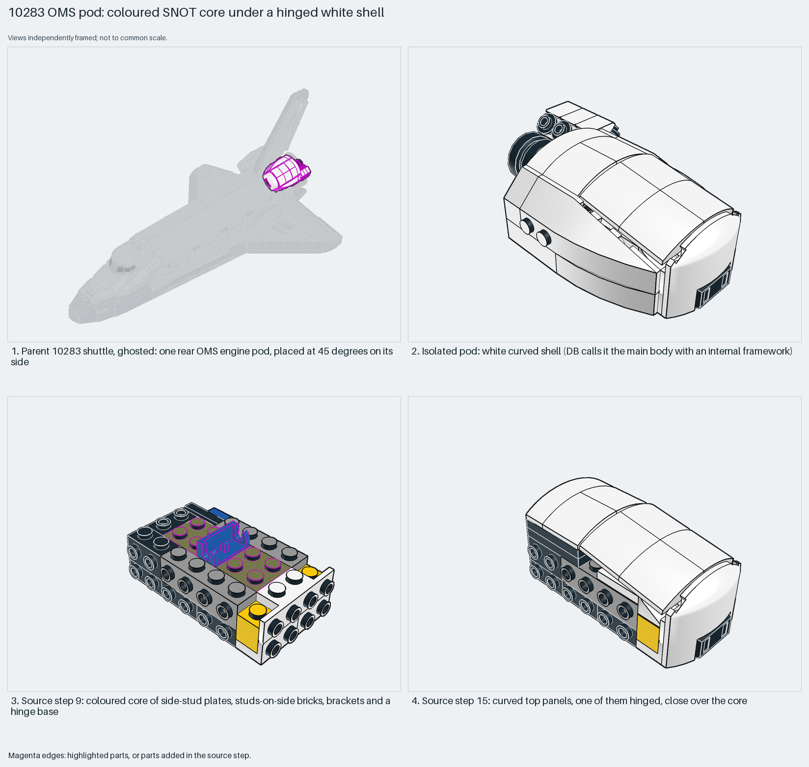

# Space Shuttle OMS pod: a colour-coded SNOT core under a hinged white shell

A colour-coded SNOT core carries a hinged white shell. For thick, layered SNOT, source steps explain more than transparency.

Reusable source construction: source checks pass and the Python and LeoCAD BOMs match.

Spaceship SNOT · 87 parts · 43 source steps in 7 sections

[Build pages](index.html) · [Inspection board](board/mosaic.png) · [Source](source.mpd) · [Editable plan](scene.plan.json) · [Checks](source-checks.json) · [Board provenance](board/board.json)



## Read the construction

46 placements in 24 steps plus child sections (87 parts in all). Steps 1–9: a core in yellow, black, blue and olive: plates 2×2×⅔ with two side studs, bricks 1×4 with side studs, brackets and a hinge base (step 9). Steps 10–24: the white shell: curved panels and children (`433` is hinged on the hinge base), a locking hinge plate (step 15), wedges, and a wheel rim and child `444` as engine bells.

The parent places it with matrix `0 -0.707 0.707 / 0 0.707 0.707 / -1 0 0`: on its side and turned 45°.

## What the parent supplies

- `10283 - shuttle.ldr` places it at `90 -142 -40`, matrix `0 -0.707 0.707 / 0 0.707 0.707 / -1 0 0`.

One rear OMS engine pod beside the tail of `10283 - shuttle.ldr`.

The 45° side-on placement beside the tail.

## Description check

- **Database (misleading):** “Shuttle main body structure with yellow bricks, brackets, hinges, and olive-green plates forming a complex internal framework.”
- **What it is:** One rear OMS engine pod beside the tail, not the shuttle's main body structure.

## Read the board

Panel 1: the ghosted shuttle, pod highlighted at 45° on its side. Panel 2: the isolated pod, a white curved shell. Panel 3: source step 9, the coloured core. Panel 4: step 15, curved top panels close over the core.

Magenta edges mark highlighted parts or the parts added in a source step. Pale grey, see-through parts are ghosted context. A neon-green rod (`#39FF14`) is a synthetic axis marker, not a part. Stud maps recolour each part by where its studs point: up lilac, +X rose, −X vermilion, +Z electric blue, −Z aqua, down lime, odd angle violet. These synthetic colours are ΔE ≥ 16 from every LDraw colour. LDraw −Y is up; LeoCAD `right` shows the model's right side, from −X.

Replay a board into `output/`:

    ./ldraw-xray board run examples/submodel-atlas/recipes/06-10283-shuttle-framework.json --output output/boards/06-10283-shuttle-framework

## Reuse it

Build the core in contrasting colours: it makes each SNOT direction obvious while building. Hinge a shell panel where the shape must close over a curve.

```sh
./ldraw-agent manual export examples/submodel-atlas/06-10283-shuttle-framework --outdir output/my-06-10283-shuttle-framework
./ldraw-agent build output/my-06-10283-shuttle-framework/scene.plan.json --output output/my-06-10283-shuttle-framework/06-10283-shuttle-framework.mpd
```

Export needs a current visual review. Build the copied plan, then inspect its interfaces in the new model.

The placement plan preserves source axes. `source_origin` is a positioning frame, not a physical connector.

## Limits

A see-through copy did not help: all 38 white parts were recoloured, including those inside the children, and the layered shell stayed unreadable. Recolouring a child's placement line does not change parts with explicit colours inside it.

The source and renders teach a construction. They do not prove clutch, fit, clearance, travel or stability. Boards are rendered from synthetic inspection copies, and poses are rigid re-placements.

## Source and evidence

Source: `10283-1.mpd` / `10283 - shuttle-421-451.ldr`, SHA-256 `19bbbc644ca8c24548ffbfd8b483096318864ca0b09d4b4ccceda3352288613f`. Parent: `10283 - shuttle.ldr`. Look it up with `./ldraw-agent discover show submodel-587a8ede904a7450d40ae4e6`.

Original authors and licences stay in [source.mpd](source.mpd); [extraction.json](extraction.json) records renamed sections and 6 bounded preparation changes. Python and LeoCAD BOMs match. The visual review is recorded separately, after opening the actual images.
