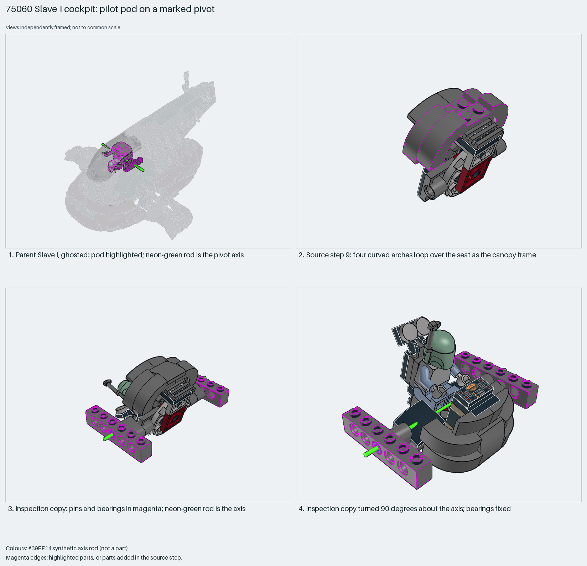

# Slave I cockpit pod on a revolute pivot

A pilot pod turns on two pinned axles in Technic-brick bearings. The axis comes from connector data, not from the picture.

Reusable source construction: source checks pass and the Python and LeoCAD BOMs match.

Spaceship mechanism · 50 parts · 14 source steps in 2 sections

[Build pages](index.html) · [Inspection board](board/mosaic.png) · [Pose sweep](board/poses.png) · [Source](source.mpd) · [Editable plan](scene.plan.json) · [Checks](source-checks.json) · [Board provenance](board/board.json)



## Read the construction

50 parts in 13 steps. Step 1: a 4×4 round plate. Step 3: a 9-position locking hinge and plates. Step 9: four curved arches loop over the seat as the canopy frame. Step 11: liftarms with friction pins and blue axle pins. Step 13: 1×6 Technic bricks on both sides and the Boba Fett minifigure child.

The axle half of each `43093` sits in a `74695` liftarm pinned to the pod; the pin half turns in the centre hole of a `3894` brick. The axis runs through (0, −18, 0) along +Z in section coordinates, and through (0, −182, −300) along −X in the ship. The two bearing bricks are the fixed group; everything else moves.

## What the parent supplies

- `75060 - main.ldr` places it at `0 -164 -300`, matrix `0 0 -1 / 0 1 0 / 1 0 0`.

The pilot pod inside the canopy dome of `75060 - main.ldr`, rotated 90° about Y, with Boba Fett tilted 15°.

The canopy dome around the pod, and the ship that turns about the lateral axis. You confirmed in review that the cockpit rotates.

## Description check

- **Database (vague):** “Hinged structural platform with round snapstud plates, curved black slopes, and a Jedi Starfighter controls tile forming a cockpit or canopy base.”
- **What it is:** The pilot pod inside the canopy dome, on a pivot; not a generic hinged platform.

## Read the board

The main board: panel 1 is the ghosted ship, pod highlighted, with the neon-green pivot axis. Panel 2: source step 9, the canopy arches. Panel 3: the pivot hardware (pins and bearings) in magenta with the axis rod. Panel 4: the moving group turned 90° with the bearings fixed. The pose-sweep board renders 0°, 45° and 90° with one fixed camera in `analysis` mode, so its three panels compare directly. The three-pose sweep is the default for moving parts. How the pivot is marked, with xray layers on synthetic copies: a `highlight` layer on `part:43093|part:3894` outlines only the pivot hardware; an `axis` layer draws the neon-green rod (custom code 9008), thicker in ship coordinates in the parent view; a `pose` layer rotates the moving group about the axis with the bearings fixed. The recipes state the centre and direction explicitly; `./ldraw-xray axes` only proposes candidates.

Magenta edges mark highlighted parts or the parts added in a source step. Pale grey, see-through parts are ghosted context. A neon-green rod (`#39FF14`) is a synthetic axis marker, not a part. Stud maps recolour each part by where its studs point: up lilac, +X rose, −X vermilion, +Z electric blue, −Z aqua, down lime, odd angle violet. These synthetic colours are ΔE ≥ 16 from every LDraw colour. LDraw −Y is up; LeoCAD `right` shows the model's right side, from −X.

Replay a board into `output/`:

    ./ldraw-xray board run examples/submodel-atlas/recipes/07-75060-cockpit-base.json --output output/boards/07-75060-cockpit-base
    ./ldraw-xray board run examples/submodel-atlas/recipes/07-75060-cockpit-base-poses.json --output output/boards/07-75060-cockpit-base-poses

## Reuse it

Use the same pin-in-brick bearing for any pod that must stay level while a hull turns. Derive the axis from both connectors before marking or posing it.

```sh
./ldraw-agent manual export examples/submodel-atlas/07-75060-cockpit-base --outdir output/my-07-75060-cockpit-base
./ldraw-agent build output/my-07-75060-cockpit-base/scene.plan.json --output output/my-07-75060-cockpit-base/07-75060-cockpit-base.mpd
```

Export needs a current visual review. Build the copied plan, then inspect its interfaces in the new model.

The placement plan preserves source axes. `source_origin` is a positioning frame, not a physical connector.

## Limits

Coaxial connectors prove the geometry only, not that the joint turns freely. No clearance against the dome was checked. The marker and posed copies are for rendering only. The tilted minifigure produces warnings, not errors.

The source and renders teach a construction. They do not prove clutch, fit, clearance, travel or stability. Boards are rendered from synthetic inspection copies, and poses are rigid re-placements.

## Source and evidence

Source: `75060-1.mpd` / `75060 - step84.ldr`, SHA-256 `0bf76c215fe21b44e614fa22d28c655a624b5899c15e6d2996c2b669fd74ddd3`. Parent: `75060 - main.ldr`. Look it up with `./ldraw-agent discover show submodel-20011ce9fbd348e856ce03ea`.

Original authors and licences stay in [source.mpd](source.mpd); [extraction.json](extraction.json) records renamed sections and 42 bounded preparation changes. Python and LeoCAD BOMs match. The visual review is recorded separately, after opening the actual images.

How the axis was found, from connector data:

1. Take each joint part's connector from `./ldraw-agent part`. The `43093` axle runs along local X through its origin; the `3894` centre pin hole is at local (0, 10, 0), along local Z.
2. Map each connector into section coordinates with its placement line: point = position + R · local point; direction = R · local axis.
3. Check that all four lines coincide. The two pins (z = ±80) and the two holes (z = ±90) all lie on x = 0, y = −18, along ±Z, with 0.0 LDU offset.
4. The marker centre is their midpoint, (0, −18, 0).
5. For the parent, map the same line through the section placement: (0, −164, −300) with `0 0 −1 / 0 1 0 / 1 0 0` gives (0, −182, −300) along −X.
6. Each pose applies p′ = R(θ)·(p − centre) + centre and M′ = R(θ)·M to every part except the bearings.
