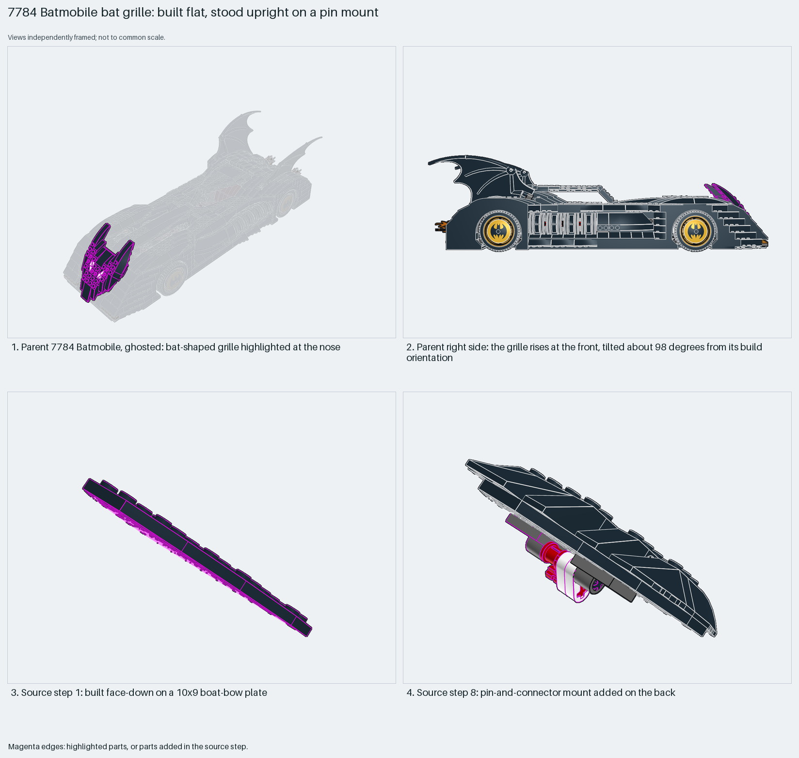

# Batmobile bat grille: built flat, stood upright on a pin mount

Build a silhouette flat on its studs, then stand it in place on a pin mount. The parent's matrix tilts it about 98°.

Reusable source construction: source checks pass and the Python and LeoCAD BOMs match.

Vehicle shaping · 37 parts · 15 source steps in 4 sections

[Build pages](index.html) · [Inspection board](board/mosaic.png) · [Source](source.mpd) · [Editable plan](scene.plan.json) · [Checks](source-checks.json) · [Board provenance](board/board.json)



## Read the construction

37 parts in 8 steps. Step 1: a 10×9 boat-bow plate, face-down. Steps 2–6: slopes and wedges, plus two Technic 1×1 bricks (step 3) and two eye children (step 4). Steps 7–8: 2×2 plates with a hole and the `Head Axle` child form the pin mount on the back.

The parent places it with matrix `1 0 0 / 0 -0.139 -0.99 / 0 0.99 -0.139`, about 98° about X. The mount on the back is the only connection.

## What the parent supplies

- `7784 - Batmobile.ldr` places it at `0 -73.242 -955.849`, matrix `1 0 0 / 0 -0.139 -0.99 / 0 0.99 -0.139`.

The bat-shaped front grille/nose of `7784 - Batmobile.ldr`.

The near-vertical tilt and the mounting point at the nose.

## Description check

- **Database (misleading):** “An angular black vehicle body built from a boat bow plate, multiple wedge and slope bricks forming a sleek bat-shaped hull.”
- **What it is:** The bat-shaped front grille/nose, not the vehicle's body hull.

## Read the board

Panel 1: the ghosted Batmobile, grille highlighted at the nose. Panel 2: the parent from the right, the grille rising at the front. Panels 3–4: source steps 1 (face-down boat-bow plate) and 8 (the mount on the back).

Magenta edges mark highlighted parts or the parts added in a source step. Pale grey, see-through parts are ghosted context. A neon-green rod (`#39FF14`) is a synthetic axis marker, not a part. Stud maps recolour each part by where its studs point: up lilac, +X rose, −X vermilion, +Z electric blue, −Z aqua, down lime, odd angle violet. These synthetic colours are ΔE ≥ 16 from every LDraw colour. LDraw −Y is up; LeoCAD `right` shows the model's right side, from −X.

Replay a board into `output/`:

    ./ldraw-xray board run examples/submodel-atlas/recipes/08-7784-bat-hull.json --output output/boards/08-7784-bat-hull

## Reuse it

Use it for any upright silhouette: a grille, a fin or a sign. Build it flat where studs make the outline easy, then add one pin mount on the back.

```sh
./ldraw-agent manual export examples/submodel-atlas/08-7784-bat-hull --outdir output/my-08-7784-bat-hull
./ldraw-agent build output/my-08-7784-bat-hull/scene.plan.json --output output/my-08-7784-bat-hull/08-7784-bat-hull.mpd
```

Export needs a current visual review. Build the copied plan, then inspect its interfaces in the new model.

The placement plan preserves source axes. `source_origin` is a positioning frame, not a physical connector.

## Limits

A single pin mount was not checked for stability.

The source and renders teach a construction. They do not prove clutch, fit, clearance, travel or stability. Boards are rendered from synthetic inspection copies, and poses are rigid re-placements.

## Source and evidence

Source: `7784-1.mpd` / `7784 - Bat.ldr`, SHA-256 `495724c03f1645d73619cc5c82117027ef0581972b3f84ead27ea3f268a0decf`. Parent: `7784 - Batmobile.ldr`. Look it up with `./ldraw-agent discover show submodel-c5f2f5e327a2300c3005131e`.

Original authors and licences stay in [source.mpd](source.mpd); [extraction.json](extraction.json) records renamed sections and 24 bounded preparation changes. Python and LeoCAD BOMs match. The visual review is recorded separately, after opening the actual images.
