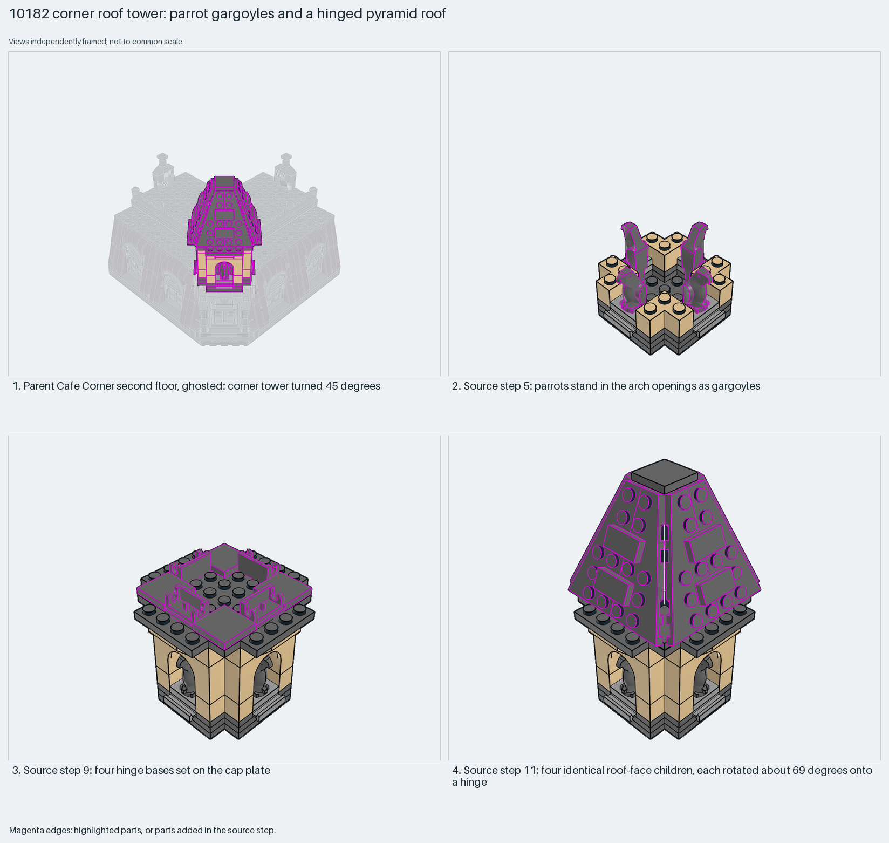

# Café Corner roof tower: parrot gargoyles and a hinged pyramid roof

A pitched corner roof from four identical hinged panels around a pillar, with parrots as gargoyles.

Reusable source construction: source checks pass and the Python and LeoCAD BOMs match.

Building · 81 parts · 18 source steps in 4 sections

[Build pages](index.html) · [Inspection board](board/mosaic.png) · [Source](source.mpd) · [Editable plan](scene.plan.json) · [Checks](source-checks.json) · [Board provenance](board/board.json)



## Read the construction

81 parts in 12 steps. Steps 1–4: plates and corner bricks. Step 5: four parrots stand in the arch openings as gargoyles. Step 6: four 1×4×2 arches. Step 9: four hinge 1×2 bases on the cap plate. Step 10: a central `Roof tower pillar` child. Step 11: four identical `Roof tower roof element` children, each rotated about 69° onto a hinge. Step 12: a 2×2 turntable top cap.

The parent rotates it 45° about Y onto the corner of the second floor.

## What the parent supplies

- `10182 - Second floor.ldr` places it at `220 -192 -300`, matrix `0.707107 0 -0.707107 / 0 1 0 / 0.707107 0 0.707107`.

The corner tower on `10182 - Second floor.ldr` of Café Corner.

The 45° corner placement.

## Description check

- **Database (accurate):** “Ornamental roof tower: dark-bluish-grey plates and tan corner bricks, arches and inverted slopes, four dark-bluish-grey parrots, hinged bases and a turntable top”
- **What it is:** An ornamental roof tower with parrots, hinged bases and a turntable top.

## Read the board

Panel 1: the ghosted second floor, tower at the corner. Panels 2–4: source steps 5 (parrots), 9 (hinge bases) and 11 (four roof children on hinges).

Magenta edges mark highlighted parts or the parts added in a source step. Pale grey, see-through parts are ghosted context. A neon-green rod (`#39FF14`) is a synthetic axis marker, not a part. Stud maps recolour each part by where its studs point: up lilac, +X rose, −X vermilion, +Z electric blue, −Z aqua, down lime, odd angle violet. These synthetic colours are ΔE ≥ 16 from every LDraw colour. LDraw −Y is up; LeoCAD `right` shows the model's right side, from −X.

Replay a board into `output/`:

    ./ldraw-xray board run examples/submodel-atlas/recipes/10-10182-roof-tower.json --output output/boards/10-10182-roof-tower

## Reuse it

Change the roof by changing the one roof-element child; keep the four copies identical so the hinges close evenly. The hinge angle sets the pitch.

```sh
./ldraw-agent manual export examples/submodel-atlas/10-10182-roof-tower --outdir output/my-10-10182-roof-tower
./ldraw-agent build output/my-10-10182-roof-tower/scene.plan.json --output output/my-10-10182-roof-tower/10-10182-roof-tower.mpd
```

Export needs a current visual review. Build the copied plan, then inspect its interfaces in the new model.

The placement plan preserves source axes. `source_origin` is a positioning frame, not a physical connector.

## Limits

The hinge angles come from the source; whether the panels meet without gaps was not checked.

The source and renders teach a construction. They do not prove clutch, fit, clearance, travel or stability. Boards are rendered from synthetic inspection copies, and poses are rigid re-placements.

## Source and evidence

Source: `10182-1.mpd` / `10182 - Second floor - Roof tower.ldr`, SHA-256 `42164d93e442d125195d722cc2e3fa6cc116b2d5c410a2a3bfdeab0b36f54c11`. Parent: `10182 - Second floor.ldr`. Look it up with `./ldraw-agent discover show submodel-433d167e0fef6ad33176562b`.

Original authors and licences stay in [source.mpd](source.mpd); [extraction.json](extraction.json) records renamed sections and 0 bounded preparation changes. Python and LeoCAD BOMs match. The visual review is recorded separately, after opening the actual images.
