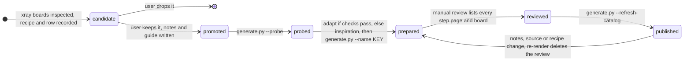

# Submodel atlas

Thirty reviewed submodels from real sets, chosen because each teaches a
construction a new model can reuse. Most are SNOT. Every entry has:

- **build pages:** the source steps, with each step's new parts outlined;
- **an inspection board:** the section in its parent, chosen steps, and an
  x-ray, stud-direction map or pivot sweep where it helps;
- **a guide:** how it is built, what the parent supplies, what the database
  description gets wrong, and what is not verified.

Sources are in `data/models-annotated/`; each hash is the SHA-256 of the whole MPD.

## Use it

```sh
./ldraw-agent examples --family submodel --details hinge     # 25 modules that need a parent
./ldraw-agent examples --family submodel                     # 5 stand-alone objects
./ldraw-agent examples --family submodel --details snot --limit 30
```

Search matches the key, title, category, tags, lesson and corrected description.
Open the result's `guide` first, then its `board`. Use the build pages
(`manual`, an offline `index.html`) for the order of construction.

| Use | Meaning | What to do |
|---|---|---|
| `adapt` | Source checks pass and the Python and LeoCAD BOMs match | `./ldraw-agent manual export examples/submodel-atlas/KEY --outdir output/my-KEY`, then build the copied `scene.plan.json` |
| `inspiration` | The source keeps errors that block export; each guide's *Limits* says which | Study the technique and rebuild it with the new model's parts |

Each entry folder holds:

| Path | Contents |
|---|---|
| `GUIDE.md` | Construction, parent context, description check, how to read the board, reuse and limits |
| `board/mosaic.png` | The reviewed xray board (07 also has `board/poses.png`) |
| `board/board.json` | Board provenance: recipe and image hashes, panels, replay command |
| `index.html`, `manual/NN/` | Build pages for the section and each child section |
| `source.mpd`, `extraction.json` | Dependency-closed, attributed source and its extraction record |
| `scene.plan.json`, `generate.py` | Editable placement plan; `generate.py` rebuilds it (adapt entries only) |
| `source-checks.json`, `bom-comparison.json` | Source checks and the Python/LeoCAD BOM comparison |
| `study-notes.json`, `manual.json`, `visual-review.json` | Study notes, hashed evidence and the recorded review |

## Pick an entry by technique

| Technique | Entries | Start with |
|---|---|---|
| The parent supplies parts the section lacks | 01 (the 8T pinion), S04 (eight skin panels) | 01 |
| Built in a convenient frame; the parent's matrix turns it | 04, 06, 08, S07, S17, S17b, S20 | 08 |
| Studs-forward faces and skins | S01, S05, S13, S18 | S01 |
| Radial cores with identical faces | S04, S08, S22 | S08 |
| Rounded edges from curved bricks | S09 (on their sides), S15 (upside down), S17 (bilge) | S09 |
| Sideways discs and covers | 05 | 05 |
| A colour-coded core under a shell | 06, S13 | 06 |
| Hinges and pivots | 07 (revolute pod), 10 (hinged roof faces), S11 (rudder on handles), S16 (wing on a clip), S19 (limbs) | 07 |
| Patterns from edges, fins and clips | S03 (plate edges), S06 (clipped vines), S10 (fins) | S03 |
| Repurposed parts | S02 (revolvers), S14 (hoses), S18 (a mudguard), S20 (animal tails) | S02 |
| Technic mechanisms | 01, 02, 03 | 03 |
| Micro scale | S16, S22 | S22 |

**Read the parent before trusting a description.** Seventeen of the thirty
database descriptions are wrong, misleading, vague or empty; each guide's
*Description check* gives the correction. Many walls and silhouettes are built
flat, and only the parent's matrix stands them up.

## Entries

| # | Entry | Category | Use | Lesson | Board |
|---|---|---|---|---|---|
| 01 | [Steerable Technic front axle; the pinion lives in the parent](01-8081-front-axle/GUIDE.md) | Technic chassis | adapt | A steerable, sprung Technic front axle carries the steering rack, but the 8T pinion that drives the rack is placed in the parent frame. | [board](01-8081-front-axle/board/mosaic.png) |
| 02 | [Differential rear axle with U-joints, mounted tilted](02-42075-rear-axle/GUIDE.md) | Technic chassis | inspiration | A driven Technic rear axle: a differential in an open frame, U-joints and half-shafts. The parent's matrix sets its tilt. | [board](02-42075-rear-axle/board/mosaic.png) |
| 03 | [V8 engine: crank train hidden under the cylinder banks](03-42050-v8-engine/GUIDE.md) | Technic mechanism | adapt | A Technic V8 puts its whole crank train in one step between the two cylinder banks, so the finished engine hides it. | [board](03-42050-v8-engine/board/mosaic.png) |
| 04 | [Technic-to-System SNOT headlight cluster](04-42078-headlight/GUIDE.md) | Technic-to-System SNOT | inspiration | A sideways System lamp cluster sits on a Technic mount; only the parent's axis-permutation matrix explains its orientation. | [board](04-42078-headlight/board/mosaic.png) |
| 05 | [Motorcycle primary-drive cover: a sideways round disc on headlight bricks](05-10269-headlight-nacelle/GUIDE.md) | Vehicle SNOT | adapt | A sideways round disc on headlight-brick studs. The parent shows it is a drive cover, not the headlight nacelle the database names. | [board](05-10269-headlight-nacelle/board/mosaic.png) |
| 06 | [Space Shuttle OMS pod: a colour-coded SNOT core under a hinged white shell](06-10283-shuttle-framework/GUIDE.md) | Spaceship SNOT | adapt | A colour-coded SNOT core carries a hinged white shell. For thick, layered SNOT, source steps explain more than transparency. | [board](06-10283-shuttle-framework/board/mosaic.png) |
| 07 | [Slave I cockpit pod on a revolute pivot](07-75060-cockpit-base/GUIDE.md) | Spaceship mechanism | adapt | A pilot pod turns on two pinned axles in Technic-brick bearings. The axis comes from connector data, not from the picture. | [board](07-75060-cockpit-base/board/mosaic.png) · [poses](07-75060-cockpit-base/board/poses.png) |
| 08 | [Batmobile bat grille: built flat, stood upright on a pin mount](08-7784-bat-hull/GUIDE.md) | Vehicle shaping | adapt | Build a silhouette flat on its studs, then stand it in place on a pin mount. The parent's matrix tilts it about 98°. | [board](08-7784-bat-hull/board/mosaic.png) |
| 10 | [Café Corner roof tower: parrot gargoyles and a hinged pyramid roof](10-10182-roof-tower/GUIDE.md) | Building | adapt | A pitched corner roof from four identical hinged panels around a pillar, with parrots as gargoyles. | [board](10-10182-roof-tower/board/mosaic.png) |
| S01 | [Vespa front leg shield: a studs-forward column under a smooth skin](s01-10298-vespa-front/GUIDE.md) | Vehicle body | adapt | A smooth vehicle panel is a studs-forward column skinned with tiles, then tilted as a whole. | [board](s01-10298-vespa-front/board/mosaic.png) |
| S02 | [Caterham engine: a sideways exhaust manifold made of revolvers](s02-21307-caterham-nose/GUIDE.md) | Vehicle mechanical detail | adapt | Mechanical detail from sideways studs and repurposed parts: four minifigure revolvers become exhaust pipes. | [board](s02-21307-caterham-nose/board/mosaic.png) |
| S03 | [Central Perk floor slab: a pattern from plates turned on edge](s03-21319-central-perk-wall/GUIDE.md) | Building pattern | adapt | An edge-on plate mosaic: bricks and plates laid on their sides show their edges as a high-resolution flat pattern. | [board](s03-21319-central-perk-wall/board/mosaic.png) |
| S04 | [Saturn V radial clip hub carrying eight spoke panels](s04-21309-saturn-module/GUIDE.md) | Round body | adapt | A radial hub of jumper and clip plates on four faces carries eight skin panels by their handles. | [board](s04-21309-saturn-module/board/mosaic.png) |
| S05 | [BrickHeadz Yoda: face and ears on a side-stud core](s05-41627-yoda/GUIDE.md) | Character | adapt | BrickHeadz faces use a side-stud core plus flat panels built separately and turned. | [board](s05-41627-yoda/board/mosaic.png) |
| S06 | [Police Station door column: a sideways stone column with clipped vines](s06-10278-door-column/GUIDE.md) | Building ornament | adapt | A stone-texture column built sideways, with vines hung on clip bars from handle plates. | [board](s06-10278-door-column/board/mosaic.png) |
| S07 | [Old Trafford glazed wall: built in its own frame, turned into the stand](s07-10272-rooftop-box/GUIDE.md) | Building glazing | adapt | Build in a convenient frame, then rotate. Here "studs down" is the builder's frame, not a physical upside-down build. | [board](s07-10272-rooftop-box/board/mosaic.png) |
| S08 | [Four-sided Christmas tree: identical faces on a four-sided stud core](s08-10267-christmas-tree/GUIDE.md) | Round/conical | adapt | A radial core with identical faces, for round or conical shapes. | [board](s08-10267-christmas-tree/board/mosaic.png) |
| S09 | [London bus roof: rounded edges from curved bricks on their sides](s09-10258-bus-roof/GUIDE.md) | Vehicle body | adapt | Rounded vehicle body edges from curved-top bricks laid on their sides on brackets. | [board](s09-10258-bus-roof/board/mosaic.png) |
| S10 | [Empire State entrance: a recessed doorway in a sideways fin facade](s10-21046-empire-corner/GUIDE.md) | Building facade | adapt | A doorway recessed into a sideways rib facade. | [board](s10-21046-empire-corner/board/mosaic.png) |
| S11 | [Sopwith Camel striped rudder: built sideways, hung on handle bricks](s11-10226-radial-engine/GUIDE.md) | Aircraft control surface | adapt | A flat, striped control surface built sideways, with a handle as the hinge point. | [board](s11-10226-radial-engine/board/mosaic.png) |
| S13 | [Buckbeak head: a studs-forward face on a hidden colour-coded core](s13-40412-buckbeak-body/GUIDE.md) | Animal head | adapt | An animal face built studs-forward on a hidden core. | [board](s13-40412-buckbeak-body/board/mosaic.png) |
| S14 | [WALL-E left eye: mixed-direction SNOT with ribbed-hose cables](s14-21303-walle-eye/GUIDE.md) | Robot character | inspiration | The densest mixed-direction SNOT in the set, with flexible parts as decoration. | [board](s14-21303-walle-eye/board/mosaic.png) |
| S15 | [Swiss Crocodile underbody: a real upside-down build](s15-10183-underbody/GUIDE.md) | Train underbody | inspiration | Inverted curved-top bricks give a rounded belly; the studs point down in the locomotive too. | [board](s15-10183-underbody/board/mosaic.png) |
| S16 | [Micro Republic Attack Shuttle: wings stood on edge on clips](s16-30050-shuttle-fuselage/GUIDE.md) | Micro spaceship | adapt | Micro-scale SNOT: a wing child stands on edge, turned 90° about Z on a clip. | [board](s16-30050-shuttle-fuselage/board/mosaic.png) |
| S17 | [Titanic lower hull wall: built flat, stood on its side](s17-10294-titanic-hull/GUIDE.md) | Ship hull | adapt | A ship's hull side is built as a flat plate-and-tile panel, then stood on its side. The panel's top becomes the hull's outside. | [board](s17-10294-titanic-hull/board/mosaic.png) |
| S17b | [Titanic black hull wall: portholes from open studs](s17b-10294-titanic-hull-cabins/GUIDE.md) | Ship hull | adapt | Portholes come from open studs on a wall built flat; children inside a sideways wall are counter-rotated so they end up upright. | [board](s17b-10294-titanic-hull-cabins/board/mosaic.png) |
| S18 | [Stormtrooper helmet mouth vent: offset plates centre a grille](s18-75276-tie-mount/GUIDE.md) | Helmet detail | adapt | Offset (jumper) plates centre a 2-wide grille on a face built forward; a car mudguard becomes the sculpted arch. | [board](s18-75276-tie-mount/board/mosaic.png) |
| S19 | [Chameleon: flank stripes, turret eyes and hinged limbs](s19-31031-chameleon/GUIDE.md) | Animal | adapt | Turret eyes from sideways convex slopes; limbs as rotated children on hinges and ball joints. | [board](s19-31031-chameleon/board/mosaic.png) |
| S20 | [Blacksmith tree trunk: built lying down, stood up](s20-21325-blacksmith/GUIDE.md) | Tree | adapt | An organic shape built in a convenient frame, with animal tails as roots. | [board](s20-21325-blacksmith/board/mosaic.png) |
| S22 | [Micro Tantive IV: built sideways along its length](s22-10030-isd-tower/GUIDE.md) | Micro spaceship | adapt | A micro ship built sideways along its length on bricks with studs on four sides. | [board](s22-10030-isd-tower/board/mosaic.png) |

`09-10262` (the DB5's front module) is excluded until its purpose is known; the
database and the model header both call the model a "Lunar Lander". S12 (`10241 -
step77.ldr`) was dropped because the container stacks hide it, and S21 (`40413 -
charlie.ldr`) because it overlaps S05 and S13.

## Add or refresh an entry

[`selections.json`](selections.json) is the single source of truth. Each row has
the source identity, the family tag (`category`), search `tags`, the five study
notes, the guide fields and its board recipes in [`recipes/`](recipes).



```sh
.venv/bin/python examples/submodel-atlas/generate.py --probe                 # source checks only, no LeoCAD
.venv/bin/python examples/submodel-atlas/generate.py --name KEY [--name KEY]  # build pages, board, BOM, guide
./ldraw-agent manual review examples/submodel-atlas/KEY --images IMAGE... --note '...'
.venv/bin/python examples/submodel-atlas/generate.py --refresh-catalog       # guides, catalog.json, index.html
```

- **`status`:** `candidate` rows are recorded but not generated; only `promoted`
  rows reach the catalog.
- **Pre-flight:** the generator checks every selected source hash, parent,
  discovery id and recipe before it touches a folder.
- **What a review must list:** every step page, `renders/home.png` and every
  board image, as `manual.json` names them. A changed board, page or note
  invalidates the review, and the catalog shows `pending` again.
- **Guide-only edits:** the guide fields are not hashed, so changing them needs
  only `--refresh-catalog`. Changing the notes, source or recipe needs a fresh
  render and review.

`tests/test_submodel_atlas.py` checks every hash, parent, recipe, catalog path,
board provenance, review status and link. It also checks that `adapt` plans
rebuild with matching BOMs. The [inspection guide](../../docs/agent/submodel-inspection.md)
covers finding and inspecting new candidates.

## Reading the boards

- **Panels differ on purpose.** The last source step usually looks like the
  finished isolated view, so boards avoid pairing them. xray reports
  `duplicate_panels` when two 96×72 greyscale thumbnails differ by a mean below
  7 (0–255 scale). A real duplicate measures 0–4.5. Board 05 is flagged at 5.6,
  but its panels differ visibly; the threshold needs recalibrating.
- **Step numbers.** Board labels number steps as LeoCAD does, counting every
  `0 STEP` and `0 ROTSTEP`. The build pages fold a `0 STEP` followed by
  `0 ROTSTEP` into one step. The two agree everywhere except S16, whose labels
  give both numbers.
- **Boards are synthetic.** Recoloured, ghosted, posed and marked copies are for
  rendering only; they are not buildable models.

## How the SNOT entries were found

The S entries come from measuring stud directions across the whole corpus, not
from descriptions. The one-off scan covered 1,821 annotated MPDs, with every
section's children flattened. For each part it took the direction its studs
point, `R · (0,−1,0)`.

| Filter | Sections left |
|---|---|
| 15–220 parts and at least 25% of studs not pointing up | 1,918 |
| Also: ≥3 SNOT enablers (brackets, studs-on-side and headlight bricks), ≤35% parts at odd angles, ≤20% Technic, has a parent, ≥4 steps, 20–130 parts, a real description | 273 |

Sections already used by an atlas or example were excluded, and so were the
existing SNOT references (parrot, cat, F40, 6208 B-Wing and Halcyon). The
entries were picked from the 273 by hand.

**Stud-direction map.** The `stud_map` layer recolours each part by where its
studs point, in section coordinates with children flattened. The colours are
xray's custom codes 9001–9007. They are deliberately not LEGO colours: each is
ΔE ≥ 16 from every `LDConfig.ldr` colour. `./ldraw-xray palette` lists the codes
and values.

| Studs point | Colour |
|---|---|
| Up | lilac |
| +X | rose |
| −X | vermilion |
| +Z | electric blue |
| −Z | aqua |
| Down | lime |
| Odd angle | violet |

## Limits

Renders and sources teach a construction. They do not prove clutch, fit,
clearance, travel or stability, and poses are rigid re-placements. The reviews
were recorded after opening every image; step pages were read through contact
sheets of the exact files. Use nova's [validation](../../docs/agent/validation.md)
for physical claims about a new model.
