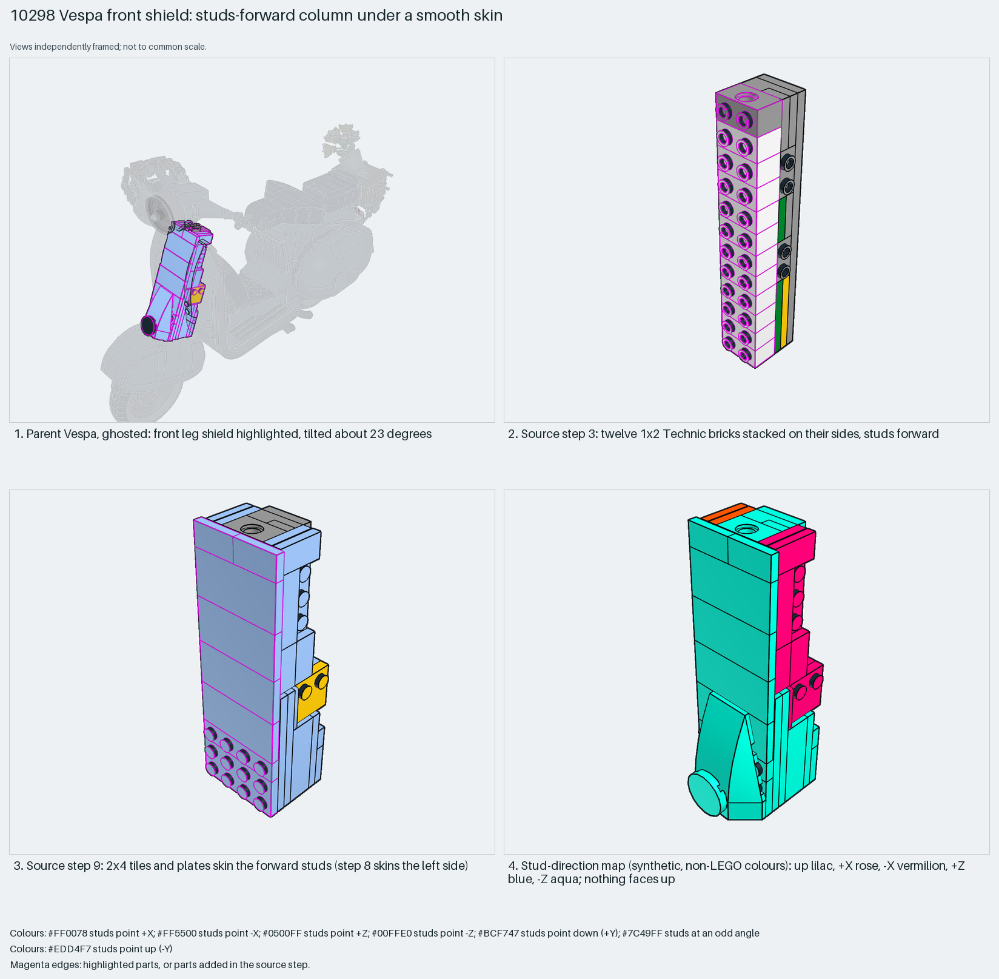

# Vespa front leg shield: a studs-forward column under a smooth skin

A smooth vehicle panel is a studs-forward column skinned with tiles, then tilted as a whole.

Reusable source construction: source checks pass and the Python and LeoCAD BOMs match.

Vehicle body · 63 parts · 11 source steps in 1 section

[Build pages](index.html) · [Inspection board](board/mosaic.png) · [Source](source.mpd) · [Editable plan](scene.plan.json) · [Checks](source-checks.json) · [Board provenance](board/board.json)



## Read the construction

63 parts in 11 steps. Step 3: twelve Technic bricks 1×2 with hole, stacked on their sides with studs forward. Steps 6 and 8: side skins of plates and tiles. Step 9: the forward skin of 2×4 tiles and plates. Steps 10–11: slopes and a 4×4 triple-curved wedge form the nose.

Stud directions: 63 parts, 0 up, 47 −Z (forward), 8 +X, 8 −X. The parent tilts the whole section about 23° about X.

## What the parent supplies

- `10298 - vespa.ldr` places it at `0 -207.078 -195.412`, matrix `1 0 0 / 0 0.923 0.385 / 0 -0.385 0.923`.

The front leg shield of the Vespa (`10298 - vespa.ldr`).

Only the 23° tilt.

## Description check

- **Database (vague):** “The front chassis section built from light bluish grey plates and Technic bricks with holes, providing structural mounting for the steering and front fairing.”
- **What it is:** The Vespa's tiled front leg shield, built studs-forward; more than a chassis section for mounting.

## Read the board

Panel 1: the ghosted Vespa, shield highlighted. Panel 2: step 3, twelve Technic bricks on their sides. Panel 3: step 9, tiles skin the forward studs. Panel 4: the stud map; nothing faces up.

Magenta edges mark highlighted parts or the parts added in a source step. Pale grey, see-through parts are ghosted context. A neon-green rod (`#39FF14`) is a synthetic axis marker, not a part. Stud maps recolour each part by where its studs point: up lilac, +X rose, −X vermilion, +Z electric blue, −Z aqua, down lime, odd angle violet. These synthetic colours are ΔE ≥ 16 from every LDraw colour. LDraw −Y is up; LeoCAD `right` shows the model's right side, from −X.

Replay a board into `output/`:

    ./ldraw-xray board run examples/submodel-atlas/recipes/s01-10298-vespa-front.json --output output/boards/s01-10298-vespa-front

## Reuse it

This is the technique the Technic car trial lacked: point the panel's studs at the surface, skin them with tiles, and tilt the section once.

```sh
./ldraw-agent manual export examples/submodel-atlas/s01-10298-vespa-front --outdir output/my-s01-10298-vespa-front
./ldraw-agent build output/my-s01-10298-vespa-front/scene.plan.json --output output/my-s01-10298-vespa-front/s01-10298-vespa-front.mpd
```

Export needs a current visual review. Build the copied plan, then inspect its interfaces in the new model.

The placement plan preserves source axes. `source_origin` is a positioning frame, not a physical connector.

## Limits

How the shield mounts to the frame was not checked.

The source and renders teach a construction. They do not prove clutch, fit, clearance, travel or stability. Boards are rendered from synthetic inspection copies, and poses are rigid re-placements.

## Source and evidence

Source: `10298-1.mpd` / `10298 - front.ldr`, SHA-256 `4e93be56fd86770a2ae7e16ede8110eec5c85aa23297691738fdfe4beba7c185`. Parent: `10298 - vespa.ldr`. Look it up with `./ldraw-agent discover show submodel-46145a2deca05617f312a429`.

Original authors and licences stay in [source.mpd](source.mpd); [extraction.json](extraction.json) records renamed sections and 0 bounded preparation changes. Python and LeoCAD BOMs match. The visual review is recorded separately, after opening the actual images.
