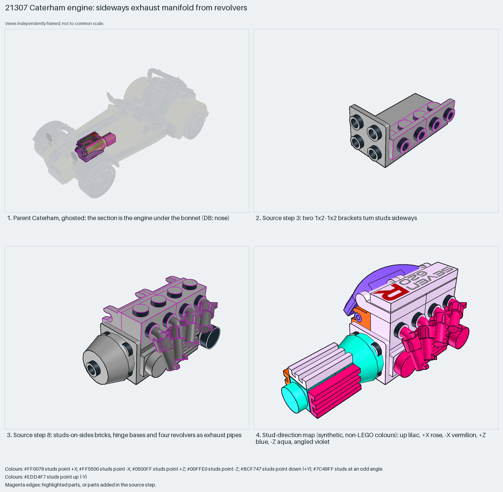

# Caterham engine: a sideways exhaust manifold made of revolvers

Mechanical detail from sideways studs and repurposed parts: four minifigure revolvers become exhaust pipes.

Reusable source construction: source checks pass and the Python and LeoCAD BOMs match.

Vehicle mechanical detail · 37 parts · 11 source steps in 1 section

[Build pages](index.html) · [Inspection board](board/mosaic.png) · [Source](source.mpd) · [Editable plan](scene.plan.json) · [Checks](source-checks.json) · [Board provenance](board/board.json)



## Read the construction

37 parts in 11 steps. Steps 2–5: brackets turn studs sideways (two 1×2–1×2 brackets in step 3). Step 8: bricks with studs on sides, hinge bases and four minifigure revolvers as exhaust pipes. Steps 9–11: hinge tops, a curved slope, handle plates and grille tiles.

Stud directions: 37 parts, 14 up, 9 +X, 5 −X, 5 −Z, 4 angled.

## What the parent supplies

- `21307 - Car.ldr` places it at `0 -42 -120`, matrix `-1 0 0 / 0 1 0 / 0 0 -1`.

The engine under the bonnet of the Caterham (`21307 - Car.ldr`).

The bonnet and body around it.

## Description check

- **Database (wrong):** “A detailed front wing and nose section with grille tiles, brackets, slopes, hinges, and revolver barrels used as exhaust tips.”
- **What it is:** The engine under the bonnet, with a sideways exhaust manifold; not a front wing or nose.

## Read the board

Panel 1: the ghosted car, engine highlighted. Panel 2: step 3, brackets. Panel 3: step 8, revolvers as exhaust pipes. Panel 4: the stud map.

Magenta edges mark highlighted parts or the parts added in a source step. Pale grey, see-through parts are ghosted context. A neon-green rod (`#39FF14`) is a synthetic axis marker, not a part. Stud maps recolour each part by where its studs point: up lilac, +X rose, −X vermilion, +Z electric blue, −Z aqua, down lime, odd angle violet. These synthetic colours are ΔE ≥ 16 from every LDraw colour. LDraw −Y is up; LeoCAD `right` shows the model's right side, from −X.

Replay a board into `output/`:

    ./ldraw-xray board run examples/submodel-atlas/recipes/s02-21307-caterham-nose.json --output output/boards/s02-21307-caterham-nose

## Reuse it

Hang greebles on studs-on-sides bricks where no body panel is needed. Look for parts whose shape, not name, fits the role.

```sh
./ldraw-agent manual export examples/submodel-atlas/s02-21307-caterham-nose --outdir output/my-s02-21307-caterham-nose
./ldraw-agent build output/my-s02-21307-caterham-nose/scene.plan.json --output output/my-s02-21307-caterham-nose/s02-21307-caterham-nose.mpd
```

Export needs a current visual review. Build the copied plan, then inspect its interfaces in the new model.

The placement plan preserves source axes. `source_origin` is a positioning frame, not a physical connector.

## Limits

This entry teaches greebling more than body panels.

The source and renders teach a construction. They do not prove clutch, fit, clearance, travel or stability. Boards are rendered from synthetic inspection copies, and poses are rigid re-placements.

## Source and evidence

Source: `21307-1.mpd` / `21307 - 21307 Step 71-82 Submodel.ldr`, SHA-256 `cb81c162429e7c06f2a53f830ba2176aa08c220bc058d05eb3949eb9d8783ac7`. Parent: `21307 - Car.ldr`. Look it up with `./ldraw-agent discover show submodel-ca7cd4340d800d0c8b43bbed`.

Original authors and licences stay in [source.mpd](source.mpd); [extraction.json](extraction.json) records renamed sections and 5 bounded preparation changes. Python and LeoCAD BOMs match. The visual review is recorded separately, after opening the actual images.
