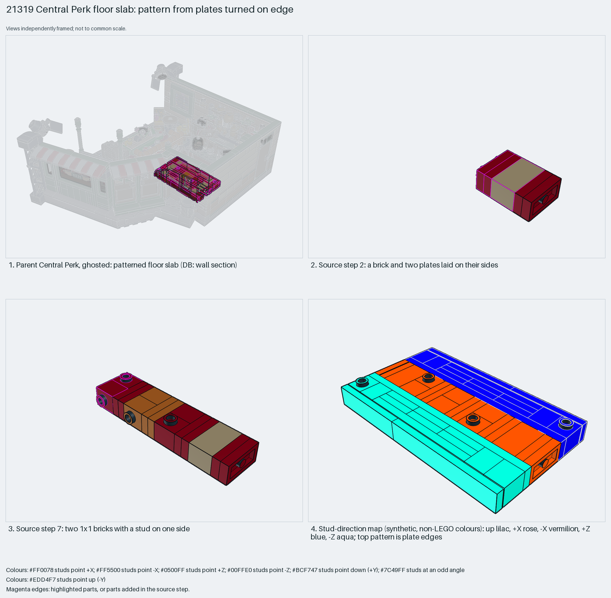

# Central Perk floor slab: a pattern from plates turned on edge

An edge-on plate mosaic: bricks and plates laid on their sides show their edges as a high-resolution flat pattern.

Reusable source construction: source checks pass and the Python and LeoCAD BOMs match.

Building pattern · 46 parts · 13 source steps in 2 sections

[Build pages](index.html) · [Inspection board](board/mosaic.png) · [Source](source.mpd) · [Editable plan](scene.plan.json) · [Checks](source-checks.json) · [Board provenance](board/board.json)



## Read the construction

46 parts in 9 steps. Courses of bricks and plates lie on their sides (steps 1–8); 1×1 bricks with a stud on one side hold them (steps 3, 5 and 7). Step 9: two identical `Step 118` children finish the slab.

Stud directions: 46 parts, 0 up, 18 −X, 14 +Z, 14 −Z.

## What the parent supplies

- `21319 - Central Perk.ldr` places it at `14 -18 -360`, matrix `1 0 0 / 0 1 0 / 0 0 1`.

A patterned floor slab inside the café (`21319 - Central Perk.ldr`).

Only its place in the café floor.

## Description check

- **Database (wrong):** “A dark red and dark tan wall section with side-stud bricks and grooved tiles”
- **What it is:** A patterned floor slab, not a wall section.

## Read the board

Panel 1: the ghosted café, slab highlighted. Panel 2: step 2, a brick and two plates on their sides. Panel 3: step 7, side-stud bricks. Panel 4: the stud map; the top pattern is plate edges.

Magenta edges mark highlighted parts or the parts added in a source step. Pale grey, see-through parts are ghosted context. A neon-green rod (`#39FF14`) is a synthetic axis marker, not a part. Stud maps recolour each part by where its studs point: up lilac, +X rose, −X vermilion, +Z electric blue, −Z aqua, down lime, odd angle violet. These synthetic colours are ΔE ≥ 16 from every LDraw colour. LDraw −Y is up; LeoCAD `right` shows the model's right side, from −X.

Replay a board into `output/`:

    ./ldraw-xray board run examples/submodel-atlas/recipes/s03-21319-central-perk-wall.json --output output/boards/s03-21319-central-perk-wall

## Reuse it

Use it for floors, signs or inlays where the stud grid is too coarse. Alternate plate colours in each course to draw the pattern.

```sh
./ldraw-agent manual export examples/submodel-atlas/s03-21319-central-perk-wall --outdir output/my-s03-21319-central-perk-wall
./ldraw-agent build output/my-s03-21319-central-perk-wall/scene.plan.json --output output/my-s03-21319-central-perk-wall/s03-21319-central-perk-wall.mpd
```

Export needs a current visual review. Build the copied plan, then inspect its interfaces in the new model.

The placement plan preserves source axes. `source_origin` is a positioning frame, not a physical connector.

## Limits

How the slab is retained in the floor was not checked.

The source and renders teach a construction. They do not prove clutch, fit, clearance, travel or stability. Boards are rendered from synthetic inspection copies, and poses are rigid re-placements.

## Source and evidence

Source: `21319-1.mpd` / `21319 - Steps 110 to 118.ldr`, SHA-256 `ce8497bcfd0135029f8d8ebe6dfd0beaa4fdc89fe83652379f815d161c6e7b5e`. Parent: `21319 - Central Perk.ldr`. Look it up with `./ldraw-agent discover show submodel-828332d61c956fe0a4755767`.

Original authors and licences stay in [source.mpd](source.mpd); [extraction.json](extraction.json) records renamed sections and 0 bounded preparation changes. Python and LeoCAD BOMs match. The visual review is recorded separately, after opening the actual images.
