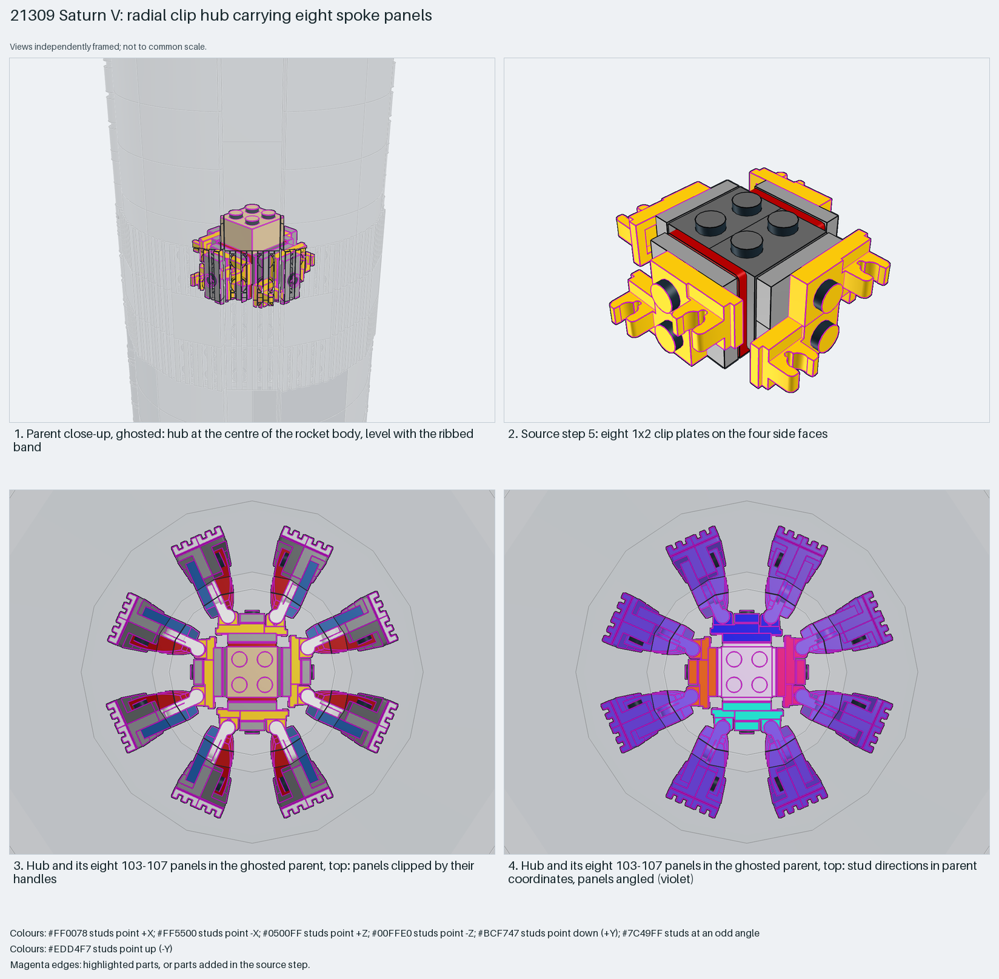

# Saturn V radial clip hub carrying eight spoke panels

A radial hub of jumper and clip plates on four faces carries eight skin panels by their handles.

Reusable source construction: source checks pass and the Python and LeoCAD BOMs match.

Round body · 26 parts · 7 source steps in 1 section

[Build pages](index.html) · [Inspection board](board/mosaic.png) · [Source](source.mpd) · [Editable plan](scene.plan.json) · [Checks](source-checks.json) · [Board provenance](board/board.json)



## Read the construction

26 parts in 7 steps. Steps 1–2: two 1×2–2×2 brackets and a 2×2 tan brick. Step 3: two down brackets. Step 4: eight 1×2 jumper plates on the four faces. Step 5: eight 1×2 clip plates. Steps 6–7: four more jumper plates and a 2×2 brick.

Stud directions: 26 parts, 6 up and exactly 5 per horizontal direction. All eight clip centres fall inside `48336` handle plates of the eight `21309 - 103-107.ldr` panels.

## What the parent supplies

- `21309 - main.ldr` places it at `0 -328 0`, matrix `1 0 0 / 0 1 0 / 0 0 1`.

The hub at the centre of the rocket body, level with a band of vertical ribbed panels, in `21309 - main.ldr` (identity matrix).

The eight skin panels (`21309 - 103-107.ldr`: grille tiles and red curved slopes on a blue 2×4 plate). The parent places them two per face, splayed ±24°, at a radius of about 50 LDU; their grille ends form the ribbed outer band.

## Description check

- **Database (accurate):** “Repeating bracket-and-brick structural module with red and dark grey brackets, tan bricks, grooved jumpers, and yellow clip plates for attachment points.”
- **What it is:** A repeating bracket-and-brick module with clip plates for attachment points.

## Read the board

Panel 1: a parent close-up, ghosted, with the hub at the centre. Panel 2: step 5, the eight clip plates. Panels 3–4: the hub with its eight panels in the ghosted parent, from above; then the same with stud directions in parent coordinates (the panels are angled, violet). xray has no layer that removes the rest of the parent.

Magenta edges mark highlighted parts or the parts added in a source step. Pale grey, see-through parts are ghosted context. A neon-green rod (`#39FF14`) is a synthetic axis marker, not a part. Stud maps recolour each part by where its studs point: up lilac, +X rose, −X vermilion, +Z electric blue, −Z aqua, down lime, odd angle violet. These synthetic colours are ΔE ≥ 16 from every LDraw colour. LDraw −Y is up; LeoCAD `right` shows the model's right side, from −X.

Replay a board into `output/`:

    ./ldraw-xray board run examples/submodel-atlas/recipes/s04-21309-saturn-module.json --output output/boards/s04-21309-saturn-module

## Reuse it

Use it for round bodies that need a skin of identical panels: two panels per face, splayed.

```sh
./ldraw-agent manual export examples/submodel-atlas/s04-21309-saturn-module --outdir output/my-s04-21309-saturn-module
./ldraw-agent build output/my-s04-21309-saturn-module/scene.plan.json --output output/my-s04-21309-saturn-module/s04-21309-saturn-module.mpd
```

Export needs a current visual review. Build the copied plan, then inspect its interfaces in the new model.

The placement plan preserves source axes. `source_origin` is a positioning frame, not a physical connector.

## Limits

The clip–bar fit is not verified: the evidence is bounding-box coincidence at every clip.

The source and renders teach a construction. They do not prove clutch, fit, clearance, travel or stability. Boards are rendered from synthetic inspection copies, and poses are rigid re-placements.

## Source and evidence

Source: `21309-1.mpd` / `21309 - 16-22.ldr`, SHA-256 `fca920c256ac2ccdfecc6c168f656cdcf3568a1c40c164292ab7f68d8bcbb3e2`. Parent: `21309 - main.ldr`. Look it up with `./ldraw-agent discover show submodel-3da59c8d046b7afb11595c20`.

Original authors and licences stay in [source.mpd](source.mpd); [extraction.json](extraction.json) records renamed sections and 0 bounded preparation changes. Python and LeoCAD BOMs match. The visual review is recorded separately, after opening the actual images.

All 8 hub clip centres fall inside `48336` handle plates of the eight `21309 - 103-107.ldr` panels. This is bounding-box coincidence; the clip–bar fit is not verified. You could not tell from the images either; this measurement is the evidence.
