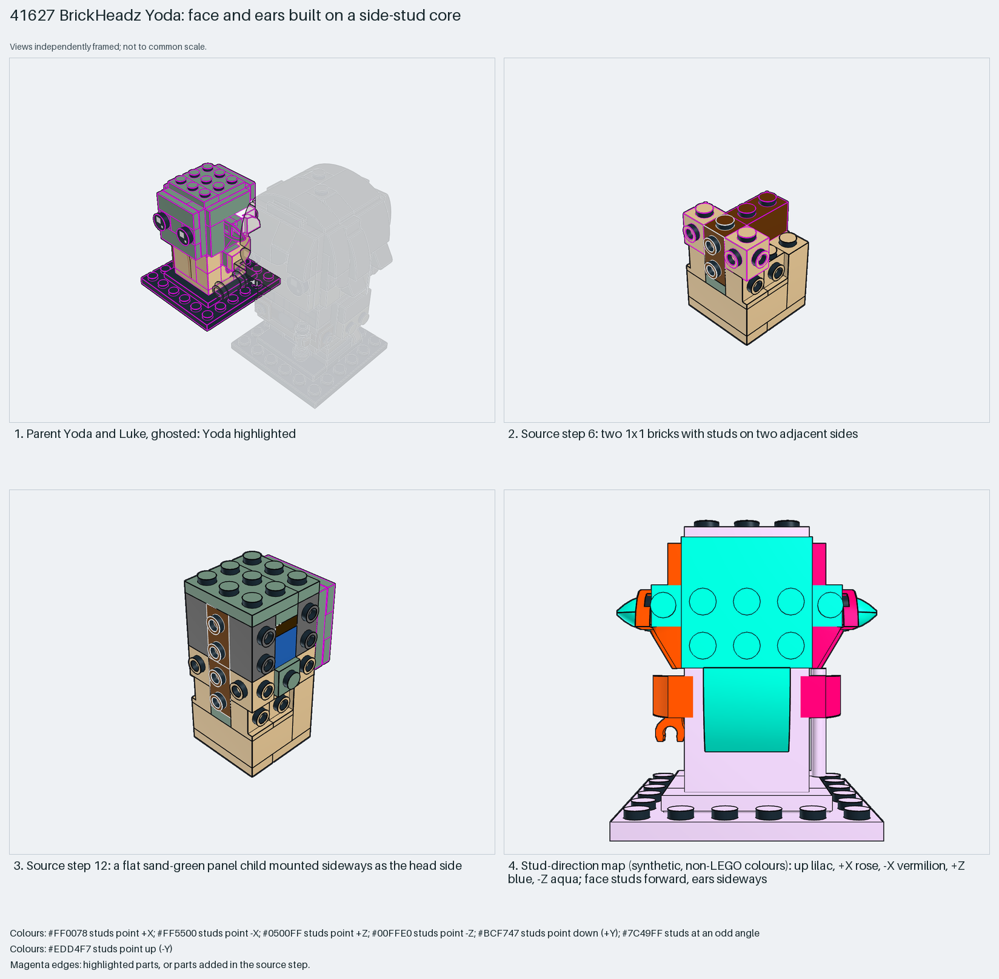

# BrickHeadz Yoda: face and ears on a side-stud core

BrickHeadz faces use a side-stud core plus flat panels built separately and turned.

Reusable source construction: source checks pass and the Python and LeoCAD BOMs match.

Character · 80 parts · 40 source steps in 7 sections

[Build pages](index.html) · [Inspection board](board/mosaic.png) · [Source](source.mpd) · [Editable plan](scene.plan.json) · [Checks](source-checks.json) · [Board provenance](board/board.json)



## Read the construction

80 parts in 24 steps plus six children. Steps 4 and 7: 1×1 headlight bricks. Step 6: 1×1 bricks with studs on two adjacent sides. Step 9: a core child inside the head. Step 12: a flat sand-green plate-and-tile child panel mounted sideways as the side of the head. Steps 15 and 18: the ear children. Steps 16 and 19: the hand children. Step 23: the 6×6 base plate.

Stud directions: 80 parts, 41 up, 12 −Z, 9 each +X, −X and +Z.

## What the parent supplies

- `41627 - Yoda and Luke Skywalker.ldr` places it at `-20 86 0`, matrix `-1 0 0 / 0 1 0 / 0 0 -1`.

Yoda in `41627 - Yoda and Luke Skywalker.ldr`, rotated 180° about Y.

Nothing beyond its placement.

## Description check

- **Database (accurate):** “Sand green and tan brick-built figure of Yoda wearing a tan Jedi robe with reddish brown details and black patterned eyes.”
- **What it is:** A brick-built Yoda figure.

## Read the board

Panel 1: the ghosted pair, Yoda highlighted. Panel 2: step 6, bricks with studs on two adjacent sides. Panel 3: step 12, the sideways panel child. Panel 4: the stud map from the front; face studs point forward and the ears sideways.

Magenta edges mark highlighted parts or the parts added in a source step. Pale grey, see-through parts are ghosted context. A neon-green rod (`#39FF14`) is a synthetic axis marker, not a part. Stud maps recolour each part by where its studs point: up lilac, +X rose, −X vermilion, +Z electric blue, −Z aqua, down lime, odd angle violet. These synthetic colours are ΔE ≥ 16 from every LDraw colour. LDraw −Y is up; LeoCAD `right` shows the model's right side, from −X.

Replay a board into `output/`:

    ./ldraw-xray board run examples/submodel-atlas/recipes/s05-41627-yoda.json --output output/boards/s05-41627-yoda

## Reuse it

Build each head side as a flat child and turn it; the face and side panels stay independent.

```sh
./ldraw-agent manual export examples/submodel-atlas/s05-41627-yoda --outdir output/my-s05-41627-yoda
./ldraw-agent build output/my-s05-41627-yoda/scene.plan.json --output output/my-s05-41627-yoda/s05-41627-yoda.mpd
```

Export needs a current visual review. Build the copied plan, then inspect its interfaces in the new model.

The placement plan preserves source axes. `source_origin` is a positioning frame, not a physical connector.

## Limits

Fit of the turned panels was not checked.

The source and renders teach a construction. They do not prove clutch, fit, clearance, travel or stability. Boards are rendered from synthetic inspection copies, and poses are rigid re-placements.

## Source and evidence

Source: `41627-1.mpd` / `41627 - Yoda.ldr`, SHA-256 `dcfc71b1af5915d498fdbe595eadd1ee4d1c4db49981e70288e0687bdee6203d`. Parent: `41627 - Yoda and Luke Skywalker.ldr`. Look it up with `./ldraw-agent discover show submodel-f99746e162a13bd5bad959ab`.

Original authors and licences stay in [source.mpd](source.mpd); [extraction.json](extraction.json) records renamed sections and 0 bounded preparation changes. Python and LeoCAD BOMs match. The visual review is recorded separately, after opening the actual images.
