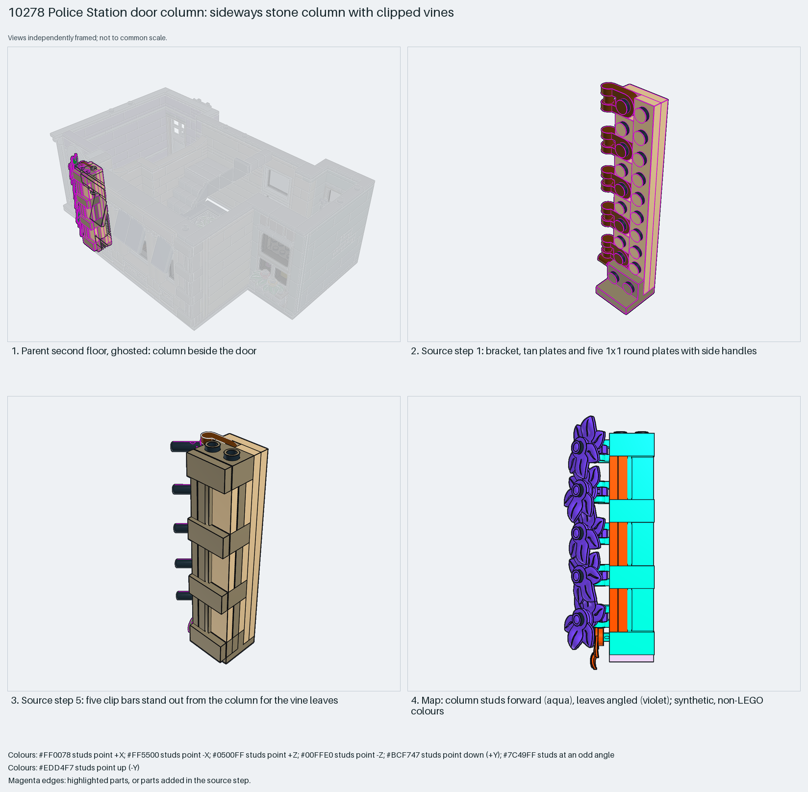

# Police Station door column: a sideways stone column with clipped vines

A stone-texture column built sideways, with vines hung on clip bars from handle plates.

Reusable source construction: source checks pass and the Python and LeoCAD BOMs match.

Building ornament · 53 parts · 8 source steps in 2 sections

[Build pages](index.html) · [Inspection board](board/mosaic.png) · [Source](source.mpd) · [Editable plan](scene.plan.json) · [Checks](source-checks.json) · [Board provenance](board/board.json)



## Read the construction

53 parts in 6 steps. Step 1: a bracket, tan plates and five 1×1 round plates with side handles. Step 2: three `doorcolumn3a` children. Step 3: dark-tan bricks, including a brick 1×2 with two studs on one side. Step 5: five 1.5L clip bars. Step 6: ten leaf plates.

Stud directions: 53 parts, 30 −Z, 7 −X, 15 angled, 1 up.

## What the parent supplies

- `10278 - 2ndfloor.ldr` places it at `-160 -108 -8`, matrix `1 0 0 / 0 1 0 / 0 0 1`.

Beside the door on `10278 - 2ndfloor.ldr`.

The door and the wall it frames.

## Description check

- **Database (accurate):** “A decorative door column with tan and dark tan plates, reddish brown handles, and green leaf vine decorations.”
- **What it is:** A decorative door column with vines.

## Read the board

Panel 1: the ghosted floor, column beside the door. Panel 2: step 1. Panel 3: step 5, clip bars. Panel 4: the stud map from the front; column studs face forward (aqua) and the leaves are angled (violet).

Magenta edges mark highlighted parts or the parts added in a source step. Pale grey, see-through parts are ghosted context. A neon-green rod (`#39FF14`) is a synthetic axis marker, not a part. Stud maps recolour each part by where its studs point: up lilac, +X rose, −X vermilion, +Z electric blue, −Z aqua, down lime, odd angle violet. These synthetic colours are ΔE ≥ 16 from every LDraw colour. LDraw −Y is up; LeoCAD `right` shows the model's right side, from −X.

Replay a board into `output/`:

    ./ldraw-xray board run examples/submodel-atlas/recipes/s06-10278-door-column.json --output output/boards/s06-10278-door-column

## Reuse it

Chain handle plate, clip bar and leaf plate to hang plants off any sideways wall.

```sh
./ldraw-agent manual export examples/submodel-atlas/s06-10278-door-column --outdir output/my-s06-10278-door-column
./ldraw-agent build output/my-s06-10278-door-column/scene.plan.json --output output/my-s06-10278-door-column/s06-10278-door-column.mpd
```

Export needs a current visual review. Build the copied plan, then inspect its interfaces in the new model.

The placement plan preserves source axes. `source_origin` is a positioning frame, not a physical connector.

## Limits

Clip retention of the vines was not checked.

The source and renders teach a construction. They do not prove clutch, fit, clearance, travel or stability. Boards are rendered from synthetic inspection copies, and poses are rigid re-placements.

## Source and evidence

Source: `10278-1.mpd` / `10278 - doorcolumn2f.ldr`, SHA-256 `708b1d2c15e25bc3a8a44986a2d2a00598ee8de4acd8c60465e8efad7ff33f84`. Parent: `10278 - 2ndfloor.ldr`. Look it up with `./ldraw-agent discover show submodel-cb88ac82923f5b7f537d6e6b`.

Original authors and licences stay in [source.mpd](source.mpd); [extraction.json](extraction.json) records renamed sections and 16 bounded preparation changes. Python and LeoCAD BOMs match. The visual review is recorded separately, after opening the actual images.
