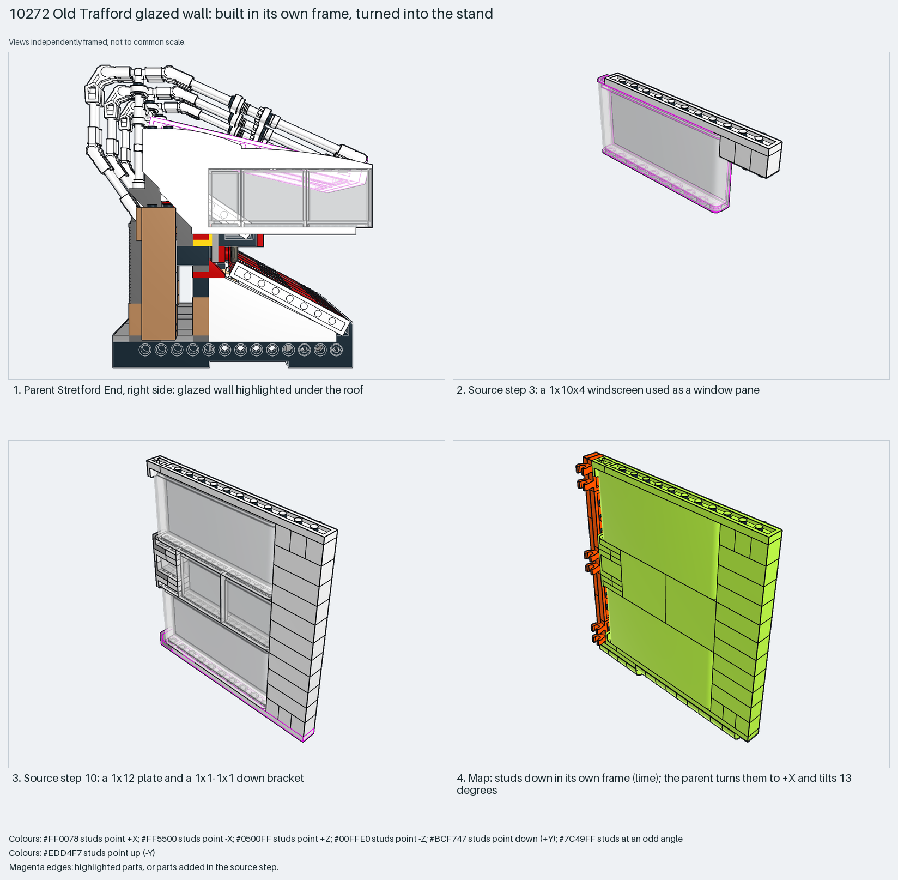

# Old Trafford glazed wall: built in its own frame, turned into the stand

Build in a convenient frame, then rotate. Here "studs down" is the builder's frame, not a physical upside-down build.

Reusable source construction: source checks pass and the Python and LeoCAD BOMs match.

Building glazing · 56 parts · 13 source steps in 1 section

[Build pages](index.html) · [Inspection board](board/mosaic.png) · [Source](source.mpd) · [Editable plan](scene.plan.json) · [Checks](source-checks.json) · [Board provenance](board/board.json)



## Read the construction

56 parts in 13 steps. Steps 3 and 9: 1×10×4 windscreens as panes. Steps 5–8: brackets, panels and 1×3 bricks. Step 10: a 1×12 plate and a 1×1–1×1 down bracket. Step 12: thirteen 1×1 curved-top bricks.

Stud directions in its own frame: 56 parts, 48 down, 8 −X. The parent matrix `0 1 0 / −0.229 0 0.973 / 0.973 0 0.229` turns "down" into +X and tilts the wall about 13°.

## What the parent supplies

- `10272 - stretford-end.ldr` places it at `0 -246 190`, matrix `0 1 0 / -0.229 0 0.973 / 0.973 0 0.229`.

A glazed window wall under the stand roof of `10272 - stretford-end.ldr`.

The turn and the 13° tilt.

## Description check

- **Database (misleading):** “Rooftop box with two trans-clear windscreens, white curved-top bricks and bracket-mounted detail.”
- **What it is:** A glazed window wall under the stand roof, not a rooftop box.

## Read the board

Panel 1: the parent from the right, wall highlighted under the roof. Panel 2: step 3, a windscreen as a pane. Panel 3: step 10. Panel 4: the stud map; studs face down (lime) in the wall's own frame.

Magenta edges mark highlighted parts or the parts added in a source step. Pale grey, see-through parts are ghosted context. A neon-green rod (`#39FF14`) is a synthetic axis marker, not a part. Stud maps recolour each part by where its studs point: up lilac, +X rose, −X vermilion, +Z electric blue, −Z aqua, down lime, odd angle violet. These synthetic colours are ΔE ≥ 16 from every LDraw colour. LDraw −Y is up; LeoCAD `right` shows the model's right side, from −X.

Replay a board into `output/`:

    ./ldraw-xray board run examples/submodel-atlas/recipes/s07-10272-rooftop-box.json --output output/boards/s07-10272-rooftop-box

## Reuse it

Choose the build frame that makes the panes easy to place, and let the parent matrix do the rest.

```sh
./ldraw-agent manual export examples/submodel-atlas/s07-10272-rooftop-box --outdir output/my-s07-10272-rooftop-box
./ldraw-agent build output/my-s07-10272-rooftop-box/scene.plan.json --output output/my-s07-10272-rooftop-box/s07-10272-rooftop-box.mpd
```

Export needs a current visual review. Build the copied plan, then inspect its interfaces in the new model.

The placement plan preserves source axes. `source_origin` is a positioning frame, not a physical connector.

## Limits

How the wall attaches to the stand was not checked.

The source and renders teach a construction. They do not prove clutch, fit, clearance, travel or stability. Boards are rendered from synthetic inspection copies, and poses are rigid re-placements.

## Source and evidence

Source: `10272-1.mpd` / `10272 - stretford-end-step186-198.ldr`, SHA-256 `aa866e738cc2403e316d8f3bcca85c722e779be0ecd4c3baabba872da26fe082`. Parent: `10272 - stretford-end.ldr`. Look it up with `./ldraw-agent discover show submodel-75b2ad5e6b9d1738d9e875a4`.

Original authors and licences stay in [source.mpd](source.mpd); [extraction.json](extraction.json) records renamed sections and 6 bounded preparation changes. Python and LeoCAD BOMs match. The visual review is recorded separately, after opening the actual images.
