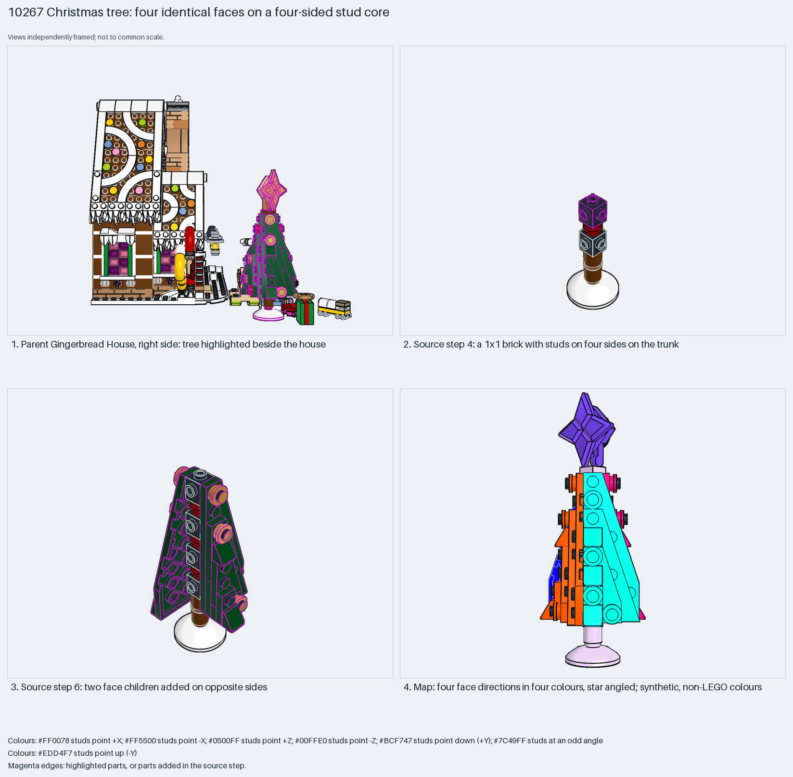

# Four-sided Christmas tree: identical faces on a four-sided stud core

A radial core with identical faces, for round or conical shapes.

Reusable source construction: source checks pass and the Python and LeoCAD BOMs match.

Round/conical · 70 parts · 20 source steps in 4 sections

[Build pages](index.html) · [Inspection board](board/mosaic.png) · [Source](source.mpd) · [Editable plan](scene.plan.json) · [Checks](source-checks.json) · [Board provenance](board/board.json)



## Read the construction

70 parts in 8 steps. Steps 3–5: 1×1 bricks with studs on four sides on the trunk. Step 6: two `christmas-tree-step6-10` face children on opposite sides. Step 7: two `christmas-tree-step11-16` children. Step 8: the star child.

Stud directions: 70 parts, 15 up; 11, 11, 12 and 12 on the four sides; 9 angled.

## What the parent supplies

- `10267 - main.ldr` places it at `-380 -16 -450`, matrix `1 0 0 / 0 1 0 / 0 0 1`.

Beside the Gingerbread House in `10267 - main.ldr`.

Only its place beside the house.

## Description check

- **Database (accurate):** “A small Christmas tree built from a brown bar trunk, round bricks as branches, black four-sided studs, and a white inverted dish base, decorated with red round plate ornaments.”
- **What it is:** A small Christmas tree on four-sided studs.

## Read the board

Panel 1: the parent from the right, tree highlighted. Panel 2: step 4, a brick with studs on four sides. Panel 3: step 6, two face children on opposite sides. Panel 4: the stud map; four face directions in four colours, and the star angled.

Magenta edges mark highlighted parts or the parts added in a source step. Pale grey, see-through parts are ghosted context. A neon-green rod (`#39FF14`) is a synthetic axis marker, not a part. Stud maps recolour each part by where its studs point: up lilac, +X rose, −X vermilion, +Z electric blue, −Z aqua, down lime, odd angle violet. These synthetic colours are ΔE ≥ 16 from every LDraw colour. LDraw −Y is up; LeoCAD `right` shows the model's right side, from −X.

Replay a board into `output/`:

    ./ldraw-xray board run examples/submodel-atlas/recipes/s08-10267-christmas-tree.json --output output/boards/s08-10267-christmas-tree

## Reuse it

Repeat one face child on each side of a four-sided stud core; change the face to change the silhouette.

```sh
./ldraw-agent manual export examples/submodel-atlas/s08-10267-christmas-tree --outdir output/my-s08-10267-christmas-tree
./ldraw-agent build output/my-s08-10267-christmas-tree/scene.plan.json --output output/my-s08-10267-christmas-tree/s08-10267-christmas-tree.mpd
```

Export needs a current visual review. Build the copied plan, then inspect its interfaces in the new model.

The placement plan preserves source axes. `source_origin` is a positioning frame, not a physical connector.

## Limits

This is a whole small object; it needs only a base stud in the new scene.

The source and renders teach a construction. They do not prove clutch, fit, clearance, travel or stability. Boards are rendered from synthetic inspection copies, and poses are rigid re-placements.

## Source and evidence

Source: `10267-1.mpd` / `10267 - christmas-tree.ldr`, SHA-256 `5b02847de56fb081daf87fb98c027055588a4d3da118f41a565082fd8a5fd773`. Parent: `10267 - main.ldr`. Look it up with `./ldraw-agent discover show submodel-44583d3e7ba511993378df63`.

Original authors and licences stay in [source.mpd](source.mpd); [extraction.json](extraction.json) records renamed sections and 5 bounded preparation changes. Python and LeoCAD BOMs match. The visual review is recorded separately, after opening the actual images.
