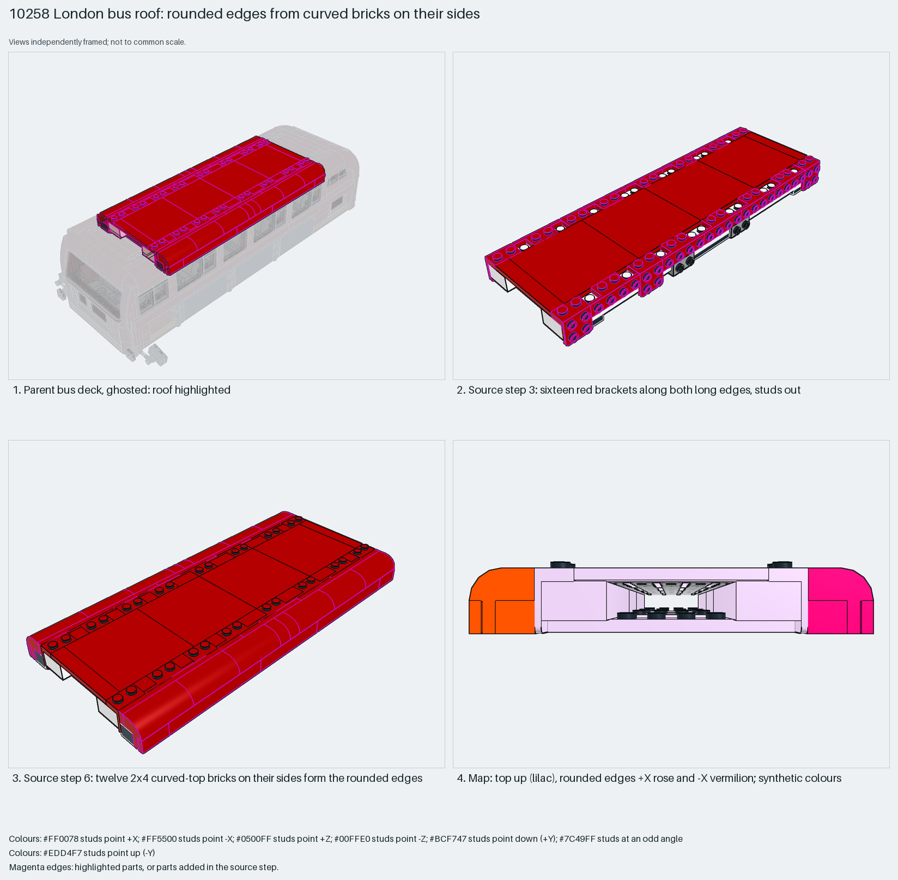

# London bus roof: rounded edges from curved bricks on their sides

Rounded vehicle body edges from curved-top bricks laid on their sides on brackets.

Reusable source construction: source checks pass and the Python and LeoCAD BOMs match.

Vehicle body · 93 parts · 7 source steps in 1 section

[Build pages](index.html) · [Inspection board](board/mosaic.png) · [Source](source.mpd) · [Editable plan](scene.plan.json) · [Checks](source-checks.json) · [Board provenance](board/board.json)



## Read the construction

93 parts in 7 steps. Step 1: four 1×2–1×2 brackets. Step 3: sixteen brackets along both long edges, studs out. Step 6: twelve 2×4 and four 2×1 curved-top bricks laid on their sides form the rounded long edges, with plates and tiles.

Stud directions: 93 parts, 53 up, 20 +X, 20 −X.

## What the parent supplies

- `10258 - deck.ldr` places it at `0 -160 240`, matrix `1 0 0 / 0 1 0 / 0 0 1`.

The roof on `10258 - deck.ldr`.

The upper deck it sits on.

## Description check

- **Database (accurate):** “The main upper roof of the bus, built from large white and red plates, black bricks, curved top bricks and numerous red tiles and brackets forming the domed roof surface.”
- **What it is:** The bus's main upper roof with a domed surface.

## Read the board

Panel 1: the ghosted deck, roof highlighted. Panel 2: step 3, sixteen brackets, studs out. Panel 3: step 6, curved-top bricks on their sides. Panel 4: the stud map; the top faces up (lilac), and the rounded edges face +X (rose) and −X (vermilion).

Magenta edges mark highlighted parts or the parts added in a source step. Pale grey, see-through parts are ghosted context. A neon-green rod (`#39FF14`) is a synthetic axis marker, not a part. Stud maps recolour each part by where its studs point: up lilac, +X rose, −X vermilion, +Z electric blue, −Z aqua, down lime, odd angle violet. These synthetic colours are ΔE ≥ 16 from every LDraw colour. LDraw −Y is up; LeoCAD `right` shows the model's right side, from −X.

Replay a board into `output/`:

    ./ldraw-xray board run examples/submodel-atlas/recipes/s09-10258-bus-roof.json --output output/boards/s09-10258-bus-roof

## Reuse it

Use it for any long rounded body edge: buses, trains or vans.

```sh
./ldraw-agent manual export examples/submodel-atlas/s09-10258-bus-roof --outdir output/my-s09-10258-bus-roof
./ldraw-agent build output/my-s09-10258-bus-roof/scene.plan.json --output output/my-s09-10258-bus-roof/s09-10258-bus-roof.mpd
```

Export needs a current visual review. Build the copied plan, then inspect its interfaces in the new model.

The placement plan preserves source axes. `source_origin` is a positioning frame, not a physical connector.

## Limits

How the roof clamps to the deck was not checked.

The source and renders teach a construction. They do not prove clutch, fit, clearance, travel or stability. Boards are rendered from synthetic inspection copies, and poses are rigid re-placements.

## Source and evidence

Source: `10258-1.mpd` / `10258 - roof.ldr`, SHA-256 `160ecddf6c38a4e0b0b8ff97c473c5c7f50f44adc1b787d02cc76d207ff47de0`. Parent: `10258 - deck.ldr`. Look it up with `./ldraw-agent discover show submodel-0e8b70cbc8b2a5d950350bf1`.

Original authors and licences stay in [source.mpd](source.mpd); [extraction.json](extraction.json) records renamed sections and 0 bounded preparation changes. Python and LeoCAD BOMs match. The visual review is recorded separately, after opening the actual images.
