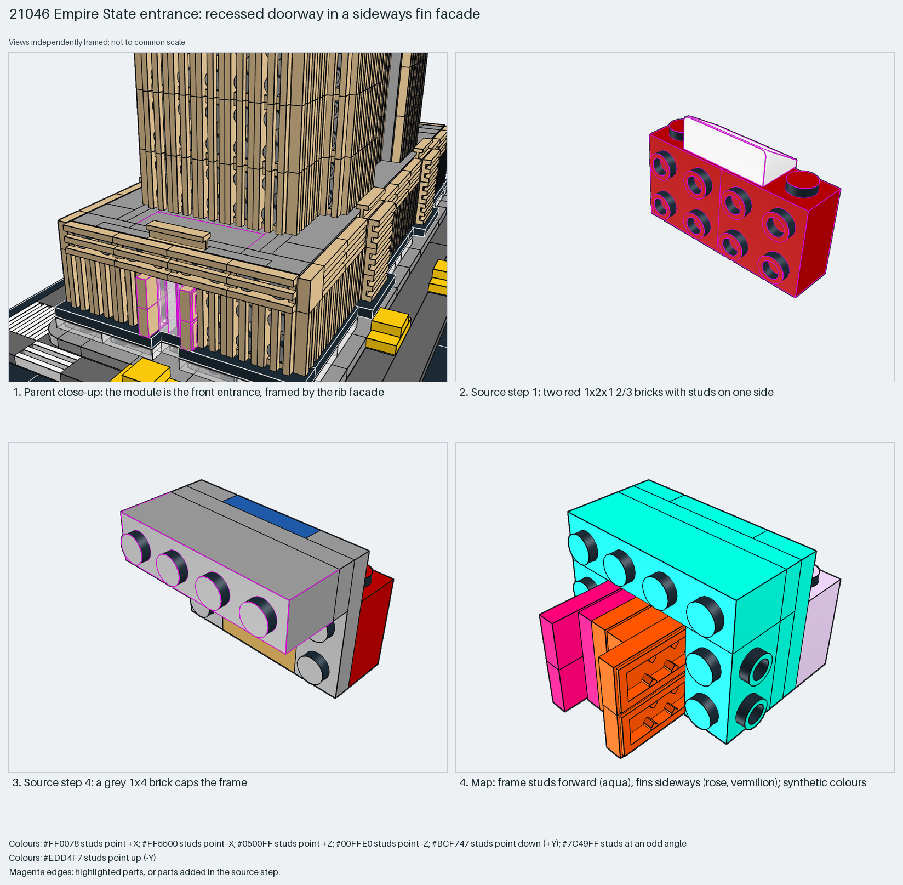

# Empire State entrance: a recessed doorway in a sideways fin facade

A doorway recessed into a sideways rib facade.

Reusable source construction: source checks pass and the Python and LeoCAD BOMs match.

Building facade · 24 parts · 14 source steps in 3 sections

[Build pages](index.html) · [Inspection board](board/mosaic.png) · [Source](source.mpd) · [Editable plan](scene.plan.json) · [Checks](source-checks.json) · [Board provenance](board/board.json)



## Read the construction

24 parts in 6 steps. Step 1: two red bricks 1×2×1⅔ with studs on one side. Step 4: a grey 1×4 brick caps the frame. Steps 5–6: children `step53` and `step54`, each a brick with studs on sides and two offset plates.

Stud directions: 24 parts, 11 −Z, 5 +X, 5 −X, 3 up. The parent places it twice, at the front and back entrances (rotated 180°, z = ±130).

## What the parent supplies

- `21046 - main.ldr` places it at `0 -80 -130`, matrix `1 0 0 / 0 1 0 / 0 0 1`.
- `21046 - main.ldr` places it at `0 -80 130`, matrix `-1 0 0 / 0 1 0 / 0 0 -1`.

The front and back entrances of `21046 - main.ldr`.

The rib facade around the doorway.

## Description check

- **Database (vague):** “Sculpted corner section with white slope, red side-stud bricks, and pearl gold groove tiles forming decorative detailing.”
- **What it is:** The front entrance, a recessed clear doorway framed by tan fins; not just a sculpted corner.

## Read the board

Panel 1: a parent close-up, module highlighted as the entrance. Panel 2: step 1, two red side-stud bricks. Panel 3: step 4, a 1×4 brick caps the frame. Panel 4: the stud map; the frame faces forward (aqua) and the fins sideways (rose, vermilion).

Magenta edges mark highlighted parts or the parts added in a source step. Pale grey, see-through parts are ghosted context. A neon-green rod (`#39FF14`) is a synthetic axis marker, not a part. Stud maps recolour each part by where its studs point: up lilac, +X rose, −X vermilion, +Z electric blue, −Z aqua, down lime, odd angle violet. These synthetic colours are ΔE ≥ 16 from every LDraw colour. LDraw −Y is up; LeoCAD `right` shows the model's right side, from −X.

Replay a board into `output/`:

    ./ldraw-xray board run examples/submodel-atlas/recipes/s10-21046-empire-corner.json --output output/boards/s10-21046-empire-corner

## Reuse it

Reuse it as a repeated entrance module: one definition, placed once per doorway.

```sh
./ldraw-agent manual export examples/submodel-atlas/s10-21046-empire-corner --outdir output/my-s10-21046-empire-corner
./ldraw-agent build output/my-s10-21046-empire-corner/scene.plan.json --output output/my-s10-21046-empire-corner/s10-21046-empire-corner.mpd
```

Export needs a current visual review. Build the copied plan, then inspect its interfaces in the new model.

The placement plan preserves source axes. `source_origin` is a positioning frame, not a physical connector.

## Limits

The micro-scale facade fit was not checked.

The source and renders teach a construction. They do not prove clutch, fit, clearance, travel or stability. Boards are rendered from synthetic inspection copies, and poses are rigid re-placements.

## Source and evidence

Source: `21046-1.mpd` / `21046 - step49-55.ldr`, SHA-256 `cd8131b740b424668ae6fd447d4069bfb3c58e0db8f4968b265acc83d55f68c5`. Parent: `21046 - main.ldr`. Look it up with `./ldraw-agent discover show submodel-c9fe6396e060da9ef1fd0067`.

Original authors and licences stay in [source.mpd](source.mpd); [extraction.json](extraction.json) records renamed sections and 0 bounded preparation changes. Python and LeoCAD BOMs match. The visual review is recorded separately, after opening the actual images.
