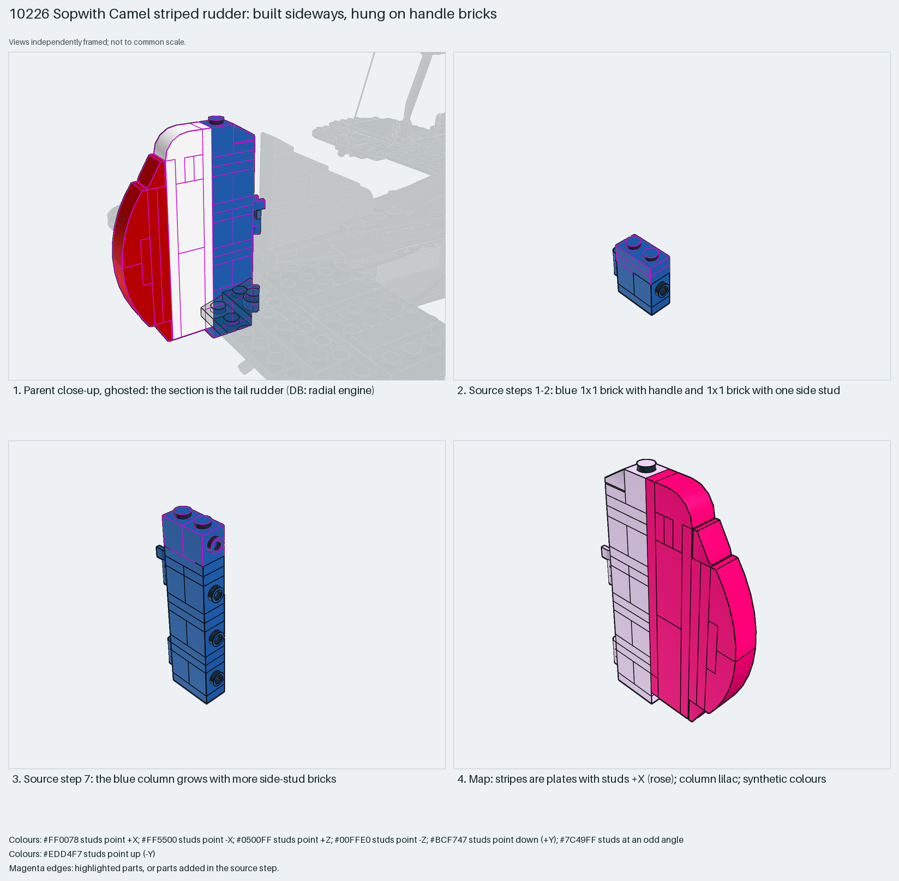

# Sopwith Camel striped rudder: built sideways, hung on handle bricks

A flat, striped control surface built sideways, with a handle as the hinge point.

Reusable source construction: source checks pass and the Python and LeoCAD BOMs match.

Aircraft control surface · 36 parts · 9 source steps in 1 section

[Build pages](index.html) · [Inspection board](board/mosaic.png) · [Source](source.mpd) · [Editable plan](scene.plan.json) · [Checks](source-checks.json) · [Board provenance](board/board.json)



## Read the construction

36 parts in 9 steps. Steps 1–8: a blue column of 1×1 bricks with one side stud, plus 1×1 bricks with a handle (steps 1 and 5) and a vertical clip plate (step 6). Step 9: white and red plates and curved slopes on the side studs form the stripes and the rounded trailing edge.

Stud directions: 36 parts, 21 up, 15 +X. The handles meet clips on the fin.

## What the parent supplies

- `10226 - main.ldr` places it at `610 -156 0`, matrix `1 0 0 / 0 1 0 / 0 0 1`.

The tail rudder behind the fin of `10226 - main.ldr`. Measured: the section is at x = +610, near the tail (x up to 740); the propeller is at x = −270.

The fin and its clips.

## Description check

- **Database (wrong):** “Radial-engine cylinder bank: blue handle and stud-on-side bricks around white and red plates and slopes”
- **What it is:** The blue/white/red striped tail rudder, not a radial-engine cylinder bank.

## Read the board

Panel 1: a ghosted parent close-up, the rudder highlighted. Panel 2: steps 1–2, a handle brick and a side-stud brick. Panel 3: step 7, the column grows. Panel 4: the stud map; the stripes are plates facing +X (rose).

Magenta edges mark highlighted parts or the parts added in a source step. Pale grey, see-through parts are ghosted context. A neon-green rod (`#39FF14`) is a synthetic axis marker, not a part. Stud maps recolour each part by where its studs point: up lilac, +X rose, −X vermilion, +Z electric blue, −Z aqua, down lime, odd angle violet. These synthetic colours are ΔE ≥ 16 from every LDraw colour. LDraw −Y is up; LeoCAD `right` shows the model's right side, from −X.

Replay a board into `output/`:

    ./ldraw-xray board run examples/submodel-atlas/recipes/s11-10226-radial-engine.json --output output/boards/s11-10226-radial-engine

## Reuse it

Use it for any striped flap, rudder or flag: build the stripes as plates on side studs, and hinge the column on handles.

```sh
./ldraw-agent manual export examples/submodel-atlas/s11-10226-radial-engine --outdir output/my-s11-10226-radial-engine
./ldraw-agent build output/my-s11-10226-radial-engine/scene.plan.json --output output/my-s11-10226-radial-engine/s11-10226-radial-engine.mpd
```

Export needs a current visual review. Build the copied plan, then inspect its interfaces in the new model.

The placement plan preserves source axes. `source_origin` is a positioning frame, not a physical connector.

## Limits

The handle-to-clip hinge is inferred from part roles; it was not checked.

The source and renders teach a construction. They do not prove clutch, fit, clearance, travel or stability. Boards are rendered from synthetic inspection copies, and poses are rigid re-placements.

## Source and evidence

Source: `10226-1.mpd` / `10226 - step66.ldr`, SHA-256 `2903c00bd3f1e0af46d47af2e09bd8ccb423eced0588947cc0fb9bd14ac20511`. Parent: `10226 - main.ldr`. Look it up with `./ldraw-agent discover show submodel-3e4279cf9c65b65522d96cd5`.

Original authors and licences stay in [source.mpd](source.mpd); [extraction.json](extraction.json) records renamed sections and 0 bounded preparation changes. Python and LeoCAD BOMs match. The visual review is recorded separately, after opening the actual images.
