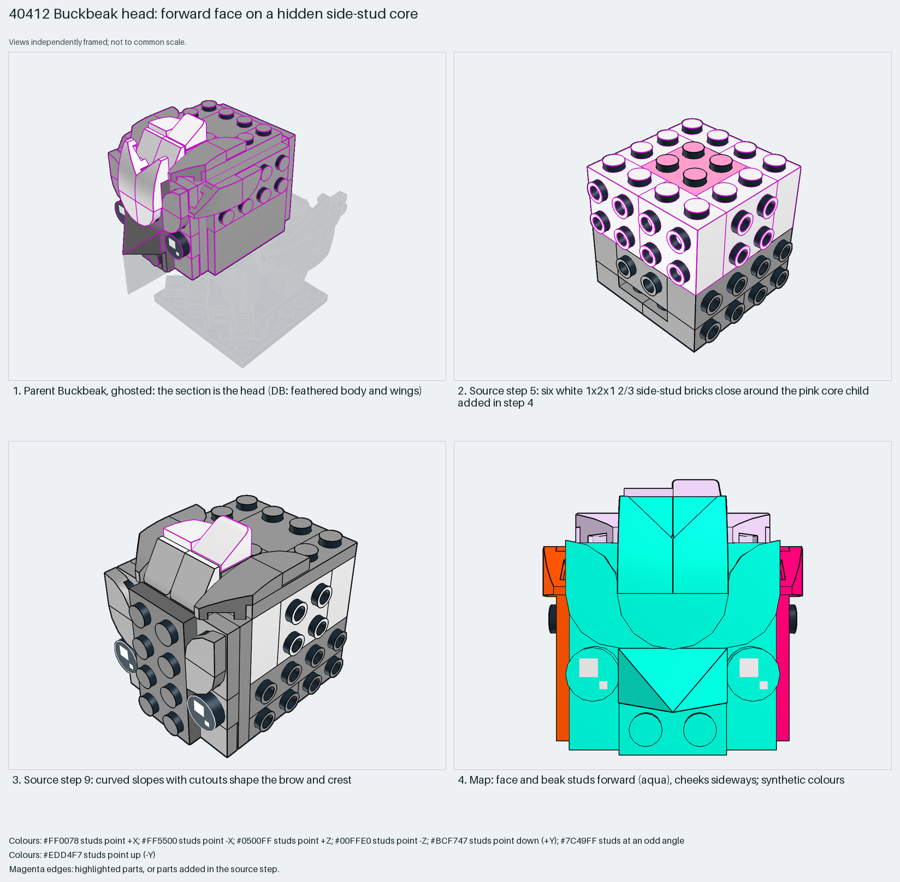

# Buckbeak head: a studs-forward face on a hidden colour-coded core

An animal face built studs-forward on a hidden core.

Reusable source construction: source checks pass and the Python and LeoCAD BOMs match.

Animal head · 59 parts · 23 source steps in 4 sections

[Build pages](index.html) · [Inspection board](board/mosaic.png) · [Source](source.mpd) · [Editable plan](scene.plan.json) · [Checks](source-checks.json) · [Board provenance](board/board.json)



## Read the construction

59 parts in source steps 2–16 (step 1 holds only a commented-out line). Steps 2–3: side-stud plates and bricks. Step 4: a colour-coded pink-and-green core child (`Step 18`). Step 5: six white 1×2×1⅔ side-stud bricks close around it. Steps 8–15: curved slopes with left and right cutouts and 1×1 corner-round tiles shape the brow and crest. Steps 7 and 16: children `Steps 21 to 25` and `Step 34`.

Stud directions: 59 parts, 28 up, 20 −Z (face forward), 4 each ±X, 3 +Z.

## What the parent supplies

- `40412 - Buckbeak.ldr` places it at `0 -106 -40`, matrix `1 0 0 / 0 1 0 / 0 0 1`.

The head of `40412 - Buckbeak.ldr`.

The neck and body it sits on.

## Description check

- **Database (wrong):** “The feathered body and wing assembly using studs-on-side bricks and curved slope pieces in light bluish grey and white.”
- **What it is:** The head, with eyes and a white beak; not the feathered body and wings.

## Read the board

Panel 1: the ghosted Buckbeak, head highlighted. Panel 2: step 5, white side-stud bricks around the pink core from step 4. Panel 3: step 9, curved slopes shape the brow. Panel 4: the stud map; face and beak studs face forward (aqua), cheeks sideways.

Magenta edges mark highlighted parts or the parts added in a source step. Pale grey, see-through parts are ghosted context. A neon-green rod (`#39FF14`) is a synthetic axis marker, not a part. Stud maps recolour each part by where its studs point: up lilac, +X rose, −X vermilion, +Z electric blue, −Z aqua, down lime, odd angle violet. These synthetic colours are ΔE ≥ 16 from every LDraw colour. LDraw −Y is up; LeoCAD `right` shows the model's right side, from −X.

Replay a board into `output/`:

    ./ldraw-xray board run examples/submodel-atlas/recipes/s13-40412-buckbeak-body.json --output output/boards/s13-40412-buckbeak-body

## Reuse it

Build the core in a contrasting colour, then cover it with forward-facing face parts.

```sh
./ldraw-agent manual export examples/submodel-atlas/s13-40412-buckbeak-body --outdir output/my-s13-40412-buckbeak-body
./ldraw-agent build output/my-s13-40412-buckbeak-body/scene.plan.json --output output/my-s13-40412-buckbeak-body/s13-40412-buckbeak-body.mpd
```

Export needs a current visual review. Build the copied plan, then inspect its interfaces in the new model.

The placement plan preserves source axes. `source_origin` is a positioning frame, not a physical connector.

## Limits

How the head mounts on the neck was not checked.

The source and renders teach a construction. They do not prove clutch, fit, clearance, travel or stability. Boards are rendered from synthetic inspection copies, and poses are rigid re-placements.

## Source and evidence

Source: `40412-1.mpd` / `40412 - Buckbeak - Steps 15 to 35.ldr`, SHA-256 `6c82cd637cf6def17916abbfb3425836c4cf62549e51668ad9212203d50a56ad`. Parent: `40412 - Buckbeak.ldr`. Look it up with `./ldraw-agent discover show submodel-18190769ba014d9a57d4b720`.

Original authors and licences stay in [source.mpd](source.mpd); [extraction.json](extraction.json) records renamed sections and 0 bounded preparation changes. Python and LeoCAD BOMs match. The visual review is recorded separately, after opening the actual images.
