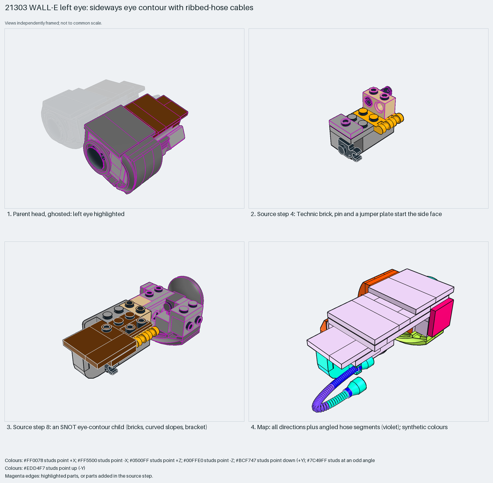

# WALL-E left eye: mixed-direction SNOT with ribbed-hose cables

The densest mixed-direction SNOT in the set, with flexible parts as decoration.

Inspiration study: the source keeps errors (`assembly.nonrigid` ×49). Study the technique and rebuild it; `manual export` is blocked.

Robot character · 119 parts · 23 source steps in 5 sections

[Build pages](index.html) · [Inspection board](board/mosaic.png) · [Source](source.mpd) · [Editable plan](scene.plan.json) · [Checks](source-checks.json) · [Board provenance](board/board.json)

## Read the construction

119 parts in 15 steps plus children. Step 1: a 2×3 brick and handle plates. Step 4: a Technic brick, a pin and a jumper plate. Step 8: the `Oeil Gauche detail` child (SNOT bricks, curved slopes, wedge cutout, bracket) shapes the eye contour. Step 11: dark tiles close the top. Steps 14–15: the `Oeil detail b` and `Cable` children; the cable is ribbed-hose segments.

Stud directions: 119 parts in every direction: 33 up, 21 −X, 19 −Z, 19 +Z, 5 down, 21 angled. The angled ones are mostly ribbed-hose segments. The parent rotates it 180° and tilts it 10°.

## What the parent supplies

- `21303 - Tete A.ldr` places it at `68.501 -2.88 10`, matrix `-0.984808 -0.173648 0 / -0.173648 0.984808 0 / 0 0 -1`.

The left eye of WALL-E's head (`21303 - Tete A.ldr`).

The head and the opposite eye.

## Description check

- **Database (accurate):** “Left eye assembly with bricks, plates, clips, a headlight brick, and reddish brown slope elements forming the eye housing.”
- **What it is:** The left eye assembly.

## Read the board

Panel 1: the ghosted head, left eye highlighted. Panel 2: step 4, Technic brick, pin and jumper plate. Panel 3: step 8, the eye-contour child. Panel 4: the stud map, with every direction plus angled hose segments (violet).

Magenta edges mark highlighted parts or the parts added in a source step. Pale grey, see-through parts are ghosted context. A neon-green rod (`#39FF14`) is a synthetic axis marker, not a part. Stud maps recolour each part by where its studs point: up lilac, +X rose, −X vermilion, +Z electric blue, −Z aqua, down lime, odd angle violet. These synthetic colours are ΔE ≥ 16 from every LDraw colour. LDraw −Y is up; LeoCAD `right` shows the model's right side, from −X.

Replay a board into `output/`:

    ./ldraw-xray board run examples/submodel-atlas/recipes/s14-21303-walle-eye.json --output output/boards/s14-21303-walle-eye

## Reuse it

Study how sideways faces combine in one small volume. Rebuild hose cables with LSynth rather than copying the segments.

Rebuild the technique with the new model's own parts and interfaces; the source errors above stay in this copy.

The placement plan preserves source axes. `source_origin` is a positioning frame, not a physical connector.

## Limits

Inspiration only: the `21303 - Cable.ldr` child places 49 ribbed-hose segments (`755`, `756`) with mirrored matrices, which fail the source checks (`assembly.nonrigid`). The rest of the eye raised no errors.

The source and renders teach a construction. They do not prove clutch, fit, clearance, travel or stability. Boards are rendered from synthetic inspection copies, and poses are rigid re-placements.

## Source and evidence

Source: `21303-1.mpd` / `21303 - Oeil gauche.ldr`, SHA-256 `c33e5baf1157dd1b68229942103de5c4ee70c46053b66033bb029b007073107b`. Parent: `21303 - Tete A.ldr`. Look it up with `./ldraw-agent discover show submodel-f9588bce11b3bf9a81c860b0`.

Original authors and licences stay in [source.mpd](source.mpd); [extraction.json](extraction.json) records renamed sections and 0 bounded preparation changes. Python and LeoCAD BOMs match. The visual review is recorded separately, after opening the actual images.
