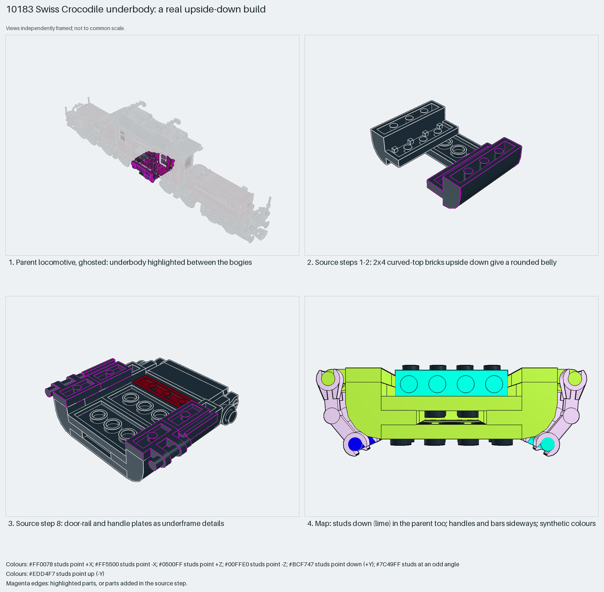

# Swiss Crocodile underbody: a real upside-down build

Inverted curved-top bricks give a rounded belly; the studs point down in the locomotive too.

Inspiration study: the source keeps errors (`assembly.nonrigid` ×4). Study the technique and rebuild it; `manual export` is blocked.

Train underbody · 28 parts · 10 source steps in 1 section

[Build pages](index.html) · [Inspection board](board/mosaic.png) · [Source](source.mpd) · [Editable plan](scene.plan.json) · [Checks](source-checks.json) · [Board provenance](board/board.json)

## Read the construction

28 parts in 10 steps. Steps 1–2: 2×4 curved-top bricks upside down give a rounded belly. Steps 3–7: plates, a bracket and clip plates. Step 8: door-rail and handle plates as underframe details. Step 9: mechanical arms and bars as pipes. Step 10: bricks with studs on sides.

Stud directions: 28 parts, 14 down; the rest are sideways handles and bars. The parent rotates it 90° about Y only.

## What the parent supplies

- `10183 - 1 - Swiss crocodile.ldr` places it at `-20 44 0`, matrix `0 0 -1 / 0 1 0 / 1 0 0`.

The underbody between the bogies of `10183 - 1 - Swiss crocodile.ldr`.

The locomotive body it hangs under.

## Description check

- **Database (accurate):** “Underbody detail: plates, brackets, curved bricks, door rails, handles, mechanical arms and bars representing pipes and linkages”
- **What it is:** Underbody detail with curved bricks, rails and handles.

## Read the board

Panel 1: the ghosted locomotive, underbody between the bogies. Panel 2: steps 1–2, curved-top bricks upside down. Panel 3: step 8, rail and handle plates. Panel 4: the stud map; studs face down (lime) in the parent too.

Magenta edges mark highlighted parts or the parts added in a source step. Pale grey, see-through parts are ghosted context. A neon-green rod (`#39FF14`) is a synthetic axis marker, not a part. Stud maps recolour each part by where its studs point: up lilac, +X rose, −X vermilion, +Z electric blue, −Z aqua, down lime, odd angle violet. These synthetic colours are ΔE ≥ 16 from every LDraw colour. LDraw −Y is up; LeoCAD `right` shows the model's right side, from −X.

Replay a board into `output/`:

    ./ldraw-xray board run examples/submodel-atlas/recipes/s15-10183-underbody.json --output output/boards/s15-10183-underbody

## Reuse it

Compare it with s07: there "down" was only the builder's frame; here the build is really upside down. Rebuild it with clean matrices before reuse.

Rebuild the technique with the new model's own parts and interfaces; the source errors above stay in this copy.

The placement plan preserves source axes. `source_origin` is a positioning frame, not a physical connector.

## Limits

Inspiration only: four `30377` mechanical-arm matrices deviate by 0.0076 from a rotation, above the 0.002 normalisation limit (`assembly.nonrigid`). How the inverted section attaches above was not checked.

The source and renders teach a construction. They do not prove clutch, fit, clearance, travel or stability. Boards are rendered from synthetic inspection copies, and poses are rigid re-placements.

## Source and evidence

Source: `10183-1.mpd` / `10183 - 1 - underside details.ldr`, SHA-256 `6e8be34eece2b74cfec73957749f3301a217203366ee586a49b86d7588f55177`. Parent: `10183 - 1 - Swiss crocodile.ldr`. Look it up with `./ldraw-agent discover show submodel-ba9bb083e3b37056da4fe252`.

Original authors and licences stay in [source.mpd](source.mpd); [extraction.json](extraction.json) records renamed sections and 0 bounded preparation changes. Python and LeoCAD BOMs match. The visual review is recorded separately, after opening the actual images.
