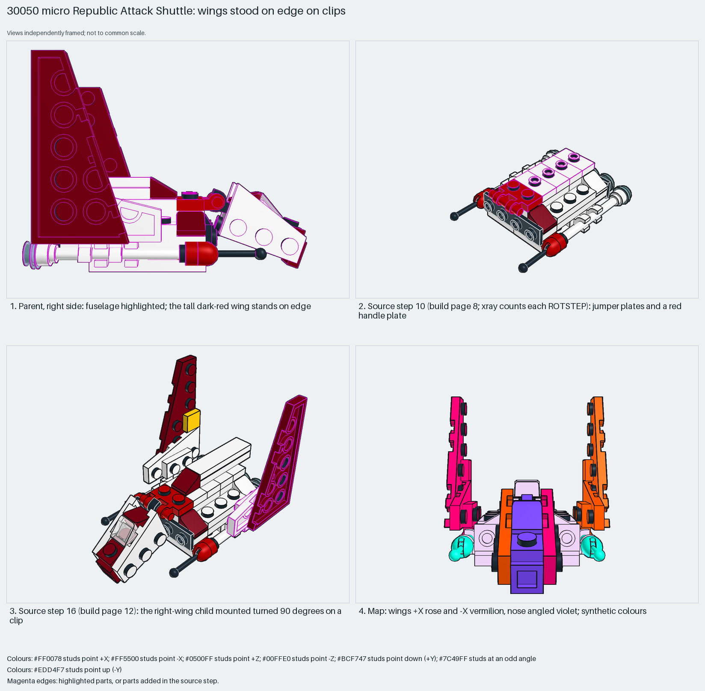

# Micro Republic Attack Shuttle: wings stood on edge on clips

Micro-scale SNOT: a wing child stands on edge, turned 90° about Z on a clip.

Reusable source construction: source checks pass and the Python and LeoCAD BOMs match.

Micro spaceship · 56 parts · 22 source steps in 4 sections

[Build pages](index.html) · [Inspection board](board/mosaic.png) · [Source](source.mpd) · [Editable plan](scene.plan.json) · [Checks](source-checks.json) · [Board provenance](board/board.json)



## Read the construction

56 parts in 12 steps plus three children. Steps 1–7: plates, clip plates, antennas, brackets and slopes. Step 8: jumper plates and a red handle plate. Steps 10–11: children `m-1a` and `m-1b`. Step 12: the right-wing child `m-1c`, a dark red 3×6 wing on a clip plate, mounted turned 90° about Z so the wing stands on edge.

Stud directions: 56 parts, 28 up, 8 −Z, 5 each ±X, 4 +Z, 6 angled. The parent uses the identity matrix; the section is almost the whole model.

## What the parent supplies

- `30050 - Republic Attack Shuttle.ldr` places it at `0 0 0`, matrix `1 0 0 / 0 1 0 / 0 0 1`.

The fuselage of `30050 - Republic Attack Shuttle.ldr`.

Little: the section is almost the whole model.

## Description check

- **Database (accurate):** “Central fuselage body built from white plates and slopes with trans light-blue accents, red and white clip-light and hinge mechanisms, and dual white antennas.”
- **What it is:** The central fuselage with clip and hinge mechanisms.

## Read the board

Panel 1: the parent from the right, fuselage highlighted; the tall wing stands on edge. Panel 2: board step 10, which is build-page step 8. Panel 3: board step 16, which is build-page step 12, the wing child on its clip. Panel 4: the stud map; wings face +X (rose) and −X (vermilion), the nose is angled (violet). The board counts each `0 ROTSTEP` as a step, as LeoCAD does; the build pages fold a `0 STEP` followed by `0 ROTSTEP` into one step.

Magenta edges mark highlighted parts or the parts added in a source step. Pale grey, see-through parts are ghosted context. A neon-green rod (`#39FF14`) is a synthetic axis marker, not a part. Stud maps recolour each part by where its studs point: up lilac, +X rose, −X vermilion, +Z electric blue, −Z aqua, down lime, odd angle violet. These synthetic colours are ΔE ≥ 16 from every LDraw colour. LDraw −Y is up; LeoCAD `right` shows the model's right side, from −X.

Replay a board into `output/`:

    ./ldraw-xray board run examples/submodel-atlas/recipes/s16-30050-shuttle-fuselage.json --output output/boards/s16-30050-shuttle-fuselage

## Reuse it

Stand thin wings on edge with a clip on a handle; it keeps a micro model's wings thin.

```sh
./ldraw-agent manual export examples/submodel-atlas/s16-30050-shuttle-fuselage --outdir output/my-s16-30050-shuttle-fuselage
./ldraw-agent build output/my-s16-30050-shuttle-fuselage/scene.plan.json --output output/my-s16-30050-shuttle-fuselage/s16-30050-shuttle-fuselage.mpd
```

Export needs a current visual review. Build the copied plan, then inspect its interfaces in the new model.

The placement plan preserves source axes. `source_origin` is a positioning frame, not a physical connector.

## Limits

Clip retention was not checked.

The source and renders teach a construction. They do not prove clutch, fit, clearance, travel or stability. Boards are rendered from synthetic inspection copies, and poses are rigid re-placements.

## Source and evidence

Source: `30050-1.mpd` / `30050 - m-1.ldr`, SHA-256 `76661f19abe3250f0e0c5f2ff443590926f1a76df3da2e00f227db7426682d01`. Parent: `30050 - Republic Attack Shuttle.ldr`. Look it up with `./ldraw-agent discover show submodel-b97eb0cff7bc8fc4f8507bbe`.

Original authors and licences stay in [source.mpd](source.mpd); [extraction.json](extraction.json) records renamed sections and 0 bounded preparation changes. Python and LeoCAD BOMs match. The visual review is recorded separately, after opening the actual images.
