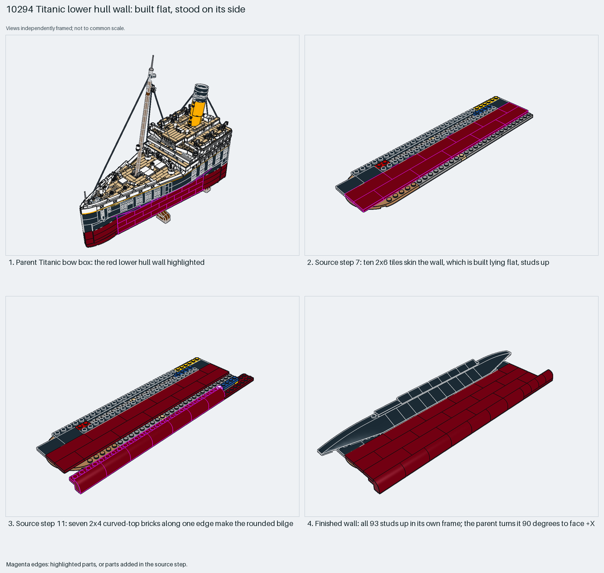

# Titanic lower hull wall: built flat, stood on its side

A ship's hull side is built as a flat plate-and-tile panel, then stood on its side. The panel's top becomes the hull's outside.

Reusable source construction: source checks pass and the Python and LeoCAD BOMs match.

Ship hull · 93 parts · 15 source steps in 1 section

[Build pages](index.html) · [Inspection board](board/mosaic.png) · [Source](source.mpd) · [Editable plan](scene.plan.json) · [Checks](source-checks.json) · [Board provenance](board/board.json)



## Read the construction

93 parts in 15 steps. Steps 1–10: a stack of 8×8, 1×12 and other plates. Step 7: ten 2×6 dark-red tiles form the outer skin. Step 11: seven 2×4×1⅓ curved-top bricks along one edge make the rounded bilge. Step 13: black 33° slopes and two 10×3 double-rounded wedges along the other edge. Step 14: three 4×6 trap-door plates with bars.

All 93 parts point up in the section's own frame. The parent matrix `0 −0.986 0.164 / 1 0 0 / 0 0.164 0.986` turns the studs to +X and angles the wall 9.4° in plan to follow the hull's taper. The mirror section `2.11.2` is placed studs −X on the other side.

## What the parent supplies

- `10294 - Titanic - Box 1.ldr` places it at `75.052 -22 -140.391`, matrix `0 -0.986 0.164 / 1 0 0 / 0 0.164 0.986`.

The red lower hull wall of the bow box (`10294 - Titanic - Box 1.ldr`).

The turn onto its side and the 9.4° taper.

## Description check

- **Database (vague):** “Large structural deck section built from multicolored plates and dark-red tiles forming a section of the ship's hull or deck plating.”
- **What it is:** A lower hull wall built flat and stood on its side; not deck plating.

## Read the board

Panel 1: the parent bow box, the red wall highlighted. Panel 2: step 7, tiles skin the wall, built lying flat. Panel 3: step 11, curved-top bricks make the bilge. Panel 4: the finished wall; all 93 studs face up in its own frame.

Magenta edges mark highlighted parts or the parts added in a source step. Pale grey, see-through parts are ghosted context. A neon-green rod (`#39FF14`) is a synthetic axis marker, not a part. Stud maps recolour each part by where its studs point: up lilac, +X rose, −X vermilion, +Z electric blue, −Z aqua, down lime, odd angle violet. These synthetic colours are ΔE ≥ 16 from every LDraw colour. LDraw −Y is up; LeoCAD `right` shows the model's right side, from −X.

Replay a board into `output/`:

    ./ldraw-xray board run examples/submodel-atlas/recipes/s17-10294-titanic-hull.json --output output/boards/s17-10294-titanic-hull

## Reuse it

Build each hull side flat, then stand it; build the mirror side as its own section.

```sh
./ldraw-agent manual export examples/submodel-atlas/s17-10294-titanic-hull --outdir output/my-s17-10294-titanic-hull
./ldraw-agent build output/my-s17-10294-titanic-hull/scene.plan.json --output output/my-s17-10294-titanic-hull/s17-10294-titanic-hull.mpd
```

Export needs a current visual review. Build the copied plan, then inspect its interfaces in the new model.

The placement plan preserves source axes. `source_origin` is a positioning frame, not a physical connector.

## Limits

How the wall attaches is not checked: clip plates sit in neighbouring sections near its edges, but no connection was verified.

The source and renders teach a construction. They do not prove clutch, fit, clearance, travel or stability. Boards are rendered from synthetic inspection copies, and poses are rigid re-placements.

## Source and evidence

Source: `10294-1.mpd` / `10294 - Titanic - 2.11.1.ldr`, SHA-256 `4c016c7c4d24144b38059c39ab8728bafc205a4579fa506290f8eac9d9a0d6b8`. Parent: `10294 - Titanic - Box 1.ldr`. Look it up with `./ldraw-agent discover show submodel-894a50cac7f736de0417c0aa`.

Original authors and licences stay in [source.mpd](source.mpd); [extraction.json](extraction.json) records renamed sections and 0 bounded preparation changes. Python and LeoCAD BOMs match. The visual review is recorded separately, after opening the actual images.
