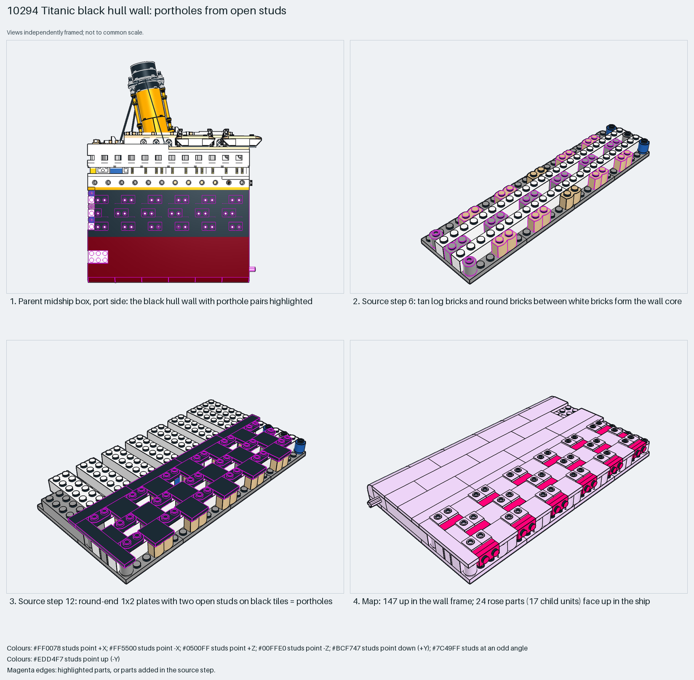

# Titanic black hull wall: portholes from open studs

Portholes come from open studs on a wall built flat; children inside a sideways wall are counter-rotated so they end up upright.

Reusable source construction: source checks pass and the Python and LeoCAD BOMs match.

Ship hull · 171 parts · 22 source steps in 4 sections

[Build pages](index.html) · [Inspection board](board/mosaic.png) · [Source](source.mpd) · [Editable plan](scene.plan.json) · [Checks](source-checks.json) · [Board provenance](board/board.json)



## Read the construction

171 parts in 17 steps. Steps 1–11: 6×6 base plates with white bricks; step 6 adds tan log bricks and round bricks between them. Step 12: black 2×2 groove tiles with seventeen 1×2 round-end plates with two open studs; the open-stud pairs are the portholes. Steps 13–14: 17 child units, each carrying two ring parts (`28974a`, an embedded part). Step 17: curved-top bricks and dark-red tiles on the lower edge.

In the wall's frame 147 parts face up and 24 face +X. The 24 belong to the 17 child units (11 × `2.7.3.1`, 6 × `1.3.2.4`), turned 90° inside the wall; through the wall's rotation they face up in the ship. The parent matrix is `0 1 0 / −1 0 0 / 0 0 1`, studs −X (port side). Its mirror is `3.16.1`.

## What the parent supplies

- `10294 - Titanic - 3.0 Funnel & Main Cabins.ldr` places it at `-148 -132 -80`, matrix `0 1 0 / -1 0 0 / 0 0 1`.

The black port hull wall of the midship box (`10294 - Titanic - 3.0 Funnel & Main Cabins.ldr`).

The turn onto its side; the mirror wall sits opposite.

## Description check

- **Database (empty):** “Titanic - 3.15.1”
- **What it is:** The black hull wall with portholes on the port side. The database text is only the section name.

## Read the board

Panel 1: the parent from the right, the wall highlighted. Panel 2: step 6, log and round bricks form the core. Panel 3: step 12, round-end plates with open studs on black tiles make the portholes. Panel 4: the stud map; 147 face up in the wall frame, and the 24 rose parts face up in the ship.

Magenta edges mark highlighted parts or the parts added in a source step. Pale grey, see-through parts are ghosted context. A neon-green rod (`#39FF14`) is a synthetic axis marker, not a part. Stud maps recolour each part by where its studs point: up lilac, +X rose, −X vermilion, +Z electric blue, −Z aqua, down lime, odd angle violet. These synthetic colours are ΔE ≥ 16 from every LDraw colour. LDraw −Y is up; LeoCAD `right` shows the model's right side, from −X.

Replay a board into `output/`:

    ./ldraw-xray board run examples/submodel-atlas/recipes/s17b-10294-titanic-hull-cabins.json --output output/boards/s17b-10294-titanic-hull-cabins

## Reuse it

Use open-stud plates on a flat-built wall for portholes; counter-rotate any child that must end up upright.

```sh
./ldraw-agent manual export examples/submodel-atlas/s17b-10294-titanic-hull-cabins --outdir output/my-s17b-10294-titanic-hull-cabins
./ldraw-agent build output/my-s17b-10294-titanic-hull-cabins/scene.plan.json --output output/my-s17b-10294-titanic-hull-cabins/s17b-10294-titanic-hull-cabins.mpd
```

Export needs a current visual review. Build the copied plan, then inspect its interfaces in the new model.

The placement plan preserves source axes. `source_origin` is a positioning frame, not a physical connector.

## Limits

Attachment to the neighbouring sections was not checked.

The source and renders teach a construction. They do not prove clutch, fit, clearance, travel or stability. Boards are rendered from synthetic inspection copies, and poses are rigid re-placements.

## Source and evidence

Source: `10294-1.mpd` / `10294 - Titanic - 3.15.1.ldr`, SHA-256 `4c016c7c4d24144b38059c39ab8728bafc205a4579fa506290f8eac9d9a0d6b8`. Parent: `10294 - Titanic - 3.0 Funnel & Main Cabins.ldr`. Look it up with `./ldraw-agent discover show submodel-901b555e611facb9c1b52c8c`.

Original authors and licences stay in [source.mpd](source.mpd); [extraction.json](extraction.json) records renamed sections and 1 bounded preparation changes. Python and LeoCAD BOMs match. The visual review is recorded separately, after opening the actual images.
