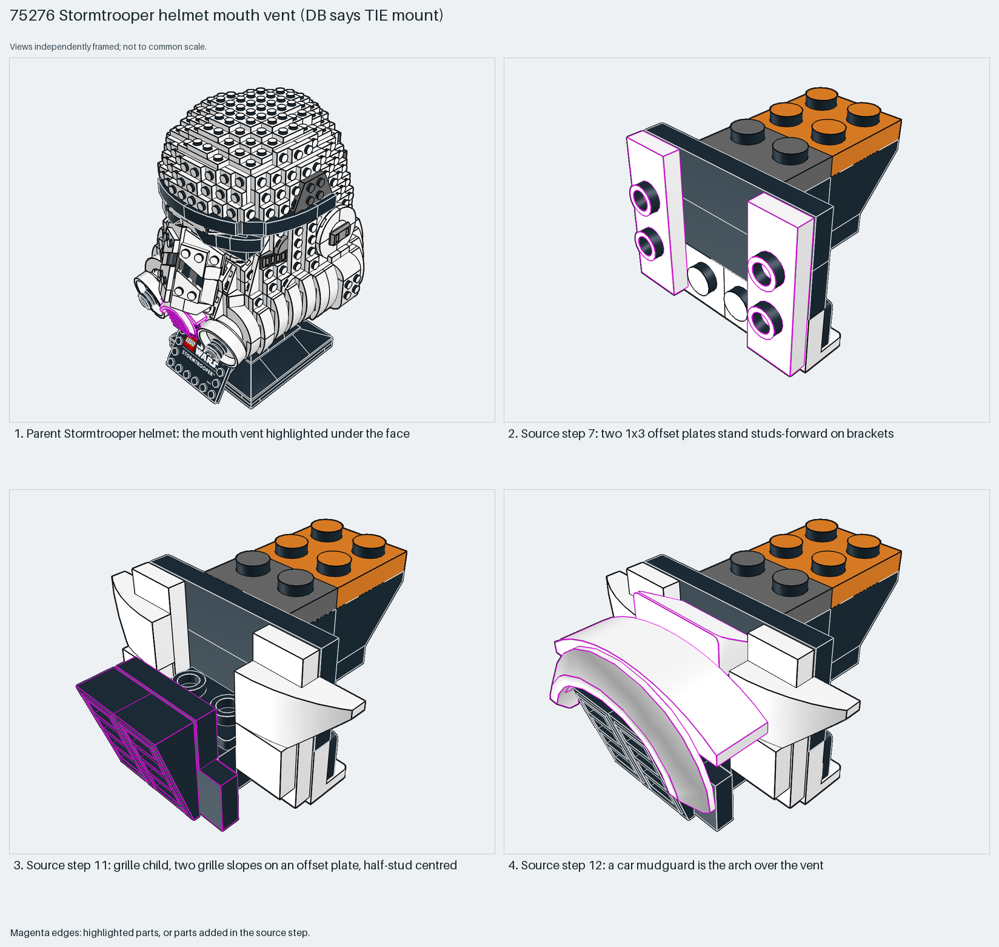

# Stormtrooper helmet mouth vent: offset plates centre a grille

Offset (jumper) plates centre a 2-wide grille on a face built forward; a car mudguard becomes the sculpted arch.

Reusable source construction: source checks pass and the Python and LeoCAD BOMs match.

Helmet detail · 27 parts · 17 source steps in 4 sections

[Build pages](index.html) · [Inspection board](board/mosaic.png) · [Source](source.mpd) · [Editable plan](scene.plan.json) · [Checks](source-checks.json) · [Board provenance](board/board.json)



## Read the construction

27 parts in 12 steps. Steps 3–8: brackets (1×2–2×2 down, 1×2–1×4, 1×2–1×2 down and up). Step 4: two 1×4 plates with two studs. Step 7: two 1×3 plates with 2 studs offset, standing studs-forward. Step 9: child `219`. Step 11: child `221`, two grille slopes on a 1×3 offset plate, half-stud centred. Step 12: child `222`, a car mudguard as the arch over the vent.

Stud directions: 27 parts, 17 −Z (forward), 9 up, 1 down. The parent uses the identity matrix.

## What the parent supplies

- `75276 - main.ldr` places it at `0 48 -80`, matrix `1 0 0 / 0 1 0 / 0 0 1`.

The mouth vent under the face of the Stormtrooper helmet (`75276 - main.ldr`).

The helmet face around the vent.

## Description check

- **Database (wrong):** “Complex dark-grey and black mounting module with brackets, offset plates, and grille-style slope details.”
- **What it is:** The Stormtrooper helmet's mouth vent, not a mounting module.

## Read the board

Panel 1: the helmet, vent highlighted under the face. Panel 2: step 7, offset plates studs-forward on brackets. Panel 3: step 11, the grille child, half-stud centred. Panel 4: step 12, the mudguard arch.

Magenta edges mark highlighted parts or the parts added in a source step. Pale grey, see-through parts are ghosted context. A neon-green rod (`#39FF14`) is a synthetic axis marker, not a part. Stud maps recolour each part by where its studs point: up lilac, +X rose, −X vermilion, +Z electric blue, −Z aqua, down lime, odd angle violet. These synthetic colours are ΔE ≥ 16 from every LDraw colour. LDraw −Y is up; LeoCAD `right` shows the model's right side, from −X.

Replay a board into `output/`:

    ./ldraw-xray board run examples/submodel-atlas/recipes/s18-75276-tie-mount.json --output output/boards/s18-75276-tie-mount

## Reuse it

Use offset plates whenever a feature must sit half a stud off the grid on a forward face.

```sh
./ldraw-agent manual export examples/submodel-atlas/s18-75276-tie-mount --outdir output/my-s18-75276-tie-mount
./ldraw-agent build output/my-s18-75276-tie-mount/scene.plan.json --output output/my-s18-75276-tie-mount/s18-75276-tie-mount.mpd
```

Export needs a current visual review. Build the copied plan, then inspect its interfaces in the new model.

The placement plan preserves source axes. `source_origin` is a positioning frame, not a physical connector.

## Limits

Bracket retention was not checked.

The source and renders teach a construction. They do not prove clutch, fit, clearance, travel or stability. Boards are rendered from synthetic inspection copies, and poses are rigid re-placements.

## Source and evidence

Source: `75276-1.mpd` / `75276 - 211-222.ldr`, SHA-256 `87bb2655044e2816d87c60214b6497b6fb91d4767cae94adc4ada60be0191059`. Parent: `75276 - main.ldr`. Look it up with `./ldraw-agent discover show submodel-8c553abbcda9b855a4635134`.

Original authors and licences stay in [source.mpd](source.mpd); [extraction.json](extraction.json) records renamed sections and 0 bounded preparation changes. Python and LeoCAD BOMs match. The visual review is recorded separately, after opening the actual images.
