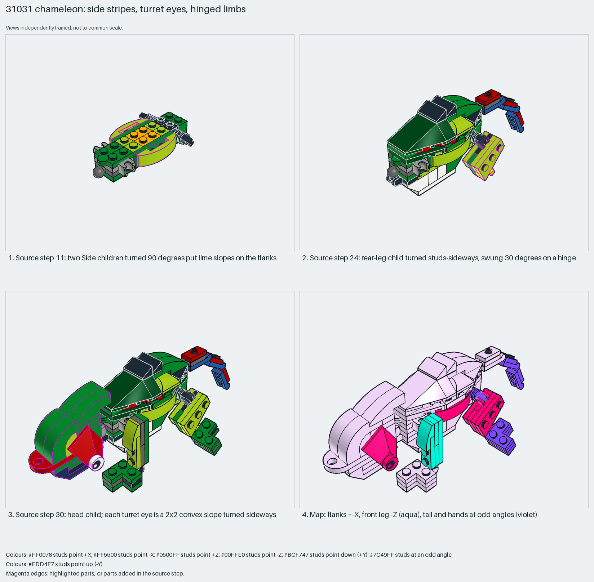

# Chameleon: flank stripes, turret eyes and hinged limbs

Turret eyes from sideways convex slopes; limbs as rotated children on hinges and ball joints.

Reusable source construction: source checks pass and the Python and LeoCAD BOMs match.

Animal · 126 parts · 80 source steps in 11 sections

[Build pages](index.html) · [Inspection board](board/mosaic.png) · [Source](source.mpd) · [Editable plan](scene.plan.json) · [Checks](source-checks.json) · [Board provenance](board/board.json)



## Read the construction

126 parts in 30 steps plus ten children. Steps 3–10: Technic bricks, locking hinge arms, side-stud bricks, a ball joint and sockets. Step 11: two `Side` children, each a 4×1 double curved slope on a 1×4 plate, turned ±X onto 1×1 side-stud bricks; they form the lime flank stripes. Steps 22–29: body, tail, legs and hands as children. The rear leg is turned studs-sideways and swung 30° on a locking hinge; the front leg is turned 90° about X (studs −Z); the hands are at odd angles. Step 30: the `Head` child; each turret eye is a 2×2 double convex 45° slope turned ±X, with an eye-pattern round tile.

Stud directions: 126 parts, 82 up, 10 each +X, −X and −Z, 14 angled.

## What the parent supplies

- `31031 - Main.ldr` places it at `0 9.861 5.857`, matrix `1 0 0 / 0 1 0 / 0 0 1`.

The whole model; `31031 - Main.ldr` places it with the identity matrix.

Nothing: the section is the whole model, so the board has no parent view.

## Description check

- **Database (vague):** “Main chameleon torso built from green and lime plates, wing elements, and ball-and-socket hinge joints connecting the limbs.”
- **What it is:** The whole chameleon, not just its torso; the torso, limbs and head are children.

## Read the board

Panel 1: step 11, two `Side` children put lime slopes on the flanks. Panel 2: step 24, the rear-leg child turned studs-sideways and swung 30°. Panel 3: step 30, the head child with turret eyes. Panel 4: the stud map; the flanks face ±X, the front leg −Z (aqua), and the tail and hands are angled (violet).

Magenta edges mark highlighted parts or the parts added in a source step. Pale grey, see-through parts are ghosted context. A neon-green rod (`#39FF14`) is a synthetic axis marker, not a part. Stud maps recolour each part by where its studs point: up lilac, +X rose, −X vermilion, +Z electric blue, −Z aqua, down lime, odd angle violet. These synthetic colours are ΔE ≥ 16 from every LDraw colour. LDraw −Y is up; LeoCAD `right` shows the model's right side, from −X.

Replay a board into `output/`:

    ./ldraw-xray board run examples/submodel-atlas/recipes/s19-31031-chameleon.json --output output/boards/s19-31031-chameleon

## Reuse it

Build limbs and eyes as children and turn them at the joint; side stripes go on side-stud bricks.

```sh
./ldraw-agent manual export examples/submodel-atlas/s19-31031-chameleon --outdir output/my-s19-31031-chameleon
./ldraw-agent build output/my-s19-31031-chameleon/scene.plan.json --output output/my-s19-31031-chameleon/s19-31031-chameleon.mpd
```

Export needs a current visual review. Build the copied plan, then inspect its interfaces in the new model.

The placement plan preserves source axes. `source_origin` is a positioning frame, not a physical connector.

## Limits

Joint friction and poses other than the source pose were not checked.

The source and renders teach a construction. They do not prove clutch, fit, clearance, travel or stability. Boards are rendered from synthetic inspection copies, and poses are rigid re-placements.

## Source and evidence

Source: `31031-1_Chameleon.mpd` / `31031 - Cameleon.ldr`, SHA-256 `7967458da7624289a6b4728b1ec16b3ebcf1997053515dd21bc748dc49c61a34`. Parent: `31031 - Main.ldr`. Look it up with `./ldraw-agent discover show submodel-981e48fb86fb6e14080b44bd`.

Original authors and licences stay in [source.mpd](source.mpd); [extraction.json](extraction.json) records renamed sections and 0 bounded preparation changes. Python and LeoCAD BOMs match. The visual review is recorded separately, after opening the actual images.
