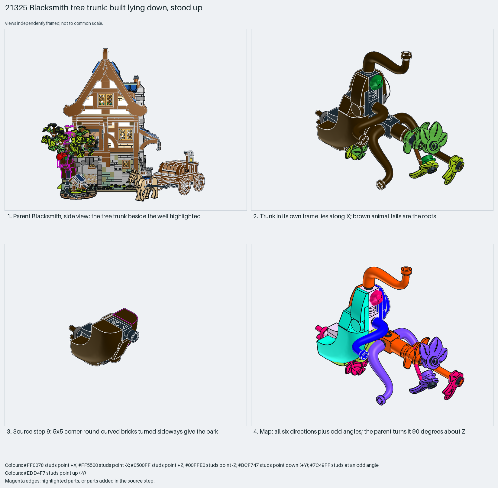

# Blacksmith tree trunk: built lying down, stood up

An organic shape built in a convenient frame, with animal tails as roots.

Reusable source construction: source checks pass and the Python and LeoCAD BOMs match.

Tree · 53 parts · 36 source steps in 7 sections

[Build pages](index.html) · [Inspection board](board/mosaic.png) · [Source](source.mpd) · [Editable plan](scene.plan.json) · [Checks](source-checks.json) · [Board provenance](board/board.json)



## Read the construction

53 parts in 14 steps plus six children. Steps 7 and 9: two 5×5 corner-round curved-top bricks facing −Z and +Z make the bark. Children `Step 79` (step 10) and `Steps 83 to 89` (step 14): 1×1 bricks with studs on four sides, plus animal tails as the bent roots and branches. Step 13: a frog, leaves and flowers.

The parent matrix `0 1 0 / −1 0 0 / 0 0 1` turns it 90° about Z. Measured: in its own frame the trunk lies along X, 262 LDU long and 172 high; in the parent that length becomes its height (y −318 to −56). Stud directions: 53 parts in all six directions: 10 up, 6 down, 9 +X, 11 −X, 6 +Z, 5 −Z, 6 angled. It has the corpus's top SNOT score.

## What the parent supplies

- `21325 - Medieval Blacksmith.ldr` places it at `0 -92 60`, matrix `0 1 0 / -1 0 0 / 0 0 1`.

The tree trunk beside the well in `21325 - Medieval Blacksmith.ldr`. The leaf canopy above it belongs to another section.

The leaf canopy, which is another section, and the upright pose.

## Description check

- **Database (empty):** “Steps 70 to 90”
- **What it is:** The tree trunk beside the well. The database text is only the section name.

## Read the board

Panel 1: the parent from the side, trunk highlighted beside the well. Panel 2: the trunk in its own frame, lying along X; brown animal tails are the roots. Panel 3: step 9, a 5×5 corner-round brick turned sideways for the bark. Panel 4: the stud map, with all six directions plus odd angles.

Magenta edges mark highlighted parts or the parts added in a source step. Pale grey, see-through parts are ghosted context. A neon-green rod (`#39FF14`) is a synthetic axis marker, not a part. Stud maps recolour each part by where its studs point: up lilac, +X rose, −X vermilion, +Z electric blue, −Z aqua, down lime, odd angle violet. These synthetic colours are ΔE ≥ 16 from every LDraw colour. LDraw −Y is up; LeoCAD `right` shows the model's right side, from −X.

Replay a board into `output/`:

    ./ldraw-xray board run examples/submodel-atlas/recipes/s20-21325-blacksmith.json --output output/boards/s20-21325-blacksmith

## Reuse it

Build tall organic shapes lying down where the studs help, then stand them up. Look for unusual parts, such as animal tails, for roots and branches.

```sh
./ldraw-agent manual export examples/submodel-atlas/s20-21325-blacksmith --outdir output/my-s20-21325-blacksmith
./ldraw-agent build output/my-s20-21325-blacksmith/scene.plan.json --output output/my-s20-21325-blacksmith/s20-21325-blacksmith.mpd
```

Export needs a current visual review. Build the copied plan, then inspect its interfaces in the new model.

The placement plan preserves source axes. `source_origin` is a positioning frame, not a physical connector.

## Limits

How the trunk anchors to the base was not checked.

The source and renders teach a construction. They do not prove clutch, fit, clearance, travel or stability. Boards are rendered from synthetic inspection copies, and poses are rigid re-placements.

## Source and evidence

Source: `21325-1.mpd` / `21325 - Steps 70 to 90.ldr`, SHA-256 `afc7ccfde6ba9fc47916e11c4e6746416a3c2f0ad87a3f0a448632619504c706`. Parent: `21325 - Medieval Blacksmith.ldr`. Look it up with `./ldraw-agent discover show submodel-150bf325cbfdbeebb5fa125a`.

Original authors and licences stay in [source.mpd](source.mpd); [extraction.json](extraction.json) records renamed sections and 12 bounded preparation changes. Python and LeoCAD BOMs match. The visual review is recorded separately, after opening the actual images.
