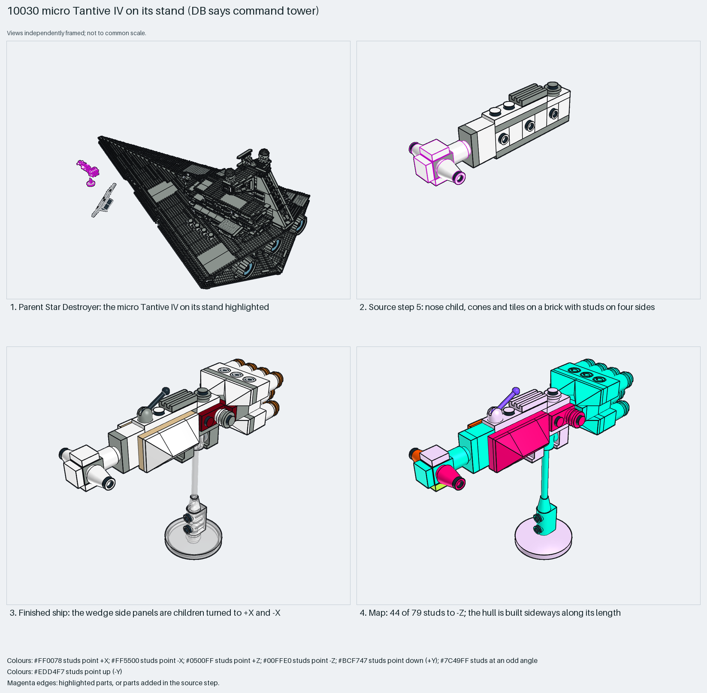

# Micro Tantive IV: built sideways along its length

A micro ship built sideways along its length on bricks with studs on four sides.

Reusable source construction: source checks pass and the Python and LeoCAD BOMs match.

Micro spaceship · 79 parts · 27 source steps in 7 sections

[Build pages](index.html) · [Inspection board](board/mosaic.png) · [Source](source.mpd) · [Editable plan](scene.plan.json) · [Checks](source-checks.json) · [Board provenance](board/board.json)



## Read the construction

79 parts in 9 steps plus six children. Step 1: child `128`, three 1×1 bricks with studs on four sides. Step 5: child `129`, a nose with cones and tiles on a four-sided-stud brick. Step 6: two wedge hull-side children `130`, turned to +X and −X. Step 7: two `131` children, red plates with round greebles. Step 8: child `132`, the engine block, with round bricks and plates as the engines. Step 9: child `133`, the clear display stand.

Stud directions: 79 parts, 44 −Z, 17 up, 8 each ±X. The parent matrix `0 0 1 / 0 1 0 / −1 0 0` turns it 90° about Y.

## What the parent supplies

- `10030 - main.ldr` places it at `-2465.26 272.825 -330`, matrix `0 0 1 / 0 1 0 / -1 0 0`.

The micro Tantive IV on its clear stand beside the Star Destroyer (`10030 - main.ldr`).

Only the placement beside the Star Destroyer; the clear stand is child `133` inside the section.

## Description check

- **Database (wrong):** “Command tower / bridge superstructure - plated tower body topped by sensor-globe supports, turrets and the bridge viewport, with control sticks.”
- **What it is:** The micro Tantive IV on its stand, not a command tower or bridge.

## Read the board

Panel 1: the Star Destroyer, with the micro ship on its stand highlighted. Panel 2: step 5, the nose child on a four-sided-stud brick. Panel 3: the finished ship; the wedge side panels are children turned to +X and −X. Panel 4: the stud map; 44 of 79 studs face −Z.

Magenta edges mark highlighted parts or the parts added in a source step. Pale grey, see-through parts are ghosted context. A neon-green rod (`#39FF14`) is a synthetic axis marker, not a part. Stud maps recolour each part by where its studs point: up lilac, +X rose, −X vermilion, +Z electric blue, −Z aqua, down lime, odd angle violet. These synthetic colours are ΔE ≥ 16 from every LDraw colour. LDraw −Y is up; LeoCAD `right` shows the model's right side, from −X.

Replay a board into `output/`:

    ./ldraw-xray board run examples/submodel-atlas/recipes/s22-10030-isd-tower.json --output output/boards/s22-10030-isd-tower

## Reuse it

Build a long, thin micro hull along a column of four-sided-stud bricks; compare s16, whose wings stand on clips instead.

```sh
./ldraw-agent manual export examples/submodel-atlas/s22-10030-isd-tower --outdir output/my-s22-10030-isd-tower
./ldraw-agent build output/my-s22-10030-isd-tower/scene.plan.json --output output/my-s22-10030-isd-tower/s22-10030-isd-tower.mpd
```

Export needs a current visual review. Build the copied plan, then inspect its interfaces in the new model.

The placement plan preserves source axes. `source_origin` is a positioning frame, not a physical connector.

## Limits

The stand connection was not checked.

The source and renders teach a construction. They do not prove clutch, fit, clearance, travel or stability. Boards are rendered from synthetic inspection copies, and poses are rigid re-placements.

## Source and evidence

Source: `10030-1.mpd` / `10030 - subModel-127.ldr`, SHA-256 `b101947efa8e265689470e048d3382728d49336f232f42237758157bb8156358`. Parent: `10030 - main.ldr`. Look it up with `./ldraw-agent discover show submodel-4aff6ad35c4fde8db7acacfe`.

Original authors and licences stay in [source.mpd](source.mpd); [extraction.json](extraction.json) records renamed sections and 1 bounded preparation changes. Python and LeoCAD BOMs match. The visual review is recorded separately, after opening the actual images.
