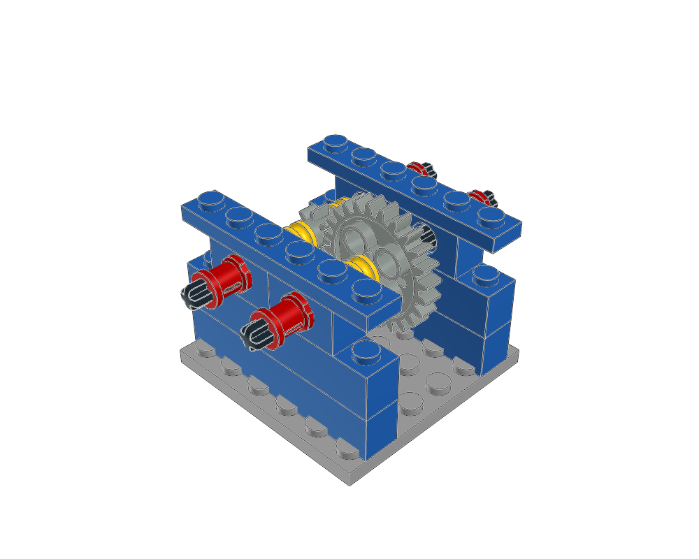

# Build a supported gear drive



This original 23-part starter connects construction to checked animation in
the independent `ldraw-mecha` project. It includes a fixed base and bonded
bearing rails, two 8L axles, four round bearings, an 8:24 spur pair, gear stops
and outer shaft-retaining bushes. One input drives the output at `-input/3`.

Use the editable [MPD](gear-drive.mpd), ordinary
[construction plan](construction.plan.json) or [generator](build.py):

```sh
.venv/bin/python examples/technic-studies/gear-drive/build.py --output output/my-gear-drive
./ldraw-agent review output/my-gear-drive/gear-drive.mpd --contacts none --views home front top
./ldraw-agent technic catalog --model output/my-gear-drive/gear-drive.mpd --connectors --output output/my-gear-drive/parts.json
```

The pitch spacing is 40 LDU. Shaft centres are Y = -62, and the bearing rails
are at Z = +/-40. The central gear hubs fit between half bushes at +/-15;
outer full bushes at +/-60 retain the shafts outside the rails. The complete
24-tooth shaft, including axle and bushes, starts at 7.5 degrees for tooth phase.
The frame bonds each pair of bearing bricks with rails below and caps above.

The MPD's three groups deliberately correspond to one fixed frame and two
rigid shafts. That correspondence is specific to this design; do not infer
rigidity from the hierarchy of an arbitrary imported model. Descriptions and
placement comments explain each group's function.

In `ldraw-mecha`, the same original MPD and `scripts/gear_drive.py` prepare the
motion plan and bound GLB without depending on this checkout:

```sh
.venv/bin/python scripts/gear_drive.py --output output/gear-drive
./ldraw-mecha check output/gear-drive --require-reviewed --require-constrained --set drive=0.731
./ldraw-mecha rig output/gear-drive --require-constrained --animate --reopen
```

Set `LDRAW_DIR` and, if needed, `BLENDER_BIN`. Use a new directory when
rebuilding. The shaft/mesh helpers check keyed-group ownership, bearing axes,
finite insertion, axial displacement, pitch spacing and the signed gear relation.
They emit the existing plan format; unsupported contact types remain explicit.

Read the [mechanism workflow](../../../docs/agent/advanced-mechanisms.md) for
differentials, carriers, mixed pin/axle sections, Cardan joints and parts with
unknown metadata. Read [validation notes](validation.md) for the evidence and
limits of this example. Nominal fit and sampled motion are not a physical
certification. `--contacts none` leaves source contact discovery explicitly
skipped; it does not declare the model collision-free.
