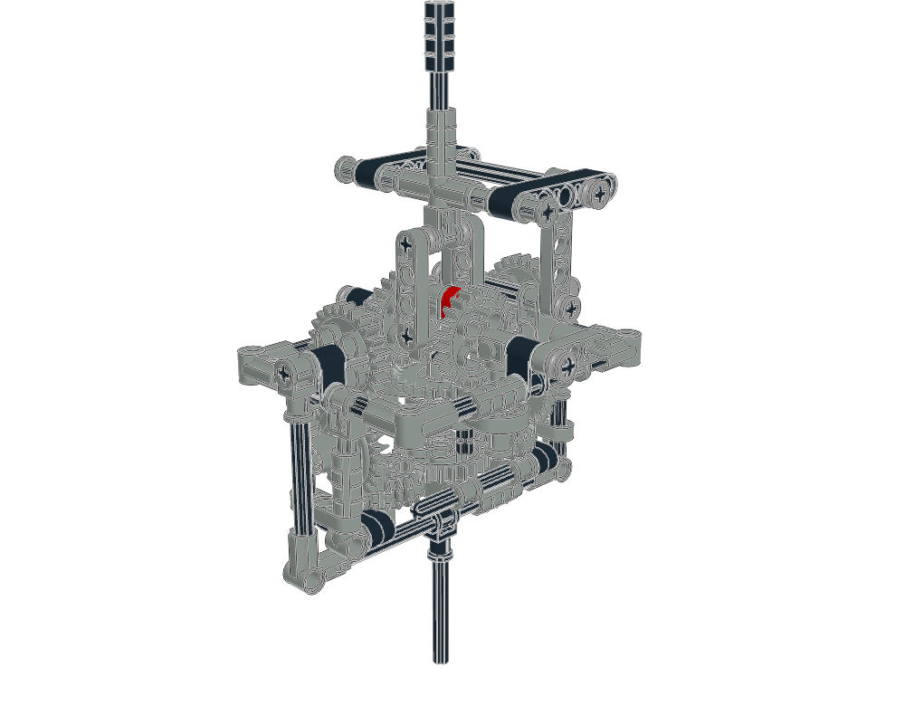

# RCVJ: constrain the machine before adding spin

Thomas Reininghaus's **Reininghaus Constant Velocity Joint** uses a double
gimbal and two differential angle bisectors operating in perpendicular planes.
The [designer's explanation and original files](https://rcvj.reininghaus.org/)
establish the mechanical intent. It is a centring mechanism, not a collection
of independently driven gears.



The preserved [RCVJ.mpd](RCVJ.mpd) contains **127 physical parts, 34 references
and five assembly sections**. All occurrences match the designer's original
LDR by reference, colour and rest transform within 0.005 matrix/LDU tolerance.
Hashes and identity mapping are in [evidence.json](evidence.json). Copied source
SHA-256: `435be93c3afa9c8c9565dcb44b20df9d66a4f2481682130d47268edd9cb073ee`.

The supplied descriptions are retained but are not reliable kinematic labels.
`bottom-axle` is on the negative-Y/upper side; `upper-arm` is on the
positive-Y/lower side. `gear-train` mixes several moving groups. Negative Y is
up in LDraw. Do not animate these submodels as rigid bodies.

## Measurements that reject the previous animation

IDs are zero-based type-1 paths in this exact MPD. Gear axes below come from
local Z through the matrices; axle axes from local X.

| Interface | Occurrences | Measured interpretation |
|---|---|---|
| Central differential sides | `9/14`, `9/16` (`3648a`) | Approximately X axes; 62.250 LDU axial separation, 1.752 LDU radial mismatch. Not a 62-LDU external spur pair |
| Left/right side shafts | `56`–`9/14`, `38`–`9/16` | Keyed shaft/gear pairs; moving only gears breaks the couplings |
| Outer side shafts | `37`–`9/1`, `27`–`9/2` | Approximately Z axes; keyed gears on separate shafts |
| Cam mounts | `2`–`9/4`, `1`–`9/5` | Approximately Y axes at x ≈ -51 and +53; occupied cam holes offset 10 LDU from the cam origin |
| Upper input | `0/6`–`5/10` | Approximately Y; axle and coupling must preserve relative pose |
| Lower output | `0/0`–`0/5` | Approximately Y; separate rotations about each part's own origin tear the coupling apart |

The workbook also checks cam shafts against their keyed `3651` connectors
(`2`–`32`, `1`–`39`) and round carrier bearings (`56`–`32`, `38`–`39`).
These ten keyed interfaces and two bearings produce **22 executable checks**:
relative rigidity and axis/axial-drift checks. Source radial fit errors range
from **0.159 to 1.369 LDU**. They are recorded, not snapped away. Tolerances
preserve that historical source; they are not manufacturing allowances.
Finite insertion, retention and surrounding supports still need review.

The previous flat-model animation was mapped to this hierarchy by physical
occurrence. At **0.371, 1.13 and -2.27 radians**, fourteen checks fail in every pose.
Four gears turn without their shafts, cam shafts separate from their keyed
connectors, and the lower output coupling separates
from its axle by **16.16, 46.90 and 79.42 LDU** respectively. At zero input all
these checks pass. A rest image or driver-expression agreement is insufficient.

`3648a` now has a supported spur discovery profile. `3650c` remains an explicit
crown-contact review case: its tooth band occupies local Z = -6..0. `3749` has
a keyed +X section and a round -X section; one overall connector label cannot
establish the mobility of both neighbours.

## Reuse the method

Read [advanced mechanisms](../../../docs/agent/advanced-mechanisms.md) for gear
equations in moving frames, differential planet spin, Cardan phasing, alias
transforms and the authoring/checking sequence.

```sh
# In ldraw-nova:
./ldraw-agent technic catalog --model examples/technic-studies/rcvj/RCVJ.mpd \
  --connectors --output output/rcvj-parts.json

# In ldraw-mecha, using the supplied file or this preserved copy:
.venv/bin/python scripts/study_rcvj.py RCVJ.mpd --output output/rcvj-study
# Add --candidate-plan PATH to test a previous plan against the interfaces.
```

The output is measured evidence and a **draft constraint workbook**. The
complete RCVJ animation is **not solved or certified** here: both carrier
assignments, crown contacts, remaining link closures and shaft phase through
spatial articulation still need work. Do not mark it ready after adding
independent gear spins or merely reviewing discovery entries. The generic
double-Cardan helper verifies an ideal equal-bend pair, not this centring linkage.

## Evidence and provenance

[Source validation](source-validation.json) passes file/geometry checks with
header/alias warnings; physical validity is unproven. [Home](home.png),
[front](front.png) and [top](top.png) images were opened and inspected. They show
the preserved arrangement and obscured inner joints. Home/front crop the upper
shaft and are study views, not final presentation renders. No animated visual
review is claimed.

[Catalog coverage](catalog-coverage.json) records the local snapshot. Every
RCVJ reference is installed, including physical-colour aliases. The catalog
includes all 1,352 supplied Technic assignments and newer installed parts;
see the [catalog guide](../../../docs/agent/technic-catalog.md).

**Attribution/licence:** model by Thomas Reininghaus, supplied with semantic
annotations. The designer's [CC BY-NC-SA 4.0](https://creativecommons.org/licenses/by-nc-sa/4.0/)
licence applies to this copied model, model-derived measurements and previews;
the toolkit's code licence does not replace it. [Original model](https://rcvj.reininghaus.org/model/RCVJ.ldr).
Part definitions retain their LDraw licences. Sources accessed 2026-10-25.
