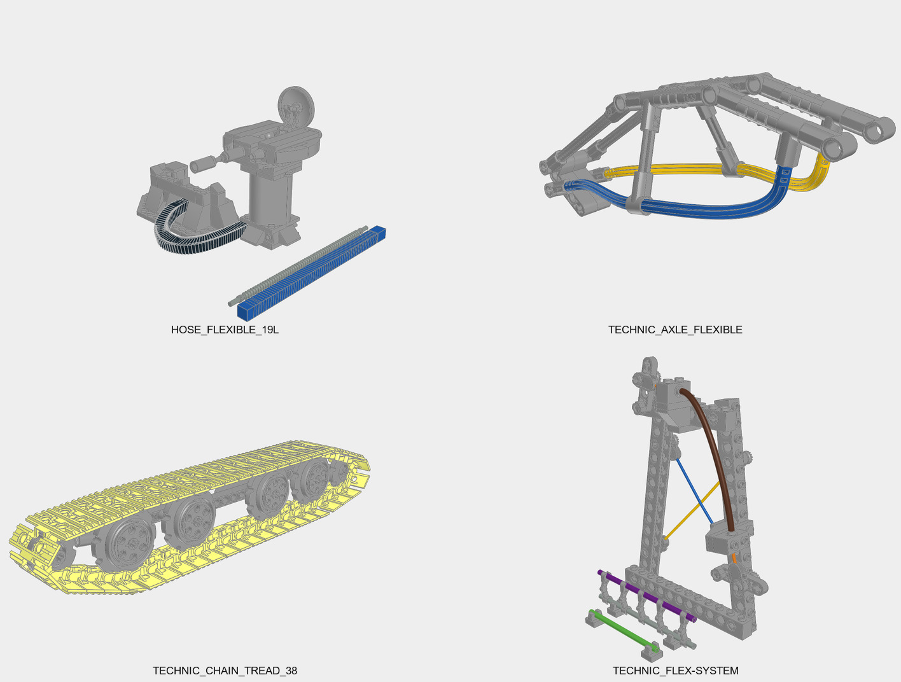

> Optional raw-source research. Start new mounted routes with the [current flex guide](../docs/agent/guides/flex.md). These legacy scenes retain missing hardware, invalid-source and unverified-operation limits; research registration does not admit them as construction examples.

# LSynth construction studies

These 26 examples are useful references for **the rigid construction around
flexible parts**: track carriers, bearing supports, pneumatic controls, cable
terminations, lighting fixtures and shaped frames. They add useful subjects and
part combinations to the Technic repertoire. Their strongest lesson is to design
the mounts, wheel stack or port hardware before shaping the flexible route.

Each `*-Constraints.*` file now starts with a plain-language identity, followed
by scene, rigid-construction, building and reuse notes. Local `Study N` comments
explain selected SYNTH blocks; numbers refer to their order in that file. Existing
part annotations remain in place. The matching `*-Synthesis.*` files show the
supplied generated scenes; they have not been regenerated or edited.

Start with the track carrier, pneumatic controls, Flex-System frame and swept
axle frame below. Then read the [industrial construction lessons](../docs/agent/guides/flex.md)
for applying them to a new model. Use the [LSynth guide](../docs/agent/reference/flex.md)
for generation commands and the [small flex examples](../examples/flex/README.md)
for simpler inputs to adapt.



*Study copies make transparent parts opaque grey to expose the construction.
These colours do not establish a real inventory.*

## Choose a reference by construction

| Constraint source | What the scene shows | Most useful lesson |
| --- | --- | --- |
| [TECHNIC_CHAIN_TREAD_38](TECHNIC_CHAIN_TREAD_38-Constraints.ldr) | Long track carrier, four large middle wheels, small end wheels and a spring detail | Wheel plane, beam carrier, bushes and end mounts; four wheel positions are duplicated in the route records |
| [TECHNIC_PNEUMATIC_HOSE](TECHNIC_PNEUMATIC_HOSE-Constraints.ldr) | Hand pump, lever valve and two-port cylinder | Actual nozzles, accessible controls and cylinder mounts before hoses |
| [TECHNIC_FLEX-SYSTEM](TECHNIC_FLEX-SYSTEM-Constraints.ldr) | Tall frame with crossed cables, outer guide and lower clip samples | Distinguish cable ends, fixed sleeve supports and lever pivots |
| [TECHNIC_AXLE_FLEXIBLE](TECHNIC_AXLE_FLEXIBLE-Constraints.ldr) | Swept open frame with angular rails and curved lower edges | Axle joiners and angle connectors establish a light body or canopy outline |
| [TECHNIC_TREAD_CRAWLER](TECHNIC_TREAD_CRAWLER-Constraints.ldr) | Vintage low, stepped and upright crawler layouts | Dedicated bearing bricks and their matching cylindrical-axle wheel family |
| [TECHNIC_TREAD](TECHNIC_TREAD-Constraints.ldr) | Three continuous-rubber-track carriers | Axle support, retention and angled liftarm frames; wheels are hidden in the supplied synthesis |
| [TECHNIC_CHAIN_TREAD](TECHNIC_CHAIN_TREAD-Constraints.ldr) | Two separate track-size comparisons | Carrier bricks, axle pins and end-wheel size define the envelope |
| [TECHNIC_CHAIN_LINK](TECHNIC_CHAIN_LINK-Constraints.ldr) | Gear pairs, a long supported chain route and smaller wrap studies | Gear centres, chain planes and the support rail |
| [TECHNIC_CHAIN_LINK_WITH_TWO_STUDS](TECHNIC_CHAIN_LINK_WITH_TWO_STUDS-Constraints.ldr) | Studded chain around coarse-toothed wheels | A starting point for conveyor flights, using its own link/wheel family |
| [STRING_HOSE](STRING_HOSE-Constraints.ldr) | Reel, sheaves, hooks and wound shafts | Separate drum, hook block, rope route and the still-needed bearing frame |
| [RUBBER_BAND](RUBBER_BAND-Constraints.ldr) | Triangular, crossed and micromotor pulley arrangements | Pulley planes and guides; some displayed routes need correction |
| [RUBBER_BELT](RUBBER_BELT-Constraints.ldr) | Two-wheel and multi-wheel flat-belt layouts | Plan centres and shafts together; a rim is not automatically a suitable pulley |
| [FIBER_OPTICS_CABLE](FIBER_OPTICS_CABLE-Constraints.ldr) | Four-cylinder V engine, optical distributor and loose guide samples | Repeated cylinder details and an orderly cross-block accessory rail |
| [FIBER_OPTICS_CABLE_WIDE](FIBER_OPTICS_CABLE_WIDE-Constraints.ldr) | Paired broad light guides around a compact mirrored frame | Short axles, cross blocks and hanging levers; the parent unit is unresolved |
| [ELECTRIC_POWER_FUNCTION_CABLE](ELECTRIC_POWER_FUNCTION_CABLE-Constraints.ldr) | Battery box, receivers and four motors laid out on a bench | Reserve controls, plug access, motor mounts and output couplings |
| [ELECTRIC_POWER_FUNCTION_CABLE_HALF](ELECTRIC_POWER_FUNCTION_CABLE_HALF-Constraints.ldr) | Plug, middle box and two small lamp heads | Use the actual branch junction and lamp-entry variants |
| [ELECTRIC_NXT_CABLE](ELECTRIC_NXT_CABLE-Constraints.ldr) | Controller, three sensors and two motors | Sensor faces, port access and cable slack; local plug geometry is missing |
| [ELECTRIC_RCX_CABLE](ELECTRIC_RCX_CABLE-Constraints.ldr) | RCX controller, sensors and motors | Separate electrical, mounting and output interfaces in a legacy system |
| [ELECTRIC_CABLE](ELECTRIC_CABLE-Constraints.ldr) | Tall workshop lamp with dish shade and a coiled lead | A signal mast, side arm and lamp make a slim industrial fixture |
| [HOSE_FLEXIBLE_12L](HOSE_FLEXIBLE_12L-Constraints.ldr) | Three-wheeled exploration rover with bubble cockpit | Combine Technic wheel mounts with System bodywork and a clear silhouette |
| [HOSE_FLEXIBLE_19L](HOSE_FLEXIBLE_19L-Constraints.ldr) | Raised equipment turret beside a curved barrier | Large cylinders, turntable, side studs and small fittings establish industrial massing |
| [HOSE_FLEXIBLE_8.5L](HOSE_FLEXIBLE_8.5L-Constraints.ldr) | Pipe mounting board with arches and an upright loop | Side-facing end seats and fitting variants control the route |
| [TECHNIC_RIBBED_HOSE](TECHNIC_RIBBED_HOSE-Constraints.ldr) | Tall arch, low return and straight samples | Pin-bearing supports and ribbed texture; touching spans do not establish a joint |
| [BRICK_ARC](BRICK_ARC-Constraints.dat) | Four curved fingers around a cylindrical wrist | Robotic silhouette and cylindrical housings; the fingers are shape studies |
| [MINIFIG_CHAIN_16L](MINIFIG_CHAIN_16L-Constraints.ldr) | Chains spread across a square display board | Visible end fittings for barriers, retained cargo and hanging detail |
| [STRING_xxL](STRING_xxL-Constraints.ldr) | Measuring-board display of straight and curved strings | End hardware and deliberate sag; length presets do not certify stock lengths |

## View the evidence

The semantic review on 2026-10-23 rendered all 26 supplied synthesis scenes in
home and front views. All 26 home views were opened in the labelled sheets below.
Twelve additional opaque views were opened to read the rigid structures, plus
the individual front views of the [optical engine](previews/optical-engine-front.png)
and [raised platform](previews/platform-front.png).

| Opened sheet | Contents |
| --- | --- |
| [Original 1](previews/original-1.jpg) | Claw, workshop lamp, NXT, Power Functions, twin lights, RCX |
| [Original 2](previews/original-2.jpg) | Both optical studies, three corrugated-hose scenes, minifigure chains |
| [Original 3](previews/original-3.jpg) | Bands, belts, winch, strings, swept frame, small-link chain |
| [Original 4](previews/original-4.jpg) | Studded chain, both hinged-track studies, Flex-System, pneumatics, ribbed hose |
| [Original 5](previews/original-5.jpg) | Continuous tread and vintage crawler |
| [Opaque 1](previews/opaque-1.jpg) | Claw, optical engine, broad-guide frame, exploration rover |
| [Opaque 2](previews/opaque-2.jpg) | Raised platform, swept frame, long track carrier, Flex-System |
| [Opaque 3](previews/opaque-3.jpg) | Pneumatics, continuous tread, vintage crawler, winch |

The [additional tread view](previews/tread-wheels-visible.png) also reveals the
nine hidden wheel placements, with their original positions and orientations.
It is an explanatory copy, not a change to the supplied synthesis.

The [review record](semantic-review.json) binds the source hashes, annotation
preservation checks, previews and known omissions. Full-size renders and local
render scripts are in `output/lsynth-semantic-study/` in the working checkout.
Rendering used an isolated library overlay for bundled LSynth geometry; the
installed parts library was left unchanged. Only the overlay's LS22 author text
needed Latin-1 decoding.

## What can be reused

**Strong construction references:** the track carriers, pneumatic component
layout, shaped axle frame, cable/sleeve terminations, lamp and rover. Select one
coherent assembly and preserve its interface context while adding the mounts
needed by the new model.

**Useful part and layout studies:** the electrical benches, winch hardware,
optical fittings and chain/belt comparisons. These identify parts and relationships;
many omit a chassis, bearing frame, output coupling or fixed anchor.

**Primarily shape demonstrations:** isolated wheel wraps, floating string/chain
poses and the brick-arc fingers. These suggest visual treatments. They do not
establish gravity, legal joints, articulation, tension or manufactured length.

Specific qualifications belong with the useful evidence:

- The local previews omit `x933c01.dat` plugs in NXT, `4173497.dat` in the broad
  optical study, `3020a.dat` in the rover, and `57539a.dat`/`57539b.dat` hose
  geometry in the raised-platform synthesis. The identity of the unresolved
  optical parent is not inferred from its surrounding frame.
- The optical constraints inline one `6637` distributor into 14 placements;
  the synthesis uses the whole part. Keep the nested credits and distinguish
  part geometry from an assembly inventory.
- The string constraints contain six studies; the supplied synthesis contains
  only the first three. Later STRING_BAND routes are described from their source.
- The continuous-tread synthesis hides its nine wheel constraints. The long
  hinged-track source repeats four middle-wheel positions along the return
  route. Neither hidden records nor repeated constraints should silently become
  missing or duplicate wheels in a new model.
- Earlier [adapter checks](../docs/reports/lsynth-integration.md) found tangent
  warnings in rubber-band, rubber-belt, small-link-chain and vintage-crawler
  scenes. Other legacy inputs have missing parts, imperfect transforms, internal
  primitives or unresolved colour 16. The annotations identify relevant cases;
  this semantic review does not repair or approve their geometry.

All 26 constraint titles were clarified and 211 ordinary comment lines added.
Every other original line, including part annotations, author and licence text,
geometry and SYNTH records, was preserved. All 26 synthesis files are byte-for-byte
unchanged. Authors remain credited in their files, including Eric Albrecht,
Steffen, Holly Wood/Holly-Wood, Jetro de Chateau, J.C. Tchang, Willy Tschager and
the inlined part author Remco Braak. The new descriptions are editorial study
notes, not claims made by those authors.

These examples are sufficient to broaden the construction vocabulary now.
Before calling a derived model correct, complete its supports and interfaces
and run the normal source, geometry, BOM and visual review. This study is not
a physical or functional certification.


## Research registration

```ldraw-knowledge
[
  {
    "id": "lsynth-research#brick_arc-constraints",
    "title": "BRICK_ARC",
    "scope": "research",
    "kind": "source",
    "families": [
      "flex"
    ],
    "aliases": [
      "lsynth-legacy:BRICK_ARC"
    ],
    "subjects": [],
    "techniques": [
      "flex"
    ],
    "lesson": "Four coloured curled fingers emerge from a stepped cylindrical wrist. Treat as silhouette demonstration; no articulated or legal-brick-joint claim. Installed engine reflection failure remains blocking for derived construction.",
    "limits": "Legacy source research only. Use the current family guide and actual-output checks; missing hardware, invalid source and synthesis failures remain unresolved unless explicitly recorded.",
    "model": "lsynth-examples/BRICK_ARC-Constraints.dat",
    "model_sha256": "cc0062b8ecf9948cb9f2dbff7ad255752614ea7304ff2ac3593c993e7b684ab2",
    "audit": "docs/plans/knowledge-base-overhaul/snapshot/lsynth-legacy-audit.json",
    "audit_pointer": "/items/0"
  },
  {
    "id": "lsynth-research#electric_cable-constraints",
    "title": "ELECTRIC_CABLE",
    "scope": "research",
    "kind": "source",
    "families": [
      "flex"
    ],
    "aliases": [
      "lsynth-legacy:ELECTRIC_CABLE"
    ],
    "subjects": [],
    "techniques": [
      "flex"
    ],
    "lesson": "Tall girder workshop lamp with side arm, broad dish shade and coiled lead. Distill mounting and cable-entry lesson, preserving lead-family roll and access.",
    "limits": "Legacy source research only. Use the current family guide and actual-output checks; missing hardware, invalid source and synthesis failures remain unresolved unless explicitly recorded.",
    "model": "lsynth-examples/ELECTRIC_CABLE-Constraints.ldr",
    "model_sha256": "04bcde46cbacbf09c75443d5eb7f3a1b3b9ed5b64cb13fed0151f6054eba4a75",
    "audit": "docs/plans/knowledge-base-overhaul/snapshot/lsynth-legacy-audit.json",
    "audit_pointer": "/items/1"
  },
  {
    "id": "lsynth-research#electric_nxt_cable-constraints",
    "title": "ELECTRIC_NXT_CABLE",
    "scope": "research",
    "kind": "source",
    "families": [
      "flex"
    ],
    "aliases": [
      "lsynth-legacy:ELECTRIC_NXT_CABLE"
    ],
    "subjects": [],
    "techniques": [
      "flex"
    ],
    "lesson": "Controller surrounded by sensors and two motors, coloured cables and slack loops. x933c01 plug geometry is missing; no complete connector-fit lesson until resolved.",
    "limits": "Legacy source research only. Use the current family guide and actual-output checks; missing hardware, invalid source and synthesis failures remain unresolved unless explicitly recorded.",
    "model": "lsynth-examples/ELECTRIC_NXT_CABLE-Constraints.ldr",
    "model_sha256": "10e3b40c6ea556998b7197a83151d6c5e52beeeeda25c8186e53c2085a55aaee",
    "audit": "docs/plans/knowledge-base-overhaul/snapshot/lsynth-legacy-audit.json",
    "audit_pointer": "/items/2"
  },
  {
    "id": "lsynth-research#electric_power_function_cable-constraints",
    "title": "ELECTRIC_POWER_FUNCTION_CABLE",
    "scope": "research",
    "kind": "source",
    "families": [
      "flex"
    ],
    "aliases": [
      "lsynth-legacy:ELECTRIC_POWER_FUNCTION_CABLE"
    ],
    "subjects": [],
    "techniques": [
      "flex"
    ],
    "lesson": "Battery box, receivers and four separate motors form a component bench. Useful for plug/control/output access; lacks a shared mounting chassis.",
    "limits": "Legacy source research only. Use the current family guide and actual-output checks; missing hardware, invalid source and synthesis failures remain unresolved unless explicitly recorded.",
    "model": "lsynth-examples/ELECTRIC_POWER_FUNCTION_CABLE-Constraints.ldr",
    "model_sha256": "c64fb070dabb8f1f7d2af1aac435f73109de64cefadd03cfa4e1d934ac4847de",
    "audit": "docs/plans/knowledge-base-overhaul/snapshot/lsynth-legacy-audit.json",
    "audit_pointer": "/items/3"
  },
  {
    "id": "lsynth-research#electric_power_function_cable_half-constraints",
    "title": "ELECTRIC_POWER_FUNCTION_CABLE_HALF",
    "scope": "research",
    "kind": "source",
    "families": [
      "flex"
    ],
    "aliases": [
      "lsynth-legacy:ELECTRIC_POWER_FUNCTION_CABLE_HALF"
    ],
    "subjects": [],
    "techniques": [
      "flex"
    ],
    "lesson": "Plug connects through middle junction to two small lamp heads. Distill explicit branching at actual hardware; two separate routes cannot substitute for missing junction.",
    "limits": "Legacy source research only. Use the current family guide and actual-output checks; missing hardware, invalid source and synthesis failures remain unresolved unless explicitly recorded.",
    "model": "lsynth-examples/ELECTRIC_POWER_FUNCTION_CABLE_HALF-Constraints.ldr",
    "model_sha256": "64d90b15632208fbea6fef47c2147a9463ffc820782500e962ce12fad0b3a1db",
    "audit": "docs/plans/knowledge-base-overhaul/snapshot/lsynth-legacy-audit.json",
    "audit_pointer": "/items/4"
  },
  {
    "id": "lsynth-research#electric_rcx_cable-constraints",
    "title": "ELECTRIC_RCX_CABLE",
    "scope": "research",
    "kind": "source",
    "families": [
      "flex"
    ],
    "aliases": [
      "lsynth-legacy:ELECTRIC_RCX_CABLE"
    ],
    "subjects": [],
    "techniques": [
      "flex"
    ],
    "lesson": "RCX controller with peripheral sensors/motors on a bench. Keep as legacy interface reference, not default current-part palette.",
    "limits": "Legacy source research only. Use the current family guide and actual-output checks; missing hardware, invalid source and synthesis failures remain unresolved unless explicitly recorded.",
    "model": "lsynth-examples/ELECTRIC_RCX_CABLE-Constraints.ldr",
    "model_sha256": "0f7ac9c86723eb1396a027f81750fd94f05544e0cc82eb5527b9ccafa4c4f2da",
    "audit": "docs/plans/knowledge-base-overhaul/snapshot/lsynth-legacy-audit.json",
    "audit_pointer": "/items/5"
  },
  {
    "id": "lsynth-research#fiber_optics_cable-constraints",
    "title": "FIBER_OPTICS_CABLE",
    "scope": "research",
    "kind": "source",
    "families": [
      "flex"
    ],
    "aliases": [
      "lsynth-legacy:FIBER_OPTICS_CABLE"
    ],
    "subjects": [],
    "techniques": [
      "flex"
    ],
    "lesson": "Four-cylinder V engine with curved optical fan-out, separate distributor assembly and loose guide samples. Front view confirms two cylinder banks; preserve distinction between inlined distributor geometry and assembly BOM.",
    "limits": "Legacy source research only. Use the current family guide and actual-output checks; missing hardware, invalid source and synthesis failures remain unresolved unless explicitly recorded.",
    "model": "lsynth-examples/FIBER_OPTICS_CABLE-Constraints.ldr",
    "model_sha256": "4761607b2e1a459e480ca662cd92f0724302b339b8d42724bd4a77f578dab2f6",
    "audit": "docs/plans/knowledge-base-overhaul/snapshot/lsynth-legacy-audit.json",
    "audit_pointer": "/items/6"
  },
  {
    "id": "lsynth-research#fiber_optics_cable_wide-constraints",
    "title": "FIBER_OPTICS_CABLE_WIDE",
    "scope": "research",
    "kind": "source",
    "families": [
      "flex"
    ],
    "aliases": [
      "lsynth-legacy:FIBER_OPTICS_CABLE_WIDE"
    ],
    "subjects": [],
    "techniques": [
      "flex"
    ],
    "lesson": "Two broad guides around compact mirrored cross-block/lever frame. Missing 4173497 parent prevents identifying a complete device or certifying its mounts.",
    "limits": "Legacy source research only. Use the current family guide and actual-output checks; missing hardware, invalid source and synthesis failures remain unresolved unless explicitly recorded.",
    "model": "lsynth-examples/FIBER_OPTICS_CABLE_WIDE-Constraints.ldr",
    "model_sha256": "b716d441ebdfb22e51ba93db1c8b320bbdf5cb244ae7ed769e97e70c54dbc9ba",
    "audit": "docs/plans/knowledge-base-overhaul/snapshot/lsynth-legacy-audit.json",
    "audit_pointer": "/items/7"
  },
  {
    "id": "lsynth-research#hose_flexible_12l-constraints",
    "title": "HOSE_FLEXIBLE_12L",
    "scope": "research",
    "kind": "source",
    "families": [
      "flex"
    ],
    "aliases": [
      "lsynth-legacy:HOSE_FLEXIBLE_12L"
    ],
    "subjects": [],
    "techniques": [
      "flex"
    ],
    "lesson": "Three-wheel rover with clear bubble canopy, Technic wheel supports and System body. Missing 3020a remains explicit; retain as mixed-construction composition candidate, not a ready hose-generation recipe.",
    "limits": "Legacy source research only. Use the current family guide and actual-output checks; missing hardware, invalid source and synthesis failures remain unresolved unless explicitly recorded.",
    "model": "lsynth-examples/HOSE_FLEXIBLE_12L-Constraints.ldr",
    "model_sha256": "3f72e52a0a4f5aeaabaa265f84490f6b2306e93346021e96ca98bf43dead993d",
    "audit": "docs/plans/knowledge-base-overhaul/snapshot/lsynth-legacy-audit.json",
    "audit_pointer": "/items/8"
  },
  {
    "id": "lsynth-research#hose_flexible_19l-constraints",
    "title": "HOSE_FLEXIBLE_19L",
    "scope": "research",
    "kind": "source",
    "families": [
      "flex"
    ],
    "aliases": [
      "lsynth-legacy:HOSE_FLEXIBLE_19L"
    ],
    "subjects": [],
    "techniques": [
      "flex"
    ],
    "lesson": "Raised cylindrical equipment turret and separate curved barrier/straight samples. Missing 57539a and 57539b leave some hose geometry absent; no complete hose path acceptance.",
    "limits": "Legacy source research only. Use the current family guide and actual-output checks; missing hardware, invalid source and synthesis failures remain unresolved unless explicitly recorded.",
    "model": "lsynth-examples/HOSE_FLEXIBLE_19L-Constraints.ldr",
    "model_sha256": "47c3413da193b2223a7fba6999c2622a1cb0c0a324b5f27dfeda2d1766a00ba6",
    "audit": "docs/plans/knowledge-base-overhaul/snapshot/lsynth-legacy-audit.json",
    "audit_pointer": "/items/9"
  },
  {
    "id": "lsynth-research#hose_flexible_8.5l-constraints",
    "title": "HOSE_FLEXIBLE_8.5L",
    "scope": "research",
    "kind": "source",
    "families": [
      "flex"
    ],
    "aliases": [
      "lsynth-legacy:HOSE_FLEXIBLE_8.5L"
    ],
    "subjects": [],
    "techniques": [
      "flex"
    ],
    "lesson": "Pipe mounting board with upright loop, broad arch and straight samples. Distill end fitting orientations and coherent single route; whole board is a comparison fixture.",
    "limits": "Legacy source research only. Use the current family guide and actual-output checks; missing hardware, invalid source and synthesis failures remain unresolved unless explicitly recorded.",
    "model": "lsynth-examples/HOSE_FLEXIBLE_8.5L-Constraints.ldr",
    "model_sha256": "77abba8676445e059c71b5448e70e5467bab44815b96efdb6f912252de4cfb5a",
    "audit": "docs/plans/knowledge-base-overhaul/snapshot/lsynth-legacy-audit.json",
    "audit_pointer": "/items/10"
  },
  {
    "id": "lsynth-research#minifig_chain_16l-constraints",
    "title": "MINIFIG_CHAIN_16L",
    "scope": "research",
    "kind": "source",
    "families": [
      "flex"
    ],
    "aliases": [
      "lsynth-legacy:MINIFIG_CHAIN_16L"
    ],
    "subjects": [],
    "techniques": [
      "flex"
    ],
    "lesson": "Many coloured chain poses on square board, with visible eye/end fittings. Useful end-link vocabulary; gravity, tautness and legal spans not established.",
    "limits": "Legacy source research only. Use the current family guide and actual-output checks; missing hardware, invalid source and synthesis failures remain unresolved unless explicitly recorded.",
    "model": "lsynth-examples/MINIFIG_CHAIN_16L-Constraints.ldr",
    "model_sha256": "728128462441a56d6e83f5f5e39976dc86470212d49be79b80ebb98c71617667",
    "audit": "docs/plans/knowledge-base-overhaul/snapshot/lsynth-legacy-audit.json",
    "audit_pointer": "/items/11"
  },
  {
    "id": "lsynth-research#rubber_band-constraints",
    "title": "RUBBER_BAND",
    "scope": "research",
    "kind": "source",
    "families": [
      "flex"
    ],
    "aliases": [
      "lsynth-legacy:RUBBER_BAND"
    ],
    "subjects": [],
    "techniques": [
      "flex"
    ],
    "lesson": "Triangular, crossed and two-wheel/micromotor arrangements. Preserve known tangent warnings and visibly questionable routes; prefer mounted tested starter for generation.",
    "limits": "Legacy source research only. Use the current family guide and actual-output checks; missing hardware, invalid source and synthesis failures remain unresolved unless explicitly recorded.",
    "model": "lsynth-examples/RUBBER_BAND-Constraints.ldr",
    "model_sha256": "1a0287bb0c3a74c858b183c4cf40e1ad3c3affb84a18edd3426b169e9063a6f4",
    "audit": "docs/plans/knowledge-base-overhaul/snapshot/lsynth-legacy-audit.json",
    "audit_pointer": "/items/12"
  },
  {
    "id": "lsynth-research#rubber_belt-constraints",
    "title": "RUBBER_BELT",
    "scope": "research",
    "kind": "source",
    "families": [
      "flex"
    ],
    "aliases": [
      "lsynth-legacy:RUBBER_BELT"
    ],
    "subjects": [],
    "techniques": [
      "flex"
    ],
    "lesson": "Two-wheel and multi-wheel flat belt wraps. Rim/pulley family compatibility and tangent warnings need per-route repair; do not copy arbitrary wheels.",
    "limits": "Legacy source research only. Use the current family guide and actual-output checks; missing hardware, invalid source and synthesis failures remain unresolved unless explicitly recorded.",
    "model": "lsynth-examples/RUBBER_BELT-Constraints.ldr",
    "model_sha256": "ed56fce579ea97964db0222496d647831e9daa295947a7c9ad5bbe86cb77f2a7",
    "audit": "docs/plans/knowledge-base-overhaul/snapshot/lsynth-legacy-audit.json",
    "audit_pointer": "/items/13"
  },
  {
    "id": "lsynth-research#string_hose-constraints",
    "title": "STRING_HOSE",
    "scope": "research",
    "kind": "source",
    "families": [
      "flex"
    ],
    "aliases": [
      "lsynth-legacy:STRING_HOSE"
    ],
    "subjects": [],
    "techniques": [
      "flex"
    ],
    "lesson": "Wound shafts, large reel and two suspended hook arrangements. Drums and hook blocks are identifiable but bearing frame/anchors are incomplete. Do not infer winding dynamics or tension.",
    "limits": "Legacy source research only. Use the current family guide and actual-output checks; missing hardware, invalid source and synthesis failures remain unresolved unless explicitly recorded.",
    "model": "lsynth-examples/STRING_HOSE-Constraints.ldr",
    "model_sha256": "ad72aedb1a6cabfadd6516edeee6184d9c0b66df755046c4e409adf35ac38c78",
    "audit": "docs/plans/knowledge-base-overhaul/snapshot/lsynth-legacy-audit.json",
    "audit_pointer": "/items/14"
  },
  {
    "id": "lsynth-research#string_xxl-constraints",
    "title": "STRING_xxL",
    "scope": "research",
    "kind": "source",
    "families": [
      "flex"
    ],
    "aliases": [
      "lsynth-legacy:STRING_xxL"
    ],
    "subjects": [],
    "techniques": [
      "flex"
    ],
    "lesson": "Measuring-board strings include straight and curved spans with ends. Only first three of six source studies are represented by supplied synthesis; later STRING_BAND blocks have no visual approval here.",
    "limits": "Legacy source research only. Use the current family guide and actual-output checks; missing hardware, invalid source and synthesis failures remain unresolved unless explicitly recorded.",
    "model": "lsynth-examples/STRING_xxL-Constraints.ldr",
    "model_sha256": "6f9e70e97fcf3c5373e34b5708723101cbb1cb632eea09ad8a50ecc04f309e7a",
    "audit": "docs/plans/knowledge-base-overhaul/snapshot/lsynth-legacy-audit.json",
    "audit_pointer": "/items/15"
  },
  {
    "id": "lsynth-research#technic_axle_flexible-constraints",
    "title": "TECHNIC_AXLE_FLEXIBLE",
    "scope": "research",
    "kind": "source",
    "families": [
      "flex"
    ],
    "aliases": [
      "lsynth-legacy:TECHNIC_AXLE_FLEXIBLE"
    ],
    "subjects": [],
    "techniques": [
      "flex"
    ],
    "lesson": "Swept open frame with angular upper rails and curved blue/yellow lower edges. Distill joiner/angle-connector interfaces and envelope; not a verified rotating transmission.",
    "limits": "Legacy source research only. Use the current family guide and actual-output checks; missing hardware, invalid source and synthesis failures remain unresolved unless explicitly recorded.",
    "model": "lsynth-examples/TECHNIC_AXLE_FLEXIBLE-Constraints.ldr",
    "model_sha256": "8170e2045d80e892b0b9fdd6a47d4aa94208242e4456dd48899344e58ebb923b",
    "audit": "docs/plans/knowledge-base-overhaul/snapshot/lsynth-legacy-audit.json",
    "audit_pointer": "/items/16"
  },
  {
    "id": "lsynth-research#technic_chain_link-constraints",
    "title": "TECHNIC_CHAIN_LINK",
    "scope": "research",
    "kind": "source",
    "families": [
      "flex"
    ],
    "aliases": [
      "lsynth-legacy:TECHNIC_CHAIN_LINK"
    ],
    "subjects": [],
    "techniques": [
      "flex"
    ],
    "lesson": "Supported long small-link chain route plus gear-pair, triangular and single-wheel comparisons. Preserve tangent-warning scope and distinguish support rail from unsupported wrap samples.",
    "limits": "Legacy source research only. Use the current family guide and actual-output checks; missing hardware, invalid source and synthesis failures remain unresolved unless explicitly recorded.",
    "model": "lsynth-examples/TECHNIC_CHAIN_LINK-Constraints.ldr",
    "model_sha256": "3ffa558bd71cd33ea4df0a683c15db57c38c1556b80d42dac7b1732bd0f5fd8f",
    "audit": "docs/plans/knowledge-base-overhaul/snapshot/lsynth-legacy-audit.json",
    "audit_pointer": "/items/17"
  },
  {
    "id": "lsynth-research#technic_chain_link_with_two_studs-constraints",
    "title": "TECHNIC_CHAIN_LINK_WITH_TWO_STUDS",
    "scope": "research",
    "kind": "source",
    "families": [
      "flex"
    ],
    "aliases": [
      "lsynth-legacy:TECHNIC_CHAIN_LINK_WITH_TWO_STUDS"
    ],
    "subjects": [],
    "techniques": [
      "flex"
    ],
    "lesson": "Studded rigid-link loops around coarse-toothed wheels; potential conveyor-flight vocabulary. Retain exact wheel/link family, closure and support checks as prerequisites.",
    "limits": "Legacy source research only. Use the current family guide and actual-output checks; missing hardware, invalid source and synthesis failures remain unresolved unless explicitly recorded.",
    "model": "lsynth-examples/TECHNIC_CHAIN_LINK_WITH_TWO_STUDS-Constraints.ldr",
    "model_sha256": "f2f36099b1b3f34cf184ab448604d772a8c52780c1f984f34d832ac05d07cd6b",
    "audit": "docs/plans/knowledge-base-overhaul/snapshot/lsynth-legacy-audit.json",
    "audit_pointer": "/items/18"
  },
  {
    "id": "lsynth-research#technic_chain_tread-constraints",
    "title": "TECHNIC_CHAIN_TREAD",
    "scope": "research",
    "kind": "source",
    "families": [
      "flex"
    ],
    "aliases": [
      "lsynth-legacy:TECHNIC_CHAIN_TREAD"
    ],
    "subjects": [],
    "techniques": [
      "flex"
    ],
    "lesson": "Two separate hinged-tread sizes on carrier blocks. Distill compatible wheel/link and axle support layout; they are not a single vehicle or interchangeable track family.",
    "limits": "Legacy source research only. Use the current family guide and actual-output checks; missing hardware, invalid source and synthesis failures remain unresolved unless explicitly recorded.",
    "model": "lsynth-examples/TECHNIC_CHAIN_TREAD-Constraints.ldr",
    "model_sha256": "ac9cba681381ee5d8ff2fece7caf167c74f653ef11414004d0457b7df5ff2fa4",
    "audit": "docs/plans/knowledge-base-overhaul/snapshot/lsynth-legacy-audit.json",
    "audit_pointer": "/items/19"
  },
  {
    "id": "lsynth-research#technic_chain_tread_38-constraints",
    "title": "TECHNIC_CHAIN_TREAD_38",
    "scope": "research",
    "kind": "source",
    "families": [
      "flex"
    ],
    "aliases": [
      "lsynth-legacy:TECHNIC_CHAIN_TREAD_38"
    ],
    "subjects": [],
    "techniques": [
      "flex"
    ],
    "lesson": "Long beam carrier with four large middle wheels, small end wheels and spring detail. Repeated route-wheel records must not create duplicate physical wheels.",
    "limits": "Legacy source research only. Use the current family guide and actual-output checks; missing hardware, invalid source and synthesis failures remain unresolved unless explicitly recorded.",
    "model": "lsynth-examples/TECHNIC_CHAIN_TREAD_38-Constraints.ldr",
    "model_sha256": "448e24a66dc782d3a22095d983bf312d0bfebcee544812301a21780eb0374d3b",
    "audit": "docs/plans/knowledge-base-overhaul/snapshot/lsynth-legacy-audit.json",
    "audit_pointer": "/items/20"
  },
  {
    "id": "lsynth-research#technic_flex-system-constraints",
    "title": "TECHNIC_FLEX-SYSTEM",
    "scope": "research",
    "kind": "source",
    "families": [
      "flex"
    ],
    "aliases": [
      "lsynth-legacy:TECHNIC_FLEX-SYSTEM"
    ],
    "subjects": [],
    "techniques": [
      "flex"
    ],
    "lesson": "Tall frame has crossed inner cables, broad outer sleeve and lower clip/lever samples. Distinguish cable ends, fixed sleeve supports and pivots; no demonstrated actuation.",
    "limits": "Legacy source research only. Use the current family guide and actual-output checks; missing hardware, invalid source and synthesis failures remain unresolved unless explicitly recorded.",
    "model": "lsynth-examples/TECHNIC_FLEX-SYSTEM-Constraints.ldr",
    "model_sha256": "f8aee4cdd0268286d4fe7a31b229751dbd63b0f206c258db72c80cd3bd2e58b8",
    "audit": "docs/plans/knowledge-base-overhaul/snapshot/lsynth-legacy-audit.json",
    "audit_pointer": "/items/21"
  },
  {
    "id": "lsynth-research#technic_pneumatic_hose-constraints",
    "title": "TECHNIC_PNEUMATIC_HOSE",
    "scope": "research",
    "kind": "source",
    "families": [
      "flex"
    ],
    "aliases": [
      "lsynth-legacy:TECHNIC_PNEUMATIC_HOSE"
    ],
    "subjects": [],
    "techniques": [
      "flex"
    ],
    "lesson": "Pump, lever valve and two-port cylinder with three working-layout hoses plus loose material samples. Prefer modern mounted press lesson; preserve hardware-before-routing principle.",
    "limits": "Legacy source research only. Use the current family guide and actual-output checks; missing hardware, invalid source and synthesis failures remain unresolved unless explicitly recorded.",
    "model": "lsynth-examples/TECHNIC_PNEUMATIC_HOSE-Constraints.ldr",
    "model_sha256": "dda9552d3dec24bc30e7429fa15eba4e0ec8420d555f92be8737546b9fb4eef0",
    "audit": "docs/plans/knowledge-base-overhaul/snapshot/lsynth-legacy-audit.json",
    "audit_pointer": "/items/22"
  },
  {
    "id": "lsynth-research#technic_ribbed_hose-constraints",
    "title": "TECHNIC_RIBBED_HOSE",
    "scope": "research",
    "kind": "source",
    "families": [
      "flex"
    ],
    "aliases": [
      "lsynth-legacy:TECHNIC_RIBBED_HOSE"
    ],
    "subjects": [],
    "techniques": [
      "flex"
    ],
    "lesson": "Broad arch, low return and straight ribbed spans seated on support bricks. Distill correct supports and broad curvature; touching segments do not establish a joint.",
    "limits": "Legacy source research only. Use the current family guide and actual-output checks; missing hardware, invalid source and synthesis failures remain unresolved unless explicitly recorded.",
    "model": "lsynth-examples/TECHNIC_RIBBED_HOSE-Constraints.ldr",
    "model_sha256": "eec04acdf47ce14cd34bc756ea2746992582e692c88d72aee61b1362e79d05b0",
    "audit": "docs/plans/knowledge-base-overhaul/snapshot/lsynth-legacy-audit.json",
    "audit_pointer": "/items/23"
  },
  {
    "id": "lsynth-research#technic_tread-constraints",
    "title": "TECHNIC_TREAD",
    "scope": "research",
    "kind": "source",
    "families": [
      "flex"
    ],
    "aliases": [
      "lsynth-legacy:TECHNIC_TREAD"
    ],
    "subjects": [],
    "techniques": [
      "flex"
    ],
    "lesson": "Three continuous rubber-track carriers; supplemental view reveals all nine wheels omitted by hidden synthesis controls. One owner per physical wheel, separate from route constraints.",
    "limits": "Legacy source research only. Use the current family guide and actual-output checks; missing hardware, invalid source and synthesis failures remain unresolved unless explicitly recorded.",
    "model": "lsynth-examples/TECHNIC_TREAD-Constraints.ldr",
    "model_sha256": "03fe00dd8d2ee415e38274e22166beaf3a0d443d0decf23bbc0088dfd4ff9e92",
    "audit": "docs/plans/knowledge-base-overhaul/snapshot/lsynth-legacy-audit.json",
    "audit_pointer": "/items/24"
  },
  {
    "id": "lsynth-research#technic_tread_crawler-constraints",
    "title": "TECHNIC_TREAD_CRAWLER",
    "scope": "research",
    "kind": "source",
    "families": [
      "flex"
    ],
    "aliases": [
      "lsynth-legacy:TECHNIC_TREAD_CRAWLER"
    ],
    "subjects": [],
    "techniques": [
      "flex"
    ],
    "lesson": "Vintage low, stepped and upright crawler layouts plus isolated wheel wraps. Dedicated cylindrical-axle wheel/bearing family; tangent warnings and support gaps remain.",
    "limits": "Legacy source research only. Use the current family guide and actual-output checks; missing hardware, invalid source and synthesis failures remain unresolved unless explicitly recorded.",
    "model": "lsynth-examples/TECHNIC_TREAD_CRAWLER-Constraints.ldr",
    "model_sha256": "9f012242f6986a2203776f08e1c53fb15e8fe361f5b6cf361b8b634b9b5e0839",
    "audit": "docs/plans/knowledge-base-overhaul/snapshot/lsynth-legacy-audit.json",
    "audit_pointer": "/items/25"
  }
]
```
